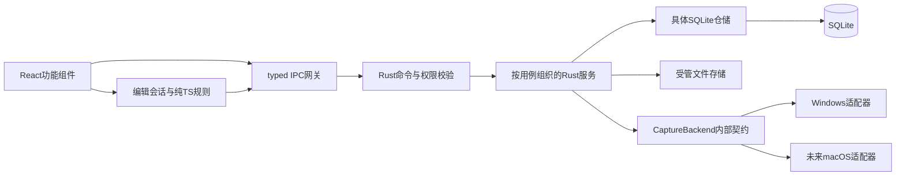
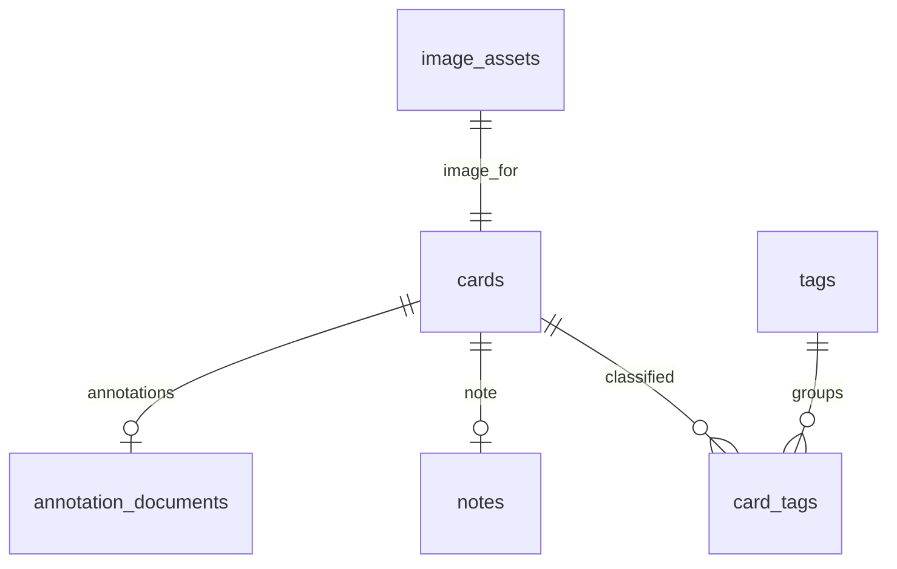
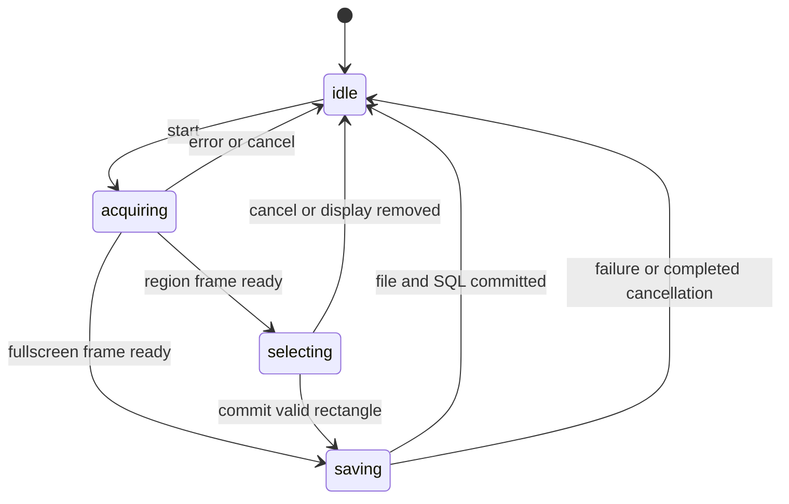

# ResearchClip 架构设计

正式规划 v1，2026-10-12。本文覆盖首发目标，只有明确标为“现有M1”的部分已经实现。接口、业务表和未来目录都是设计，不能视为可调用API、已创建数据库或已验证的截图功能。产品范围见 [PRD](PRD.md)，通过条件见 [ROADMAP](ROADMAP.md)。

## 1. 技术判断与原则

指定栈可支撑本地桌面截图、编辑与知识管理。采用模块化单体：React负责交互和Konva渲染，少量纯TypeScript负责编辑规则，Rust负责系统能力、持久化和生命周期。SQLite是持久化事实来源，Zustand是界面/编辑会话状态。首发不引入额外服务进程、ORM、DI容器或事件溯源。

全局热键与截图是两个能力：官方 [Global Shortcut插件](https://v2.tauri.app/plugin/global-shortcut/)提供注册/触发；实际图像由原生适配器取得。托盘采用 [Tauri System Tray](https://v2.tauri.app/learn/system-tray/)，单实例优先评估官方 [Single Instance插件](https://v2.tauri.app/plugin/single-instance/)。本轮不安装这些依赖。

Windows M2A先验证DXGI Desktop Duplication，原生绑定优先评估微软 [windows-rs](https://github.com/microsoft/windows-rs)。这是一条候选实现路线，Rust wrapper的具体版本和方法需在实验中确认；不为兼容尚未验证的场景提前加入多个截图后端。macOS M6评估ScreenCaptureKit，复用项目内部契约。

## 2. 组件、业务层与存储的关系



| 层 | 责任 | 数据与约束 |
| --- | --- | --- |
| React组件 | 视图、输入、可访问性、错误/脏状态展示 | 不写SQL，不直接操作用户文件，不把Konva节点当持久化数据 |
| TS业务规则 | 图元编辑、坐标转换、撤销重做、文本验证 | 纯函数可单测；一次手势提交一个操作；图像像素不进入history |
| Zustand | 页面、选择、视口、编辑草稿、连接状态 | 与已保存revision分开；不可替代数据库；不把科研内容写localStorage |
| IPC网关 | 集中invoke与事件订阅、DTO校验、错误映射 | unknown响应先验证；注销事件监听；请求/事件带sessionId防止过期响应 |
| Rust命令 | 参数、窗口权限、资源上限与版本校验 | 薄入口；不接受任意SQL或图像路径；不混入绘图UI逻辑 |
| Rust用例服务 | 捕获会话、保存卡片、保存编辑、搜索、导出、设置/退出 | 协调短SQL事务和文件提交；耗时任务离开UI线程 |
| SQLite仓储 | 参数化查询、约束、迁移、revision更新 | 使用具体结构/函数，不为每个表制造抽象trait |
| 文件服务 | 原图不可变落盘、缩略图、导出暂存 | UUID路径、禁止覆盖、根目录检查；与数据库一致性需要恢复策略 |
| 原生适配器 | 显示器、权限、像素帧、平台错误 | 不创建卡片或写DB；不依赖React/Konva |

当前初始化包含App/store、features/home欢迎视图、Tauri getVersion、test_connection和既有v1存储模块。get_workspace_status保留为显式诊断，欢迎窗口启动不打开数据库；此前M1三页视图已移除，历史结果见M1-VALIDATION。未来服务按阶段添加，不把M1重写成框架。截图/D3D/COM若有线程亲和，由所属后台线程创建和使用；不强制原生对象实现Send+Sync。SQLite锁只包裹短查询/事务，不持锁等待帧、编码、用户确认或导出渲染。

### 前端功能组件规划

| feature | 主要组件 | 业务逻辑位置 |
| --- | --- | --- |
| capture | CaptureOverlay、SelectionBox、CaptureStatus | 单屏框选与逻辑→像素转换；原生捕获仍在Rust |
| editor | EditorView、AnnotationCanvas、EditorToolbar、StylePanel、TextInputOverlay | editorModel、history、viewport；图元JSON驱动Konva |
| library | LibraryView、CardGrid、CardItem、CardDetail、TrashView | 列表筛选、分页、卡片动作与错误反馈 |
| notes | NoteEditor | 原始Markdown编辑、脏状态、保存冲突 |
| tags | TagPicker、TagManager | 关联和编辑UI，最终唯一性由Rust/SQLite校验 |
| settings | SettingsView、ShortcutField | 用户配置输入与注册失败反馈；托盘/退出由Rust管理 |
| export | ExportDialog | 导出模式、保存前确认、进度与错误 |

不强制每个小组件立即拆文件；达到实际复杂度再拆。feature通过shared/api与后端协作，避免互相导入内部store。通用Modal/Button等真正重复后才进入shared/ui。

## 3. 项目目录

以下为目标目录。M1现有文件保留；标“后续”的模块按请求创建，不生成无作用stub。

```text
ResearchClip/
  README.md
  AGENTS.md
  docs/
    PRD.md
    ARCHITECTURE.md
    ROADMAP.md
    M1-VALIDATION.md           # 保留历史事实
  src/
    app/
      App.tsx
      store.ts                # 初始化、通信状态
    features/
      home/                   # 当前欢迎界面
      capture/                # 后续：覆盖层/选区
      editor/                 # 后续model/history/viewport
      library/                # 后续卡片库
      notes/                  # 后续：Markdown笔记
      tags/                   # 后续：标签管理
      settings/               # 后续工作区诊断/设置输入
      export/                 # 后续：导出交互
    shared/
      api/                    # typed IPC，按业务扩展文件
      types/                  # DTO与标注文档类型
      ui/                     # 复用组件
    main.tsx
    styles.css
  src-tauri/
    src/
      lib.rs                  # 组装状态、窗口和命令
      main.rs
      commands/               # 薄IPC入口
      domain/                 # DTO、业务校验、错误
      services/               # 后续：capture/cards/export/settings用例
      capture/                # 后续：backend.rs、geometry.rs、windows.rs
                              # macos.rs在M6实现
      storage/                # 现有迁移；后续具体仓储、files.rs
    migrations/               # 顺序SQL，已发布文件不可随意改写
    capabilities/             # 按窗口最小权限
    icons/
    Cargo.toml
    Cargo.lock
    tauri.conf.json
  scripts/                    # 现有工具链包装和冒烟
  assets/                     # 图标源等构建资料
  package.json
  package-lock.json
```

单测靠近对应TS/Rust逻辑；少量跨模块测试在需要时放tests/。构建产物、artifacts、.tools及用户资料保持忽略。新目录不意味着新服务进程或独立package。

## 4. 数据模型

### 4.1 通用约定

- 主键UUID字符串，时间为UTC Unix毫秒，JSON使用camelCase，SQL使用snake_case。
- 文件路径相对于受管数据根目录，用正斜杠保存；不能包含绝对路径、..、Windows设备名或越界符号链接。导出目标来自受限文件选择流程。
- 图像尺寸为原图物理像素；原图保存后不可改写。所有图元数值有限，不接受NaN/Infinity。
- DB schema版本（PRAGMA user_version）、文档schemaVersion和编辑revision分别管理；三者不是同一个版本号。
- 当前M1仅app_metadata(key TEXT PRIMARY KEY, value TEXT NOT NULL)，保存workspace_initialized_at，user_version=1。以下业务表尚未创建。

### 4.2 目标表与字段

| 表 | 字段（目标） | 关系、约束与生命周期 |
| --- | --- | --- |
| image_assets | id TEXT PK；original_relpath TEXT UNIQUE；mime_type TEXT；width_px/height_px INTEGER；byte_size INTEGER；sha256 TEXT；capture_metadata_json TEXT；created_at INTEGER | 首发PNG；宽高/字节数>0；SHA-256为64个十六进制字符；capture JSON验证版本与范围；原图不可变；首发不做哈希去重 |
| cards | id TEXT PK；image_asset_id TEXT UNIQUE FK；title TEXT；revision INTEGER；created_at/updated_at INTEGER；trashed_at INTEGER NULL | 一卡一张原图；资产删除RESTRICT；revision>=0；title 1–200个Unicode标量；回收站保留所有关联 |
| annotation_documents | card_id TEXT PK/FK；schema_version INTEGER；revision INTEGER；document_json TEXT；updated_at INTEGER | 一卡一个文档，首次采集创建空文档的机制在M3接入；JSON合法且类型/尺寸/version经过领域验证 |
| notes | card_id TEXT PK/FK；markdown TEXT；revision INTEGER；updated_at INTEGER | 一卡0或1笔记；首次保存建立；空笔记可保留；首发不做独立笔记或HTML持久化 |
| tags | id TEXT PK；display_name TEXT；normalized_name TEXT UNIQUE；created_at/updated_at INTEGER | 1–50个Unicode标量；trim/NFKC后非空，再将ASCII字母小写；显示名保留输入；不做语义合并 |
| card_tags | card_id TEXT FK；tag_id TEXT FK；created_at INTEGER；联合PK(card_id, tag_id) | 关联不可重复；硬删除tag可CASCADE关联；不级联删卡片 |
| app_settings | key TEXT PK；value_json TEXT；updated_at INTEGER | 已知key和类型白名单；快捷键/默认显示器/关闭行为/导出模式；未知key不静默丢弃 |

FK开启；notes/annotation_documents/card_tags的card FK可CASCADE，但首发卡片动作仅更新trashed_at，不执行硬删除。未来永久删除必须是独立请求、显式用户操作与文件清理策略。业务SQL采用STRICT和必要CHECK；不能只靠JSON合法性保证领域有效性。



目标关系在MVP中稳定；M2尚未接入标注表，M3后新卡片需同步建立空文档，旧卡片升级时补齐。笔记和标注各有revision，避免保存笔记覆盖刚保存的图元。标题/回收站更新用cards.revision；同一事务更新card.updated_at用于排序。

索引先保留cards(trashed_at, updated_at DESC, id)和card_tags(tag_id, card_id)。image_assets的路径/外键唯一约束自带唯一索引。不提前增加每字段索引。

搜索使用参数绑定的字面子串查询：转义%、_、反斜杠后LIKE，针对ASCII大小写规则使用显式规范化；中文按原文匹配。标签筛选AND，搜索范围OR，用EXISTS避免重复卡片。默认排除trashed_at非空；分页游标为固定排序下的(updated_at,id)，编辑导致重排时刷新分页会话。LIKE前置通配符不会因普通B-tree自动提速；超过M4性能目标时再评估索引方案，不先引入搜索服务。

### 4.3 截图源数据

capture_metadata_json的目标结构包含：schemaVersion=1、mode=fullscreen/region、capturedAt、displayId/name、displayPixelSize、原生原点及其单位、scaleFactor、rotation、cropRectPx、colorSpace=srgb-sdr、cursorIncluded=false。

cropRectPx在已转正的显示器冻结帧中，以左上为(0,0)，整数[x,y,width,height]；全屏为完整帧。资产width/height等于裁切后尺寸。displayId可能因插拔/系统升级变化，不把它当永久设备身份。首次版本排除光标；HDR不受支持，不能把未经色彩转换的HDR数据谎称SDR。

### 4.4 标注文档与对象

下面是**项目自定义类型草案**，未写入业务代码；不会把Konva节点JSON或事件处理器作为文档格式。

```ts
type Point = { x: number; y: number };
type StrokeStyle = { stroke: string; strokeWidth: number; opacity: number };
type ShapeStyle = StrokeStyle & { fill: string | null };
type AnnotationObject =
  | { id: string; type: 'arrow'; start: Point; end: Point;
      headLength: number; headWidth: number; style: StrokeStyle }
  | { id: string; type: 'rectangle'; x: number; y: number;
      width: number; height: number; rotation: number; style: ShapeStyle }
  | { id: string; type: 'ellipse'; cx: number; cy: number;
      radiusX: number; radiusY: number; rotation: number; style: ShapeStyle }
  | { id: string; type: 'text'; x: number; y: number; text: string;
      width: number; fontFamily: string; fontSize: number; lineHeight: number;
      align: 'left' | 'center' | 'right'; fill: string; rotation: number }
  | { id: string; type: 'pen'; points: Point[]; style: StrokeStyle };
interface AnnotationDocument {
  schemaVersion: 1;
  imageAssetId: string;
  imageSize: { width: number; height: number };
  objects: AnnotationObject[];
}
```

数组顺序是层级顺序，不另存zIndex。矩形/文字起点在未旋转状态下左上，椭圆起点为中心；旋转用角度。图元坐标、笔宽、字号均为原图像素，不跟随视口缩放重写。颜色格式限定#RRGGBB，透明度0–1；宽高/半径/字号/线宽/箭头headLength和headWidth>0；文字提交非空；箭头两端不重合；画笔至少两点；文档尺寸和asset_id必须匹配原图；ID不重复；未知图元/version拒绝覆盖原数据。

使用领域文档驱动react-konva，节点的scale/transformer在手势结束时折回尺寸/旋转字段。保存采用UPDATE ... WHERE revision=expectedRevision，成功后revision+1；没有影响行时返回REVISION_CONFLICT并保留草稿。现有文档不能被旧客户端静默“修复”。

[Konva官方保存建议](https://konvajs.org/docs/data_and_serialization/Best_Practices.html)支持把应用状态与渲染节点分开；具体领域模型是本项目的设计决策。

### 4.5 撤销、重做与PNG渲染

采用有界的编辑命令before/after对象片段，避免复制整个图像或建立持久化事件日志。创建/删除/移动/改样式/文本提交各一个命令，笔画为一个命令；普通操作至少100步，history总预算32 MiB，按PRD降级。缩放、选择和pan只改变会话视图。

脏状态比较当前文档与最近成功保存的快照；revision不是撤销历史序号。重新打开从已保存文档开始，新会话没有旧undo栈。笔记保存与图元历史分开。

PNG合成复用Konva文档渲染，建立原图width×height、视口变换为单位矩阵的专用导出画布，等图像/字体就绪后生成PNG。原图导出直接复制不可变文件。正式编码/IPC字节传输API在M3查安装版本文档并验证，不在高频绘制中传base64大图。Rust只接收有界、匹配导出任务的PNG并校验尺寸/格式，写入新文件；导出不会反写原图。

## 5. Windows截图接口与macOS扩展

### 5.1 分工与内部契约

CaptureBackend只提供平台信息与帧。CaptureService拥有一次活动会话、取消/超时、覆盖窗口和保存用例。无需为每个OS创建不同的卡片/标注模型。

以下Rust是**自定义接口示意**，引用的DTO需在该阶段实现，不是现有第三方方法，不能据此宣称编译或截图已成功：

```rust
trait CaptureBackend {
    fn permission_state(&mut self) -> Result<PermissionState, CaptureError>;
    fn request_permission(&mut self) -> Result<PermissionState, CaptureError>;
    fn enumerate_displays(&mut self) -> Result<Vec<DisplayInfo>, CaptureError>;
    fn display_under_cursor(&mut self) -> Result<Option<DisplayId>, CaptureError>;
    fn capture_display(
        &mut self,
        display: &DisplayId,
        options: &CaptureOptions,
        budget: &CaptureBudget,
    ) -> Result<FrozenFrame, CaptureError>;
}
```

| 自定义类型 | 契约 |
| --- | --- |
| DisplayId | 当次显示器枚举中的不透明ID；提交前检查仍存在 |
| DisplayInfo | id/name、转正后的物理尺寸、覆盖窗口逻辑尺寸、原生原点/单位、scaleFactor、rotation、isPrimary |
| NativeOrigin | Windows DPI-aware desktop physical pixels或macOS desktop points，带单位；可以为负；跨平台禁止直接套统一除法 |
| PermissionState | NotRequired / Unknown / Granted / Denied；Windows普通桌面可为NotRequired，不表示一定能捕获所有桌面 |
| CaptureOptions | 首发includeCursor=false、目标SDR；不支持选项明确返回UNSUPPORTED，不静默替代 |
| CaptureBudget | 最长等待2秒和可取消标记；超时/取消释放所有原生帧资源 |
| FrozenFrame | DisplayInfo快照、转正且归一化到sRGB的RGBA8、strideBytes、capturedAt；无文件路径/卡片ID；帧缓冲生命周期由会话拥有 |
| CaptureError | PERMISSION_DENIED、UNSUPPORTED、DISPLAY_GONE、DEVICE_LOST、TIMEOUT、CANCELLED、RESOURCE_LIMIT、INTERNAL；平台细节供诊断，UI用可读消息 |

校验width/height>0、stride>=width×4、缓冲长度足够，计算使用checked arithmetic；超过资源上限在分配前拒绝。Mac原点单位与Windows不同，原生适配器负责创建窗口/选择目标的转换；对裁切层统一暴露“显示器本地物理像素”。避免在trait上预设Send+Sync而破坏图形对象线程亲和。

### 5.2 状态机与IPC草案



拟议IPC只有数据/用例语义：list_displays、begin_capture、commit_capture(sessionId, rectPx)、cancel_capture；保存编辑、查询库和导出以后按阶段增加。当前真实自定义命令为初始化test_connection与既有get_workspace_status；上述捕获接口尚未注册。

begin_capture返回sessionId并由会话事件提供就绪/完成/错误；全屏自动使用完整帧，区域等待所属覆盖窗口提交。overlay只能读本会话预览、提交选区、取消；main负责资料读写。进度/结果带sessionId，不接收旧会话的提交或重复保存，成功commit仅创建一张卡片。事件监听随窗口销毁注销，不建通用事件总线。

状态到达saving后以文件+SQL提交为终点：提交前取消可回退；已提交后即使收到取消仍报告已保存，不谎称零数据。请求超时不能偷偷在后台生成第二份卡片；重试前确认原会话终态。

### 5.3 原生流程与坐标

1. 处理主窗口未保存内容；获得活动会话锁，枚举显示器并选定目标。
2. 隐藏ResearchClip自己的可见窗口，等隐藏生效；获取一张有效新帧并冻结。不能拍到覆盖层，也不能因桌面静止而无限等待；获取不到有效帧时报TIMEOUT。
3. 全屏直接保存；区域仅为选定目标显示器建立独立覆盖窗口，框选限定该屏。预览来自受限的会话token，不把原始帧复制到全局store。
4. 对单屏覆盖窗口，局部逻辑坐标q转换为物理坐标p：p.x=q.x×frameWidth/overlayLogicalWidth，p.y=q.y×frameHeight/overlayLogicalHeight。左/上向下取整，右/下向上取整，再夹到帧边界。前端和Rust都验证矩形；DPI比例不可当唯一依据。
5. 冻结期间禁止resize改变映射；DPI/分辨率/旋转/插拔变化时取消会话并重新枚举，不在旧帧上推测新坐标。跨屏拖动限制在目标显示器。
6. 裁切已转正帧，编码PNG、计算hash，执行持久化用例，再关闭覆盖层/恢复主窗口。所有终态释放帧句柄和资源。

Konva编辑坐标另外使用P=(client−containerOffset−pan)/zoom；它与桌面框选不是同一坐标空间。全局原点只用于窗口定位/截图来源，原图编辑坐标永远局部。Windows进程DPI-awareness和Tauri窗口API坐标单位在M2A核查，不能单凭配置推断正确性。[Windows高DPI说明](https://learn.microsoft.com/en-us/windows/win32/hidpi/high-dpi-desktop-application-development-on-windows)

## 6. 文件存储、迁移与导出

### 文件与SQLite一致性

沿用app_data_dir及originals/thumbnails/exports，按需要新增工作区内部.tmp和backups；不允许首发随意更改数据目录。数据库中只有相对受管路径，缩略图名由asset ID派生，原图名用UUID，不使用用户标题当内部文件名。

创建顺序：受管临时文件create-new → PNG写入与flush/sync → 同目录同卷禁止覆盖的原子落盘 → 短SQL事务插入asset/card及当前阶段的初始标注 → 返回成功。禁止把“文件写了一半”当成已保存。

文件和SQL没有共同事务。SQL失败时只能清理本次创建且确认未被引用的临时文件；无法确认则保留并报告。崩溃在落盘与SQL提交间会产生孤立原图，启动扫描列为待恢复，不自动永久删除。DB引用的文件丢失显示断链状态，不能删卡或用空图覆盖。回收站只改元数据。

rename在不同平台的覆盖/耐久语义不能假设相同；实现阶段验证no-clobber方案，唯一UUID也须检查冲突。数据根限定本机文件系统，首发不支持放在网络盘/云盘同步目录；[SQLite WAL](https://sqlite.org/wal.html)对共享内存与数据库附属文件有明确约束。

### 数据迁移

读取user_version→拒绝未来版本→检查已知schema→升级前保存一致DB备份→顺序事务迁移→同事务递增版本→验证行数/约束/关键数据。无版本但存在不兼容表不视为空库；未知或损坏库不重建。升级失败回滚并保留备份，备份失败或磁盘空间不足则停止升级。

WAL运行中不能仅拷贝主库。优先使用 [SQLite backup API](https://sqlite.org/backup.html)获取一致快照；完整资料恢复还需要不可变原图、标注文档和笔记。升级备份路径唯一，保留升级前版本，不静默覆盖旧备份。schemaVersion更新与业务内容转换需要测试，应用降级只能拒绝写入。恢复演练使用新目录，不写回用户唯一副本。

### 导出

Rust取得选定卡片/笔记/标注的固定revision快照和不可变asset；前端按快照渲染需要的合成PNG。UI若有脏内容先保存或取消。整个导出写在新临时目录，所有.md和PNG完成校验后提交到用户选择位置中的唯一新子目录。出错保留可报告状态，不留下看似完整的导出，不覆写已有目录。

包结构为notes/<card-id>.md与images/<card-id>.png，Markdown标题使用卡片标题，图片引用../images/<card-id>.png。不使用用户标题作路径，UUID避免重名；链接用正斜杠。每份Markdown包括卡片标题、UTC截图时间、标签列表、原样笔记正文和附图链接；应用生成的标题、标签和链接单独转义。首发不搬运正文中用户自行填写的外部附件，也不下载远程链接；附图仅是本卡截图。

## 7. 风险、处置与验收映射

| 风险 | 处置设计 | 客观检查阶段 |
| --- | --- | --- |
| Windows权限/安全桌面 | 普通桌面运行；对拒绝、设备丢失给出失败；不要求管理员/SYSTEM权限，不绕过受保护内容 | M2A/B：权限拒绝/锁屏失败后可继续正常截图 |
| macOS录屏授权 | 区分未知/拒绝/授予，提供授权说明；撤销后停捕获；最低系统/重启需求依真机验证确定 | M6：首次授权、拒绝、撤销、重新授予 |
| 多显示器/负原点 | 每屏枚举与冻结快照、首发单屏选区、插拔取消、固定显示器失效回退 | M2：双屏、左/上负坐标、横竖屏 |
| 高DPI/旋转 | 显式坐标单位、用实际frame/CSS尺寸映射、转正帧、变化时取消 | M2：100/125/150/200%，混合DPI，裁切边缘误差<=1物理像素 |
| 文件/SQL分裂与磁盘满 | 临时写、禁止覆盖、落盘后事务；断链/孤立文件保留与报告 | M2/M5：故障注入、崩溃节点、无半卡/原图破坏 |
| schema/文档升级 | 分离版本、备份、逐步事务、拒绝未知版本和旧客户端写入 | M3/M5：升级、失败回滚、未来版本、恢复 |
| 快捷键/托盘/多实例 | 只处理Pressed、注册失败回滚、托盘失败主窗口可见、第二实例激活现有进程 | M2/M5：冲突、重复触发、关闭、退出、二次启动 |
| 大图/画笔/IPC | 分配前上限校验、缩略图列表、会话帧有界、有界history/导出字节 | M3/M4：资源上限、4K与1000卡性能 |
| 文本/路径/安全 | 参数化SQL、纯Markdown源码、受管文件/导出任务校验、最小capability/CSP | M4/M5：通配符、路径穿越、已有文件冲突 |

Windows DXGI可能在安全桌面返回访问拒绝；这是OS能力边界，不是可通过普通设置消除的bug。[DuplicateOutput错误说明](https://learn.microsoft.com/en-us/windows/win32/api/dxgi1_2/nf-dxgi1_2-idxgioutput1-duplicateoutput)。旋转帧和光标处理依据 [Desktop Duplication文档](https://learn.microsoft.com/en-us/windows/win32/direct3ddxgi/desktop-dup-api)。

macOS需要用户授予Screen Recording权限，拒绝可形成明确错误；Apple样例对系统版本的要求不能直接等同于本产品最低版本。[ScreenCaptureKit示例](https://developer.apple.com/documentation/screencapturekit/capturing-screen-content-in-macos)、[用户拒绝错误](https://developer.apple.com/documentation/screencapturekit/error-constants)

## 8. 安全与实施边界

当前初始化只授权main读取应用版本、测试Rust通信和请求既有工作区诊断；后续main/capture-overlay各自配置最小capability。原图asset范围限受管originals/thumbnails或本会话preview token，overlay没有笔记/库写权限。CSP保留本地脚本/IPC限制，不授权远程页面调用系统命令。[Tauri capabilities](https://v2.tauri.app/security/capabilities/)

DTO目前手工对齐并测试；增长后有实际收益才评估类型生成。不提前创建所有未来命令或表。Mock后端可以用于失败路径单测，必须标为测试数据；native验收必须来自真实屏幕，不能以mock替代。所有数值性能目标、Windows/macOS接口有效性须按ROADMAP实测；本轮仅形成设计。
