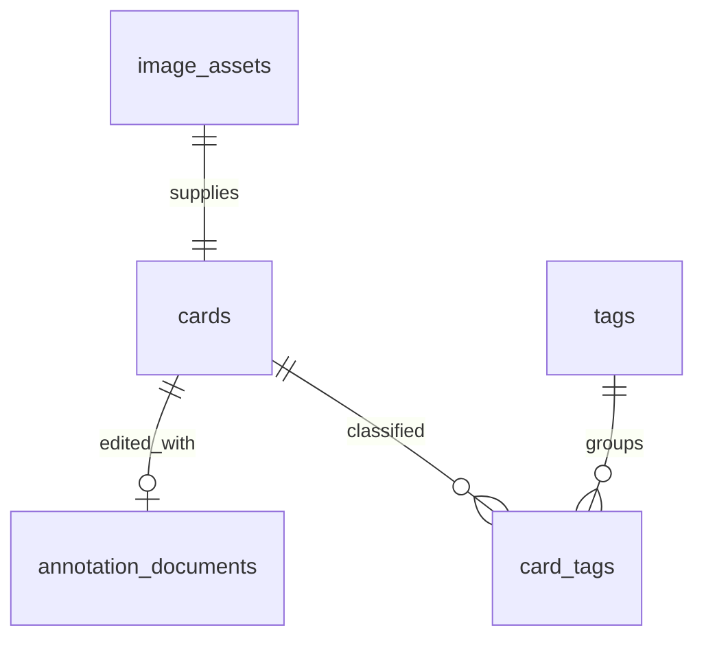

> 历史草案：本文保留M1规划时的设计。正式产品范围见 [PRD](PRD.md)，当前数据与接口设计以 [ARCHITECTURE](ARCHITECTURE.md) 为准。原有模型中的笔记字段、图元范围等不再作为实施契约。

# 数据模型与无损编辑

本文件区分**M1 已有结构**与**M2–M5 设计**。未来表尚未迁移创建，不可据此宣称卡片功能已实现。

## M1 实际数据库

`src-tauri/migrations/001_workspace.sql` 创建唯一业务表：

| 表/字段 | 类型/约束 | 用途 |
| --- | --- | --- |
| app_metadata.key | TEXT PRIMARY KEY NOT NULL | 元数据键 |
| app_metadata.value | TEXT NOT NULL | 元数据值 |
| workspace_initialized_at | 上表的一行；UTC ISO 8601 | 第一次建库时间，重启不覆盖 |
| PRAGMA user_version | INTEGER = 1 | 迁移版本，不是业务表 |

`STRICT` 表、bundled SQLite、事务 migration；未来版本拒绝打开。现有数据库没有 cards/tags/annotations，也没有用 UI 假数据填充表。

## MVP 目标实体（未来迁移）

统一使用 UUID 字符串主键、UTC Unix 毫秒时间戳、相对数据根目录的文件路径；原图尺寸以**物理像素**整数计。业务校验和 SQL 约束同时存在。

| 实体 | 关键字段 | 关系 / 约束 |
| --- | --- | --- |
| image_assets | id, original_relpath, mime_type, width_px, height_px, byte_size, sha256, created_at | PNG 原图不可变；relative path 唯一；宽高/字节数 >0；SHA-256 检验，不强制跨卡片去重 |
| cards | id, image_asset_id, title, note_markdown, source_kind, source_metadata_json, created_at, updated_at | 一卡一图；asset FK UNIQUE；source_kind=capture/import；不渲染不可信 HTML |
| annotation_documents | card_id, schema_version, revision, document_json, updated_at | card_id PK/FK CASCADE；一卡一个编辑文档；revision >=0；JSON 合法且未知版本拒绝写入 |
| tags | id, display_name, normalized_name, created_at | 非空；normalized_name UNIQUE；Rust 做 NFKC、trim、统一大小写并制定中文规则 |
| card_tags | card_id, tag_id, created_at | 联合 PK；双方 FK CASCADE；反向 tag_id 索引 |
| app_settings | key, value_json, updated_at | 后续快捷键/用户偏好；与 M1 元数据用途区分 |



首次采集通过事务插入 asset + card + 空 annotation document，避免半张卡片。删除卡片在 SQL 事务删除关联数据；asset 文件的删除要在提交后由清理流程处理，失败可重试。文件与 SQLite 无统一事务，因此采用不可变文件、临时文件写入、提交日志/恢复扫描；先删除文件再提交 SQL 会破坏一致性，禁止这种顺序。

建议索引：cards(updated_at DESC, id)、cards(created_at DESC, id)、card_tags(tag_id, card_id)。分页使用稳定游标 `(updated_at, id)`。不为每个字段盲目加索引。

搜索先定义对 title、note_markdown、tag display_name 的中文/英文**字面子串匹配**。参数绑定且转义 `%`、`_` 和转义字符。`LIKE '%query%'` 不依赖普通 B-tree 索引加速；M4 用实际规模测量，再选择 FTS5 tokenizer 或辅助索引。英文 unicode61 不能自动提供中文分词，不把 FTS5 的默认行为当成中文搜索方案。

## annotation document v1（M3 设计）

```ts
interface AnnotationDocument {
  schemaVersion: 1;
  imageAssetId: string;
  imageSize: { width: number; height: number }; // 原图物理像素
  objects: AnnotationObject[]; // 数组顺序 = 绘制顺序
}
type AnnotationObject =
  | { id: string; type: 'rectangle'; x: number; y: number;
      width: number; height: number; rotation: number; style: ShapeStyle }
  | { id: string; type: 'arrow'; points: number[]; style: ShapeStyle }
  | { id: string; type: 'pen'; points: number[]; style: ShapeStyle }
  | { id: string; type: 'text'; x: number; y: number; text: string;
      fontSize: number; fontFamily: string; fill: string; rotation: number };
interface ShapeStyle { stroke: string; strokeWidth: number; opacity: number }
```

该类型是规划示意，不是已经支持的命令或前端组件 API。M3 需要为每种图元定义长度/边界、数值有限性、颜色格式、对象数量和文档大小上限；箭头 points 恰好四个数，画笔 points 至少两点且为偶数长度。未知类型不可静默丢弃。

视口的缩放、平移、选择框、Konva transformer 不保存为权威对象；所有图元坐标转换回原图像素。React-Konva 由文档驱动，禁止仅通过 Stage.toJSON() 保存用户成果。

保存策略：`UPDATE annotation_documents ... WHERE card_id=? AND revision=?`，revision 原子递增；影响行数为 0 时向用户报告冲突，不能覆盖较新的编辑。撤销/重做只管理会话命令或快照；脏状态离开确认、自动保存、重启恢复在 M3 定义与验收。

原图 SHA-256 在反复保存标注、撤销、重启、导出后保持一致。导出合成 PNG 创建新文件，Markdown 引用复制到导出目录的相对路径；必须能在应用外独立打开。文件名、路径分隔符、Markdown 标题/图片链接转义需测试。

## IPC 契约（M1 真实）

唯一业务命令 `get_workspace_status`，无参数：

```ts
{
  appName: string;
  appVersion: string;
  platform: string;
  dataDir: string;
  databasePath: string;
  schemaVersion: number;
  sqliteVersion: string;
}
```

错误：`{ code: 'STORAGE_LOCK' | 'STORAGE_READ', message: string }`。初始化失败发生在窗口启动阶段，因此不会伪装为成功的 IPC 响应。前端依赖 isTauri 检测和字段校验；不假设泛型 invoke<T> 会替我们验证响应。
