# ResearchClip 使用指南

本指南适用于 **v4.1.1 Windows 版本**。所有素材默认留在本机；无需ResearchClip账号。WebDAV仅在你明确配置并手动开始时传输选定资料，不自动上传。不同 Windows、显示缩放与第三方剪贴板的表现可能不同，请参考各版本验收报告中的已知限制。

每章末尾新增 **功能示例**：按“操作 → 完成标志”演练。左侧切换“功能示例”可只看示例索引；搜索仍保留上级章节。示例中的文件、课题和文字均为练习材料，需要自行准备，不能当作自动创建的数据或识别准确率证明。

目录使用三级结构：**章节 → 小节 → 操作步骤**。左侧可选择目录层级、展开或收起；输入关键词可搜索标题和步骤正文，点击结果定位并高亮当前阅读位置。

正文上方显示当前章节和进度，底部提供上一章、下一章。练习稿与BibTeX在Release离线指南的examples目录；组件安装方式见同包的RELEASE-COMPONENTS.md。

- **同时阅读与写作**：第19章；多个标签独立编辑，隐藏保留草稿，关闭检查保存。
- **第一次截图并保存**：第1–3章；完成后素材库能找到原图。
- **自然语言找图**：第6.4节；先安装本地模型并主动建立索引，核对候选图片。
- **项目分类、标签与查找**：第4–5、6章；在项目或搜索中找到素材。
- **标注、OCR与图片对比**：第7、8、9章；编辑结果已保存，OCR结果已核对。
- **写Markdown、公式与插图**：第10–12章；`.md` 与 `assets` 一起保存。
- **查找相似图片和完全重复组**：第4.4节；核对结果后自行决定处理。
- **链接文档、截图与反向查找**：第14章；保存后目标页显示来源文档，知识图谱能看到连线。
- **关联论文、DOI与BibTeX**：第13章；文献记录和关联均已保存。
- **减少重复操作**：第16章；命令搜索、逐步执行、识别校对与自定义组合。
- **设置、WebDAV与升级安全**：第17–18章；配置有效、操作结果已确认。

**侧栏顺序**：截图素材 → 收藏 → 标签 → 图片对比 → 相似与重复 → 文献引用 → 知识图谱 → 设置。使用指南位于底部。相似检索与文献管理以弹窗打开，关闭后可继续当前工作。

**字号与布局**：设置→显示可选12–20 px基础字号，指南正文和目录随之调整；七条任务路线直达入门、整理、写作、链接、自然语言找图和工作流。窗口变窄时目录堆叠并保留滚动，短窗可滚动侧栏到设置。内容缩放与Windows系统DPI不同，高DPI多显示器仍需按验收清单核对。

**阅读提示**：操作图可点击或按Enter放大，Esc关闭。标有旧版本号的图片用于说明操作；当前侧栏位置以上述顺序为准。流程示意图不代表实际窗口截图。下方指南图片来自隔离测试资料，无真实科研内容。

## 1. 第一次使用

保存并退出旧实例，再启动 ResearchClip。Windows 需要 WebView2，发布 EXE 未签名。左侧进入截图素材、收藏、标签、图片对比、相似与重复、文献引用、知识图谱、设置；底部“使用指南”可随时重新打开本文。顶部提供搜索、剪贴板导入、贴图恢复、主题切换和 Markdown 操作。

推荐按以下步骤开始：

1. 截图或导入图片，确认已存入素材库。
2. 新建科研项目，选择图片并移动到项目。
3. 编辑标注并“保存到素材库”，再写卡片笔记、标签和来源。
4. 新建Markdown，插入图片与注释，保存 `.md` 和 `assets`，关联到同一项目。
5. 关闭前确认没有待保存提示；定期关闭应用并整体备份资料目录。

> **三个保存动作**：“存入素材库”保留科研资料；“保存到素材库”保留可编辑标注；Markdown“保存”保留文档与assets。单独导出PNG不会替代前两者。截图预览、未保存标注和未保存 Markdown 都可能仅在当前会话中，请留意“未保存”提示。

### 1.1 五分钟完成第一份研究记录

1. **先采集**：点击左侧「新建截图」，或将一张 PNG 拖入「截图素材」。截图完成后先点击「存入素材库」；文件导入会直接入库。
2. **再标注**：在卡片点击「编辑标注」，选中箭头工具，拖动标出重点，点击「保存到素材库」。仅切换工具、缩放画布不会保存。
3. **写解释**：返回素材库，单击缩略图打开知识卡片，在「Markdown 笔记正文」记录观察；等待保存状态完成。
4. **组织成文档**：点击顶部「新建空白 Markdown」，输入标题。回到素材库，点击该卡片「插入到 Markdown」，图片与已有笔记一起插入。
5. **确认可携带**：在右侧按 Ctrl+S，选择空文件夹保存；检查里面同时有 `.md` 与 `assets`。分享或移动时选择整个文件夹。

**完成标志**：素材库里能找到图片；右侧文档显示「已保存」；重新打开 `.md` 仍能看到图片与说明。

### 1.2 先分清要保存什么

- **研究素材**：截图完成区「存入素材库」；之后才能从库中再次打开。
- **可继续修改的标注**：编辑器「保存到素材库」，或「另存可编辑项目」。PNG 不是可编辑项目。
- **给其他软件使用的图片**：编辑器「导出标注 PNG」/「复制合成图片」，包含箭头、文字等可见结果。
- **图文稿件**：Markdown 面板「保存 Markdown」，同时保留 `.md` 和相对 `assets`。

> **关键步骤**：看到「图片已复制」只表示剪贴板更新；它不表示图片已入库或 Markdown 已保存。


### 1.3 第一次运行的检查清单

#### 1.3.1 开始前

确认Windows x64已安装WebView2；保存并退出旧实例后再升级，不同时运行两个版本。

#### 1.3.2 操作步骤

先进入截图素材，再打开设置选择主题、字号与两组截图快捷键。第一次先用一张不含敏感信息的图片练习。

#### 1.3.3 完成后核对

截图预览、素材库与Markdown是不同工作状态。截图后存库，编辑后保存标注，写作后保存.md，三者分别核对。

#### 1.3.4 失败与取消

窗口没有出现时先检查托盘；启动报资料版本或锁错误时保留提示，不删除AppData或数据库。

### 1.4 功能示例

#### 1.4.1 首次启动与本地资料

**操作**：保存并退出旧实例，再启动本版；在左下角核对版本，打开“使用指南”。

**完成标志**：版本为3.1.8，原有素材仍可浏览；不需要ResearchClip账号。

#### 1.4.2 第一份研究记录

**操作**：准备一张可重复取得的实验图，导入、画箭头、保存到素材库，再写“第1次测量”。

**完成标志**：关闭卡片再打开，箭头和笔记都在。

#### 1.4.3 区分三种保存

**操作**：同一张练习图先存入素材库，再保存标注，最后将它插入Markdown并Ctrl+S。

**完成标志**：素材卡、可编辑标注、`.md`与`assets`分别存在；复制图片不代替保存。

#### 1.4.4 指南目录与图片阅读

**操作**：在目录切换“功能示例”，搜索“箭头”，点击结果；对图示按Enter，再按Esc。

**完成标志**：定位到对应示例；图片放大后可关闭，当前文档草稿保持。

**界面参考**：以下为本版隔离Edge阅读回归实际生成的深浅色界面，仅说明指南布局，不代表Windows原生截图、托盘或硬件验收。

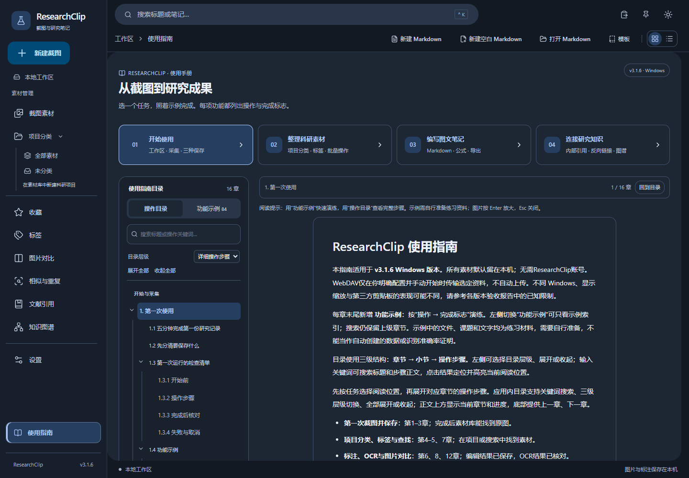

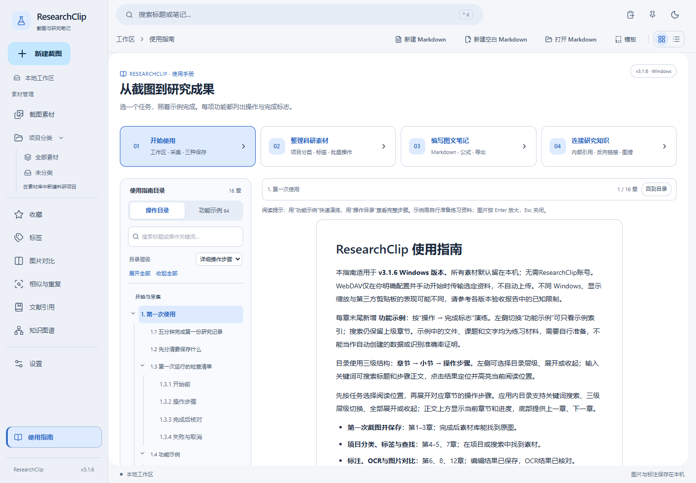

## 2. 全屏、区域与窗口截图

点击“新建截图”或素材页的截图入口，选择显示器后进行全屏截图或区域截图。区域模式显示冻结画面，拖动选择矩形，松开完成；Esc 取消，零面积选区不会保存。区域选区限制在目标显示器内，不跨屏拼接。

默认全局快捷键：区域 Ctrl+Shift+2，全屏 Ctrl+Shift+1；在设置中分别修改。快捷键捕获主显示器，注册冲突会提示并保留旧配置。Windows 高 DPI、混合缩放及特殊显示器配置需要专项验证。

截图完成后可复制图片、保存 PNG、贴图、识别文字、打开编辑器或存入素材库。复制使用真实图片数据，可在画图等应用中粘贴；保存 PNG 使用系统对话框，同名文件不会自动覆盖。“存入素材库”才会建立可重启恢复的卡片。

### 2.1 区域截图的操作顺序

1. 在「目标显示器」选择需要截取的屏幕；直接使用全局快捷键时采用主显示器。
2. 点击「区域截图」。原窗口短暂隐藏，屏幕停留在开始时的冻结画面。
3. 按下鼠标左键并拖出矩形，核对选区像素尺寸，松开完成。取消用 Esc；误触零面积时重新拖动。
4. 回到预览后选择「存入素材库」「打开编辑器」或「复制图片」。不需要该截图时点击「取消」。

**注意**：截图选择层出现后，背后应用的变化不会更新冻结画面。锁屏、受保护内容、远程桌面、HDR或混合DPI可能受到系统限制；失败提示需要按实际环境排查，不能通过清空资料解决。


**截图图注**：这里是完成后的临时预览；「存入素材库」和「保存 PNG」目的不同。

### 2.2 滚动长截图：先选窗口，再框选正文


**操作图注**：这是本版实际设置面板；示例目标为独立验收浏览器。先选窗口，再框选正文，最后开始。模式和上限可在面板内核对。

**适合**：Chrome / Edge 中普通、垂直滚动的长网页。其他应用可尝试手动滚动，但不是通用自动化支持。受保护内容不支持；页面有视频、悬浮卡片、无限加载或多层滚动容器时，优先缩小选区或分段采集。

1. 打开网页，滚到希望截取的起点，等待图片和字体加载完成。
2. 点击「滚动长截图」，在「目标窗口」**明确选择**网页所在窗口。刷新列表后要重新选择，不能依赖旧窗口编号。
3. 第一次建议取消「自动向下滚动」。点击「框选滚动区域」，在冻结屏幕上拖出正文区域；排除地址栏、滚动条、固定底栏和悬浮工具栏。选区至少128×160，最多4,194,304像素、宽不超过4096；必须处于所选窗口及同一显示器中。
4. 回到面板核对尺寸，点击「开始」。主窗口隐藏，出现单独控制窗；控制窗在取帧时短暂隐藏，不会被正常录入长图。
5. **手动模式**：自行向下滚动约半屏，等待稳定，再点击「采集下一段」。保留至少约半屏重叠；不要一次跳到很远的位置。重复画面不会增加长图高度。
6. **自动模式**：仅Chrome / Edge窗口开放；开始时鼠标定位选区中心，逐次发送向下滚轮。保持目标窗口、位置、尺寸和焦点不变，不按住Ctrl/Shift等修饰键。鼠标离开选区、窗口失焦或遮挡会暂停，不自动把输入转发给其他后台窗口；可改手动继续。
7. 点击「停止」生成当前长图；「取消」丢弃本次临时拼接，不删除已有素材。窗口关闭或应用退出也会取消并释放采集资源。
8. 检查长图接缝和末尾完整性，再点击「保存 PNG」「存入素材库」或「打开编辑器」。沿用原有PNG系统对话框、禁止自动覆盖、SQLite缩略图和无损标注流程。

**遇到提示时怎么做**：

| 提示或现象 | 操作 |
| --- | --- |
| 重叠不足 / 画面变化过大 | 当前失败帧不会追加；向上回滚到与上一成功画面仍有重叠处，稳定后再手动采集，或停止保存已有部分 |
| 页面重复纹理、没有可靠拼接点 | 选择含文字/图形特征的正文区；大片空白、重复表格可能无法可靠对齐，不强行纵向叠加 |
| 页面仍在动画 / 动态加载 | 等待加载后手动采集；延后加载仍可能在取帧后发生，最终须自行核对 |
| 连续两次画面未变化 | 自动模式按“疑似底部或滚动未生效”停止；不保证网页全部加载完，不把不变画面当作绝对底部证明 |
| Windows不允许激活窗口 / 拒绝滚动输入 | 点击目标窗口确认普通桌面及相同权限级别后重选，或用手动模式；不要以管理员权限绕过受保护内容 |
| 达到高度 / 像素 / 帧数 / 时限 | 分段采集。停止可保留已完成部分，失败或达到上限不会默默接入错误帧 |

**上限与限制**：一次最多64帧、180秒、30,000像素高，且总像素不超过16,777,216（四项同时约束）。例如1920宽的长图高度最多8738像素；10屏全宽4K不在本版预算内。拼接仅估计垂直位移，不做复杂配准。固定顶栏优先在匹配时排除顶部最多约220像素，首帧保留顶栏、后续只接入新增底部；过高顶栏、固定底栏和悬浮元素需在框选时排除。125%/150%物理缩放、多屏及特殊网页仍以专项验收记录为准。


### 2.3 选择正确的采集方式

#### 2.3.1 开始前

普通单页用全屏/区域；长网页用滚动长截图。先避开受保护窗口，确认目标显示器和缩放比例。

#### 2.3.2 操作步骤

区域截图开始后，拖出矩形并松开；选区显示的是实际图片像素。滚动截图先选Chrome/Edge目标，再框正文，选择自动或手动模式。

#### 2.3.3 完成后核对

完成后查看预览宽高和边缘，长图检查页头重复、文字断行及底部是否缺失，再保存PNG或存入素材库。

#### 2.3.4 失败与取消

Esc取消区域；滚动中停止可检查已采集内容，取消则放弃本次任务。自动滚动失焦/重叠不足时按提示暂停，切手动或重选范围。

### 2.4 智能窗口截图：捕获窗口自身画面

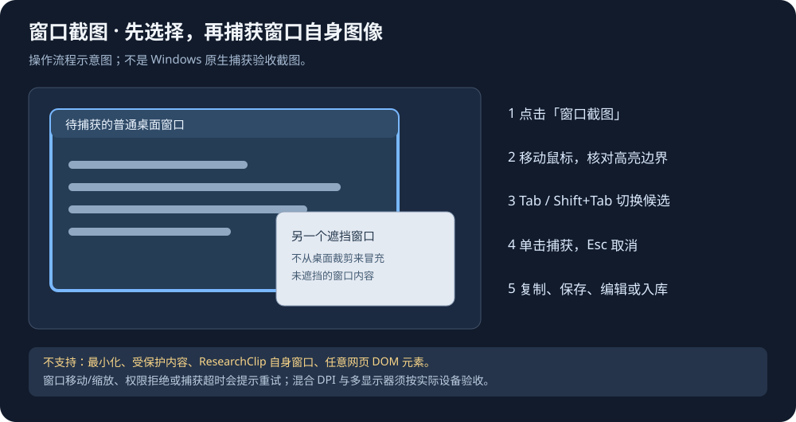

#### 2.4.1 开始前

先打开并还原需要捕获的普通桌面窗口。Windows 10 1903以上且显卡支持D3D11时才可尝试；最小化窗口、锁屏和受保护内容不可用。ResearchClip自身窗口不会出现在候选中。该功能识别整个窗口，不识别网页按钮、DOM或任意子控件。

#### 2.4.2 鼠标与键盘操作

1. 在「截图素材」展开「截图工具」，点击 **窗口截图**。空素材库可直接点击该按钮；无需先指定显示器。
2. ResearchClip主窗口暂时隐藏。移动鼠标，核对蓝色高亮框、窗口标题和物理像素尺寸。
3. 鼠标下方窗口不合适时，保持鼠标不动，按 **Tab** 切换候选，**Shift+Tab** 反向切换；再次移动鼠标恢复鼠标命中选择。
4. 确认目标后单击鼠标左键；**Esc** 或选择提示条的关闭按钮取消。选择层失焦、显示器布局变化或等待超时也会安全取消。
5. 完成后主窗口恢复，截图完成区显示原生窗口图像。点击 **复制图片**、**保存 PNG**、**打开编辑器** 或 **存入素材库**。

#### 2.4.3 遮挡、缩放与保存核对

窗口图像使用Windows Graphics Capture获取，普通窗口被部分遮挡时会尝试获取其自身内容；不会把屏幕上遮挡物一起裁剪后称为完整窗口截图。某些应用/GPU或受保护界面仍可能不能捕获。

- **核对尺寸**：高亮是DWM物理边界，最终PNG尺寸以WGC的真实内容尺寸为准；边框、阴影和系统装饰可能略有差异。
- **核对内容**：先用无敏感信息的窗口测试，确认截图没有空白或缺失，再用于科研记录。
- **保留资料**：复制只是更新剪贴板；需要下次继续编辑时选择「存入素材库」。PNG保存使用系统对话框，不自动覆盖同名文件。
- **多屏**：候选支持负坐标和跨显示器边界；极大虚拟桌面会因安全预算被拒绝。混合DPI/125%/150%和跨屏应用必须按实际硬件验收。

#### 2.4.4 失败、取消与恢复

黄色边框表示已知系统保护，不应继续捕获。权限拒绝、最小化、目标移动/缩放/关闭、图像超时均会显示提示；取消或失败保留上一张预览。还原目标、保持其位置不变后重新尝试。没有可用D3D11硬件或系统API不支持时，选择已有全屏/区域模式并接受其可见桌面语义；应用不会自动冒充无遮挡窗口捕获。不要尝试绕过权限或保护。

### 2.5 功能示例

#### 2.5.1 区域截图与取消

**操作**：打开一份练习材料，开始区域截图，拖出只含一幅图的范围；先按Esc取消，再重试保存。

**完成标志**：取消不入库；保存后的图只包含所选区域。

#### 2.5.2 全屏截图

**操作**：从采集入口选择全屏截图，检查预览后“存入素材库”。

**完成标志**：卡片保留本次所选屏幕画面；需要局部时改用区域截图。

#### 2.5.3 窗口截图与键盘选择

**操作**：打开一个练习窗口，在窗口截图候选中用鼠标或键盘选择它，再确认捕获。

**完成标志**：预览是目标窗口画面；核对边缘和内容后再入库，不把最小化或受保护窗口当作成功。

#### 2.5.4 滚动长截图

**操作**：选择含三屏正文的练习窗口，框选正文区域，按提示滚动采集，完成后检查接缝。

**完成标志**：长图按顺序拼接；遇到动画或重复内容时停止并缩小范围重试。

## 3. 从剪贴板和文件导入

点击顶部剪贴板图标“从剪贴板导入图片”。只在点击时读取一次，不监视剪贴板。需复制图片本身，复制文件路径或文本会提示没有图片；被其他应用占用时请稍后重试。支持常见 Windows PNG、24/32位 DIB 位图，特殊位图可以先在画图中打开后重新复制。

将本地 PNG、JPG/JPEG、WebP 文件拖到素材库，可一次导入多张。单张最多20 MiB、16,777,216像素，每批最多10张、合计64 MiB。扩展名与实际内容必须一致；坏图和不支持格式单独报告，同批有效图片仍可保存。重复导入创建独立副本，不覆盖已有素材。

导入后生成受管 PNG 和缩略图，外部源文件不修改；JPEG 方向信息应用到副本，预览采用8位 RGBA，动画图片仅使用静态帧，不保证保留全部元数据或色彩配置。可在素材卡片中重命名、写笔记、标注和插入 Markdown。

拖到已打开的 Markdown 面板时，会先保存到素材库，再按顺序插入当前光标位置；如文档资源已满或插入失败，素材仍保留在库中，可手动重新插入。Markdown 工具栏“从剪贴板插入图片”提供相同流程。文件夹、网页链接和远程图片不是本阶段的拖拽来源。

### 3.1 如何确认导入成功

1. 从画图或其他应用复制**图片像素**，再点击顶部剪贴板图标；不要只复制资源管理器的路径文本。
2. 拖入文件时将鼠标停在素材库内容区域，看到目标高亮后松开；不要拖到标题栏或左侧导航。
3. 查看「图片导入结果」的**成功数与失败数**。混合批次可能部分成功；先核对已入库项，再只重试失败文件，避免重复副本。
4. 如刚导入却找不到图片，切到「全部素材」，清空关键词、标签和收藏筛选，再刷新。

**常见提示**：剪贴板暂不可用→关闭占用它的操作后重试；没有图片→重新复制图片本身；格式不支持/损坏→先在系统图像应用确认能打开；尺寸超限→对外部副本缩小后导入，不改唯一原件。


### 3.2 Chrome / Edge 网页剪藏（A02）

**准备一次扩展安装，每次启动按需启用桌面连接。** 扩展不直接访问SQLite，不扫描浏览记录或读取Cookie；只有你点击图标、读取预览和保存时才工作。


1. 从同版本Release下载并解压**网页剪藏扩展包ZIP**到固定目录。按包内README执行`register-host.ps1`，再在Chrome/Edge扩展管理页由你确认加载包内`dist`目录；第一次安装需要手动启用开发者模式。
2. 在ResearchClip设置中点击**启用网页剪藏连接**。重启应用后默认关闭，需要再次启用；停止连接不删除已保存文档。
3. 打开普通网页，再点击扩展图标；先点**刷新项目连接**。Host找不到时检查注册路径是否移动、扩展ID是否与包内说明相同。
4. 选择**网页链接 / 选中文字 / 网页主要正文 / 页面图片**，点击**读取当前页并预览**。文字应从网页正文选择，表单、输入框和密码不剪藏。复杂网站提取不完整时改用选中文字或链接。
5. 修改标题，选择项目或**未分类**。图片模式可以勾选多图；默认只记录来源。明确允许复制后才尝试当前网页同源HTTPS的兼容图片，不发送Cookie，不绕过登录或付费限制；获取失败会在Markdown“图片资源状态”中说明。
6. 点击**保存到 ResearchClip**，再在桌面通知中点**打开 Markdown**。已有未保存文档会要求保存/放弃/取消；选择取消会保留原草稿。也可在该项目的文档列表打开。
7. 继续添加注释或公式，按Ctrl+S保存；另存为可将.md与本地assets放到自己选择的位置。移动整个文档文件夹时保持相对目录关系。


**重试与取消：**通信中断后，保持内容不变再保存，会复用请求ID并返回已有结果，不重复创建。浏览器会话暂存待确认内容，下次打开会清理超过10分钟的记录；浏览器退出清空。取消等待不等于撤回已提交的保存，先重试确认，不要直接删除资料。

**资源上限：**正文192 KiB、32张图片来源；本地复制最多4张、单PNG256 KiB/419万像素、合计384 KiB，整个消息预检700 KiB。跨域、非HTTPS、登录限制和超限图片保留来源，不伪称已经下载。ResearchClip不自动加载远程图片；其他Markdown软件可能联网加载这些引用，请先核对来源。

**验收边界：**真实Edge提取、扩展Native Messaging项目读取、Host→桌面保存/重试/分栏/重启已测；真实工具栏点击的完整用户交互因Windows工具无法确认浏览器URL而受阻，仍需按验收清单人工验证。Chrome及复杂网站不据此标记通过。


### 3.3 导入外部图片的完整流程

#### 3.3.1 开始前

剪贴板必须包含真正的图片数据；复制文件路径或网页文字不等于复制图片。单张20MiB、每批最多10张/合计64MiB，并受像素上限限制。

#### 3.3.2 操作步骤

主动点击顶部剪贴板图标，或拖PNG/JPG/JPEG/WebP到素材库。拖进Markdown时也要检查图片导入和插入结果。不会持续监视剪贴板。

#### 3.3.3 完成后核对

检查导入数量、失败项、缩略图与标题。图片已复制进应用目录，可重命名、编辑标注和插入Markdown；外部原文件不改动。

#### 3.3.4 失败与取消

不支持、损坏或过大的文件会单独报错。保留原文件，缩小或转换后重试；不要因一张失败就重复导入已成功的全部图片。

### 3.4 功能示例

#### 3.4.1 剪贴板图片导入

**操作**：在图片软件复制一张PNG，点击顶部“剪贴板导入”。

**完成标志**：素材库出现新卡片，原来磁盘上的PNG保持。

#### 3.4.2 拖放与多文件导入

**操作**：准备`实验A.png`和`实验B.jpg`，拖到素材页；也可用文件导入入口选中它们。

**完成标志**：两张图片分别入库；失败文件显示原因，不以改扩展名绕过格式检查。

#### 3.4.3 网页剪藏连接与项目

**操作**：解压Release的WebClipper包，按其中README注册Host并在Edge加载`dist`；桌面设置启用连接，扩展刷新项目。

**完成标志**：扩展读到当前项目；重启桌面后需要重新启用本次会话连接。

#### 3.4.4 网页链接、选文与正文

**操作**：在普通网页分别选“链接与来源”“选中文字”“主要正文”，每次读取预览后保存到练习项目。

**完成标志**：生成带来源的Markdown；选文模式先选择网页正文，复杂页面可改用链接模式。

#### 3.4.5 网页图片与取消重试

**操作**：选“选择图片”，勾选练习图片并查看资源状态；取消等待后保持内容不变重试。

**完成标志**：仅符合限制的图片复制到受管assets；其他图片明确显示状态，相同请求不会重复保存。

## 4. 素材库、网格和列表

网格适合按缩略图浏览，列表适合查看标题、尺寸、日期和批量整理。顶部视图按钮切换，两种视图使用同一真实 SQLite 数据和分页，不会复制素材；选择保留在当前页面会话内。每页24项，按创建时间最新/最早排序，搜索与筛选只加载当前页缩略图。

点击图片或标题打开科研知识卡片；“编辑标注”进入编辑器。星标收藏；铅笔按钮修改标题；删除按钮必须确认，删除记录、笔记、标签关联及受管图片，没有素材回收站。外部源图和已经导出的文件不会删除。缩略图读取失败有独立占位和重试，原图缺失不会静默清空数据库。

勾选卡片可跨页选择并批量整理，详见第5节；导出所选 Markdown；正好选择两张时可“对比所选 2 张”，顺序按选择顺序。搜索/收藏筛选可能隐藏新导入资料，请清除筛选或切回全部素材。库有未完成保存或清理任务时，先查看提示，再使用“重试恢复与清理”。

### 4.1 对照图：两种浏览方式


**网格图注**：① 左侧决定项目范围；② 顶部选择网格或列表；③ 图片下方显示标题与创建时间；④ 勾选后展开批量操作。截图区在无预览时采用紧凑布局，把空间留给素材。


**列表图注**：缩略图与文字分列，更适合连续检查名称、尺寸和时间。两种视图引用同一资料，切换不会复制文件。

### 4.2 单张图片的常用操作

1. **阅读笔记**：点击图片或标题。
2. **修改标注**：点击卡片的「编辑标注」按钮。
3. **整理名称**：点击铅笔图标，输入新标题并确认；不会改动原图文件名。
4. **查漏补缺**：损坏缩略图使用「重试」，原图缺失时先找备份，不要删除数据库。


### 4.3 按目标选择网格或列表

#### 4.3.1 开始前

网格适合识图，列表适合检查标题、时间及逐项整理；两种视图使用同一份SQLite数据。

#### 4.3.2 操作步骤

使用顶部视图切换，结合排序与检索来源缩小结果。翻页只加载当前页缩略图，点击图像/标题打开卡片，编辑标注另有入口。

#### 4.3.3 完成后核对

切换视图后核对同一批标题、数量与收藏状态。没有结果时先清除筛选，再查看全部素材或未分类。

#### 4.3.4 失败与取消

缩略图失败不代表记录已丢失，可单项重试。原图缺失时保留记录并检查文件，不把删除数据库当成修复。

**有素材时的截图工具**：为给首行缩略图留出空间，素材库内的空闲截图工具默认收起；有新截图预览或错误时自动展开，仍可手动收起；取消预览后恢复紧凑布局。点击「截图工具 · 全屏、区域与滚动长截图」展开；左侧「新建截图」和全局快捷键仍可直接使用。

### 4.4 相似图片与重复组

新版从左侧「相似与重复」进入。每张卡片也有「查找相似图片」按钮。**先更新索引，再筛选，最后人工对比；不会自动合并或删除图片。** 可在面板选择全部素材、未分类、指定项目及仅收藏范围；不自动沿用素材页的关键词和标签筛选。

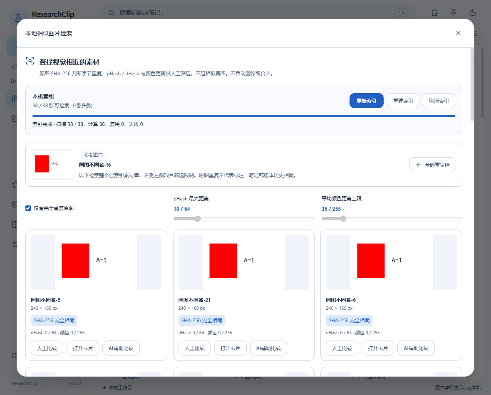

#### 4.4.1 首次建立索引

1. 打开「相似与重复」，点击「更新索引」。程序逐张读取受管原图，显示完成、复用及失败数量，不加载全部原图到界面。
2. 可以点击「取消索引」。已完成条目保留，再次更新会复用未变化的索引；重启不会自动扫描。
3. 导入新图片后再次更新。确需复核所有图片时点击「重建索引」；重建只更新派生特征，不清空原素材。
4. **完成核对**：确认已索引数量；有失败时先检查该素材是否能正常打开，失败不会删除卡片。一次最多10万张，原图仍受现有像素与解码限制。

#### 4.4.2 从一张图查找视觉接近内容

1. 在卡片点「查找相似图片」，或在重复组点「查看这一组」。选择仅完全重复或视觉接近。
2. pHash距离越小通常版式越接近；颜色距离排除颜色明显不同但布局相似的误报。默认阈值为10/64和35/255；放宽阈值可能增加无关结果。
3. 点击「人工对比」进入原有左右/分割/叠加工作区；点击卡片进入知识卡片，核对笔记、来源和可编辑标注。
4. 结果每页25项，最多翻到前5000项；过多时缩小阈值。缩略图坏了会显示占位，其他结果仍可用。

> **指标的含义**：完全重复表示受管PNG字节的SHA-256一致，文件名不参与。同一像素重新编码后可能不再字节相同。pHash、dHash和平均颜色差只是距离，不能当作概率、语义等价或数学误差。相同原图可能附有不同笔记和标注；人工确认前保留全部资料。

#### 4.4.3 批量检查完全重复组

1. 从左侧标签栏打开「相似与重复」，未指定参考图时显示重复组，每页20组。
2. 组内展开查询，逐张查看尺寸、标题和时间；文件名不同不影响重复组。
3. 相似面板没有自动删除或合并按钮。需要清理时返回素材库，人工选择并阅读明确数量的删除确认；取消确认会保留记录与文件。

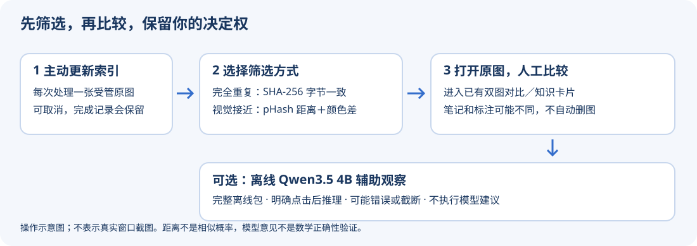

#### 4.4.4 使用完整离线包中的Qwen辅助

1. 从同一Release下载全部离线ZIP分卷及 Assemble-Offline.ps1 到同一空文件夹，用PowerShell运行脚本。先核对SHA256，再合并和解压到全新目录；不要只下载第一卷。
2. 解压后的EXE旁边带有 similarity-ai，可直接使用；若运行安装版，在「离线Qwen辅助」选择该目录。模型与CPU运行时约3.46GB，首次校验需要时间，不要改动或添加其他DLL。
3. 在结果中选择两张图，展开「离线Qwen辅助」，明确点击运行。只有这两张原图的受管缩略图进入本地进程，不上传图片、不监听其他资料。
4. 等待文本结果，可以取消；180秒超时会终止，12GiB进程上限、4 CPU线程。关闭结果面板不会自动取消后台任务，重新打开可停止。
5. **务必人工校对**：模型可能遗漏小字、公式、产生幻觉或在256token预算内截断。不会自动执行建议、删除资料或写入笔记。传统检索不依赖模型，轻量安装包本身不含这些权重。

#### 4.4.5 排错与下一步

- **没有匹配**：先更新索引，确认参考图可读；再适当放宽阈值，不代表没有其他相关研究资料。
- **同版式但颜色不同**：减小颜色阈值，结合原图人工比较；全色图可能有相同感知哈希。
- **模型缺失或校验失败**：确认所有分卷完整、选择正确目录，重新解压到空目录。不要用不明运行时替换DLL，也不需要安装Ollama。
- **推理失败**：检查可用内存和本机x64 CPU兼容性，取消后重试；仍可使用不依赖模型的SHA与感知检索。不要把失败结果当成分析结论。

### 4.5 功能示例

#### 4.5.1 网格、列表与分页

**操作**：导入数张练习图片，在顶部切换网格/列表并翻页。

**完成标志**：图片内容相同，网格便于看缩略图、列表便于看说明；计数对应筛选结果。

#### 4.5.2 收藏、标签筛选与排序

**操作**：收藏`实验A`，给它添加“演练”标签；分别进入收藏、标签入口并切换排序。

**完成标志**：在对应范围找到它，取消收藏不删除图片。

#### 4.5.3 相似检索与参考图

**操作**：在“相似与重复”先更新索引，选择一张实验图为参考，限制到练习项目再检索。

**完成标志**：候选只来自指定范围；相似分数帮助筛选，需要自行核对内容。

#### 4.5.4 完全重复组

**操作**：把同一PNG导入两次，建立索引后查看完全重复组。

**完成标志**：两张卡片可出现在同组；检索不自动合并或删除。

#### 4.5.5 可选Qwen辅助

**操作**：已有校验通过的`similarity-ai`时，在设置检查运行时与模型，再对少量候选启用Qwen辅助。

**完成标志**：显示辅助判断或明确错误；未装模型仍可进行普通相似/重复检索。

## 5. 科研项目与批量整理

项目用于逻辑分组：每张图片属于一个项目或未分类，标签可以跨项目共享。**左侧「素材管理 → 项目分类」**直接选择项目，即可只看该项目的图片；也可切换「全部素材」「未分类」。项目右侧数字是图片数，悬停查看图片/文档数量；窄窗口用分类下拉框。素材页上方保留同一套筛选和项目管理入口。新建项目最多80字符；重命名只改变名称。移动不改变图片ID、文件路径、标注、笔记或来源。


**整理图片**：勾选卡片，或按住 Ctrl 点击缩略图/标题多选；Shift 点击选择当前页锚点到目标之间的连续范围，可继续跨页勾选。“全选当前筛选结果”只查询ID和版本，包含所有分页，不读取全部大图；最多5000张，超过会要求缩小筛选，绝不静默只选一部分。切换项目/搜索/筛选后会清空选择，防止误操作。

批量工具可添加标签（逗号分隔，合并而非替换）、移动到项目/未分类、收藏/取消收藏、导出Markdown和删除。导出沿用每批最多100张及现有资源限额；选择过多请分批导出。标签、收藏和移动是整批事务；若任一资料版本已变，整批取消，请刷新并重新选择。所选卡片的待保存笔记会先保存，失败停止操作。

> **批量删除不能撤销。** 确认框明确显示数量，只有点击“确认删除 N 张图片”才删除受管原图、缩略图、记录、笔记和关联。取消会保留全部。外部源图、Markdown及assets不删；失败清理任务持久保留，可重试或重启。已打开的标注草稿保留，重新存库会建立新资料。

**关联Markdown**：文档通过应用打开或保存后登记SQLite文件引用；在Markdown面板的“项目”下拉框关联项目，或展开素材页的Markdown文档列表调整关联。点击文件名复用现有分栏打开，未保存文档仍经过保存/放弃/取消保护。首次保存前的内存草稿不能关联；旧文档需先通过“打开Markdown”登记。应用内重命名保持关联，另存为是独立文档。应用外移动或改名会导致原引用不可访问，请打开新位置重新登记；程序不会擅自搜索磁盘或搬移文件。

**删除项目与删除资料不同**：第一版仅支持删除空项目，确认框显示图片/文档数量。非空项目必须先将资料移到其他项目或未分类；不存在“删除项目内数据”的隐式选项。删除项目不删除任何图片或Markdown。数据库升级先备份再迁移，旧素材保留为未分类。

### 5.1 示例：把一批图放入同一课题

1. 点击素材页「新建项目」，输入「控制系统研究」并保存。
2. 点击左侧「全部素材」，按住 Ctrl 逐一选择需要的卡片；连续范围可以用 Shift。
3. 核对「已选 N 张」后点击「移动到项目」，选择课题并「确认应用」。
4. 点击侧栏项目名，检查图片数；项目只记录逻辑归属，不移动受管原图。
5. 需要多个主题时添加标签，例如「Lyapunov」「实验」；同一卡片可有多个标签，但只能归属一个项目。

**选择范围说明**：Shift 只选当前页可见范围；「全选当前筛选结果」包含其他分页。改变筛选会清空选择。未选择时只显示全选入口，选中后才展开完整批量按钮。

**安全删除空项目**：先移动所有图片，将关联 Markdown 调为其他项目或未分类，确认两种计数都为0，再删除项目。图片删除和项目删除是不同操作。


### 5.2 批量操作前后如何核对

#### 5.2.1 开始前

先确定项目和筛选范围；Shift只选当前页连续范围，“全选当前筛选结果”包含其他页，上限5000张。

#### 5.2.2 操作步骤

Ctrl多选或Shift选择范围，核对数量，再批量添加标签、移动项目或收藏。批量导出最多100张，请分批执行。

#### 5.2.3 完成后核对

移动项目后图片ID、原图路径、笔记和标注应保持；项目数量按真实资料计算。Markdown需已保存/打开登记后才能关联项目。

#### 5.2.4 失败与取消

删除确认必须显示数量；取消不删除。非空项目不能直接删除，先移出图片和文档。发生版本冲突时刷新并重新选择，不用重复强删。

### 5.3 功能示例

#### 5.3.1 项目新建、重命名与筛选

**操作**：新建“演练课题”，重命名为“演练课题A”，从侧栏选择它。

**完成标志**：项目名更新；项目仍是逻辑分组，不搬移原图。

#### 5.3.2 多选、跨页与全选筛选

**操作**：Ctrl选择两张图，Shift选择当前页范围；需要跨页时用“全选当前筛选结果”，执行前核对数量。

**完成标志**：选择数量与目标一致；更换筛选会清空选择，超过5000张需缩小范围。

#### 5.3.3 批量移动、标签与收藏

**操作**：选两张练习图，移动到课题A，添加“实验,演练”，再批量收藏。

**完成标志**：两张都属于课题A并保留原有标签；图像、笔记和标注不改写。

#### 5.3.4 Markdown项目归属

**操作**：保存`演练记录.md`，在面板“项目”选择课题A，再从项目文档列表打开。

**完成标志**：文档出现在同一课题，沿用右侧分栏；未保存草稿不能关联。

#### 5.3.5 批量导出与取消删除

**操作**：选两张练习卡导出Markdown到新目录；打开批量删除确认后点取消。

**完成标志**：导出含图片及笔记；取消后卡片仍在。永久删除只用于确定可丢弃的副本。

#### 5.3.6 空项目删除

**操作**：新建一个无图片、无文档的“临时项目”，确认数量均为0后删除。

**完成标志**：仅空项目消失；非空项目需先移出资料。

## 6. 科研知识卡片、笔记和搜索

卡片包含图像预览、标题、Markdown 纯文本笔记、来源 URL、多个标签、收藏及时间。停止输入约700ms后自动保存，也可点击保存或 Ctrl+S。快速切换保留各卡片的未保存草稿；保存失败明确提示，退出前请处理所有待保存内容。草稿不保证断电或强制结束后的恢复。

标签可快速添加/移除；移除标签关联不会删除截图。来源只允许有效 http/https 链接，通过显式“打开来源”打开。标签页可管理已有标签，删除标签须确认。

顶部搜索支持中文、ASCII英文不区分大小写，匹配标题和笔记正文；约300ms防抖。可组合多个标签（全部匹配）、收藏状态和创建时间排序。%、下划线和反斜杠按字面搜索。空查询表示不限制关键词；无结果时可清除全部筛选。Ctrl+K 打开快捷搜索。

### 6.1 对照图：让一张截图变成知识卡片


1. 单击素材缩略图，在右侧输入标题与 Markdown 正文。
2. 来源粘贴有效的论文/网页 `https://` 地址；点击「打开来源」会先尝试保存。
3. 标签输入后点击「添加标签」；点击标签旁的 × 仅移除该卡片关联。
4. 停止输入后观察保存状态；也可点击「保存卡片」。出现错误时先保留草稿，不要反复重新加载覆盖它。

### 6.2 搜索示例

- 输入「稳定性」：匹配标题或任意笔记正文中的这个词。
- 输入 `Lyapunov`：ASCII英文不区分大小写；不提供语义或公式相似搜索。
- 同时选择「理论」「控制」：只显示同时有两个标签的卡片。
- 搜索不到：先核对项目范围与收藏页，再点击「清除全部筛选条件」。


### 6.3 让知识卡片容易被再次找到

#### 6.3.1 开始前

标题概括内容，笔记记录解释，来源填写http(s)链接；普通OCR和手写笔记分开保存。

#### 6.3.2 操作步骤

打开卡片后编辑Markdown笔记、来源、标签和收藏。笔记会防抖自动保存，也可点击保存；等保存状态成功再快速切换。

#### 6.3.3 完成后核对

顶部搜索可以组合标题、笔记、标签和OCR来源，中文短词也可检索。核对摘要来源，不把OCR错误当成自己确认的笔记。

#### 6.3.4 失败与取消

保存失败保留草稿并显示错误，先重试或复制正文。切换/删除遇到未保存提示时处理草稿，不强制关闭或清理缓存。

### 6.4 离线图文语义搜索（实验）

**何时使用**：记得画面内容却不记得标题时，切换素材库的“图文语义 · 实验”。找精确文字、公式字符时继续使用普通搜索和OCR全文。语义结果可能误匹配，分数不是准确率。

1. 展开“模型与索引管理”，选择已安装公式OCR依赖的本地Python 3.12+运行时。无须另装PyTorch；运行时与公式OCR共用。
2. 选择“导入离线模型”，或主动确认“下载模型…”（约228 MB，只下载模型，不上传图片）。离线包中的 `semantic-search/README.md` 与 `models.json` 给出固定来源、许可证、八份文件名和SHA256。已有不同文件不会覆盖。
3. 点击“开启 / 更新语义索引”。查看已扫描、新建和跳过数量；可随时取消，已完成记录保留。默认不会自动索引，新增图片后再次点击更新。
4. 输入“神经网络结构图”或“a natural landscape”，点击“语义搜索”。候选按余弦相似度排序，单击打开知识卡片，当前Markdown草稿保留。
5. 通过上方项目范围、左侧收藏切换检索范围，改变后重新搜索。结果最多60项，索引首版最多2000张。

**维护索引**：“删除索引…”只清除派生向量，模型、原图、标注、OCR和文档保留；随后可重新建立。“重建索引…”重新编码全部图片，逐项替换，取消保留已完成记录。模型不可用时切换“普通搜索”即可继续工作。

**限制与失败处理**：仅CPU、2个推理线程、单任务、进程内存上限2 GiB。细小公式和中心裁剪外内容可能漏检，极端长图可能超出处理预算；建议结合标签、OCR和人工核对。六类小样本12条中英文查询首轮仅8条Top1正确，并非通用准确率。模型摘要失败请检查配套文件，勿自行替换某个编码器；不同嵌入空间不能混用。

### 6.5 功能示例

#### 6.5.1 卡片标题、来源与笔记

**操作**：把练习卡标题改为“实验A峰值”，来源填练习材料出处，笔记输入“峰值发生在第3秒”。

**完成标志**：保存状态完成，重开显示相同字段。

#### 6.5.2 标签添加、改名与移除

**操作**：添加“控制”和“演练”，从标签管理将练习标签改名，再从卡片移除它。

**完成标志**：筛选随保存结果更新；移除标签不删除卡片或笔记。

#### 6.5.3 笔记搜索与组合筛选

**操作**：Ctrl+K搜索“峰值”，再限制到课题A与收藏范围。

**完成标志**：结果和命中摘要来自指定范围；清空条件恢复完整列表。

#### 6.5.4 OCR全文搜索与纠错

**操作**：对含“Apollonius Circle”的练习图片建立OCR索引，搜索该词；若识别有误，打开OCR正文纠正再搜索。

**完成标志**：结果命中已保存OCR；无索引或失败会明确提示，不伪造识别内容。

#### 6.5.5 首次启用与中英文检索

操作：导入一张神经网络结构图，安装配套模型并更新索引，分别搜索“神经网络结构图”和“a neural network architecture diagram”。完成标志：看到按相似度排列的图片；单击候选核对是否真正相关，不要求每条查询第一名都正确。

#### 6.5.6 取消、增量更新与重启

操作：开始重建后取消，查看已完成计数；重新更新，关闭并重开应用再次搜索。完成标志：取消后任务结束；已完成向量仍可检索，更新会跳过相同原图，重启不自动下载或建索引。

#### 6.5.7 删除索引与普通搜索回退

操作：确认删除语义索引，再切回“普通搜索”，按卡片标题检索。完成标志：语义已索引数量归零，原图、笔记、OCR和文档仍存在；需要时可重新建索引。

#### 6.5.8 项目范围与失效记录

操作：为图片分类到项目，选该项目执行语义搜索；新增或删除一张练习图，再更新索引。完成标志：只显示范围内候选，已删除卡片不再跳转，过期记录提示重新更新；当前Markdown草稿不被替换。

## 7. 无损图片标注

编辑器支持选择、矩形、椭圆、箭头、画笔、文字、马赛克、局部模糊和编号。点击工具后在原图上拖动或点击；切回选择工具移动对象，拖动手柄调整尺寸，Delete 删除选中项，Esc 取消当前绘制。文字可双击编辑。编号可以手动修改数值，删除中间编号不会重排其他编号。

工具栏放大/缩小、适应窗口；平移工具拖动画布。坐标与标注保存在原图像素空间，视口缩放不会改变对象实际位置。马赛克和模糊处理选区原图像素，矢量标注在滤镜上方；重叠滤镜以后一个区域覆盖，具有处理预算，超出时会报错。

Ctrl+Z 撤销；Ctrl+Y 或 Ctrl+Shift+Z 重做；一次拖动是一个操作，新编辑会清除无效重做分支。历史有上限，重启不保留会话撤销记录。

“保存到素材库”保存可编辑标注；项目保存/打开可保留原图与标注 JSON。“导出 PNG”和“复制合成图片”输出原分辨率合成图，不含手柄，也不等于保存可编辑标注。原图不会被标注直接覆盖；不支持的未来数据版本会拒绝写入，请勿使用旧版本重存新类型对象。

### 7.1 标注版本：保存、预览与恢复

**v1.0.5 新增；仅管理单张素材的可编辑标注，不是全库备份。** 原图只保存一份，历史保存独立 JSON。首次存库自动生成 v1；从旧版升级时，升级前已经保存的标注保留为 v1，不会凭空重建过去未保存的操作。


1. **先存库**：截图进入编辑器，点击「保存到素材库」。尚未存库时不能浏览历史；首次说明固定为「首次保存」。
2. **创建新版本**：编辑后，在「版本说明」中填写本次修改，例如「补充控制器参数」，再点击「保存到素材库」。空说明允许；相同标注内容不会重复创建版本，仅改说明也不会创建冗余快照。
3. **核对编辑基准**：工具栏显示「编辑基准 vN」；有修改时显示「未保存修改」。这与鼠标手势产生的会话撤销记录不同，撤销记录不会跨重启保存。
4. **预览旧版**：点击「版本历史」，选择列表中的版本。只读预览通过已有 PNG 合成管线绘制，原图、当前草稿、缩放与撤销记录不变。每次最多读50条元数据，用「读取更早版本」继续浏览。
5. **比较**：选定旧版后点击「与当前草稿对比」。左图是历史，右图是包括未保存标注的当前草稿；两图使用同一原图和原像素尺寸，不进行图像配准或科学误差计算。
6. **恢复**：点击「恢复为新版本」，填写说明并确认。恢复 v1 时，若当前为 v2，会生成 v3，保留 v1/v2。若内容已经相同，则保持现有版本。父版本指向保存前的最新版本。
7. **保护草稿**：未保存修改不会自动成为正式版本。恢复确认会明确提示「放弃草稿并恢复为新版本」；如需保留，请取消恢复、先保存草稿，再重新打开历史。恢复失败时保持原草稿，不自动关闭面板。
8. **继续编辑**：恢复后仍是可编辑对象，颜色、位置、滤镜可继续修改；再次保存生成后续版本。Ctrl+Z 可以撤销本次会话中的恢复操作，但只产生草稿，不删除已保存版本。

**损坏或未知版本**：读取失败会提示错误并保留原记录，可选择其他版本；不会通过清空数据库修复。首次升级先验证并备份旧数据库，再进行 schema5 事务迁移。请不要用 schema4 的旧程序写入已经升级的资料库。

**数据范围**：不自动清理任何历史，也不新增清理按钮。删除整张素材时，该素材的历史随确认删除一起移除；导出的独立 JSON 项目仍只包含导出时的当前标注，不携带整套 SQLite 历史。图片快照对比使用适应容器的静态合成图；复杂同步对比仍可使用原有双图对比工具。

### 7.2 对照图：编辑器的三个操作区


**图注**：上排负责保存与导出；中排选择绘图工具、颜色、线宽和缩放；中央画布显示图片与独立标注。底部对象列表可直接选择已有对象。

### 7.3 画一个箭头并继续修改

1. 打开一张素材，点击「适应窗口」，让整张图片进入视口。
2. 选择箭头工具，从起点按下并拖到终点，松开创建；在绘制中按 Esc 可取消。
3. 切回选择工具，点击对象后拖动；可用属性区改颜色和线宽。
4. 需要撤回用 Ctrl+Z；重做用 Ctrl+Y。缩放后继续编辑，位置仍按原图像素保存。
5. 点击「保存到素材库」，确认保存成功提示，再导出 PNG 或插入 Markdown。

### 7.4 每种工具如何使用

- **矩形/椭圆**：拖出范围；选择后拖动手柄调整大小。
- **箭头/画笔**：拖动起终点或连续轨迹；线宽单位是原图像素。
- **文字**：点击位置，输入并确认；双击已有文字修改内容。
- **马赛克/模糊**：拖选矩形区域；选中后调整强度、位置和大小。导出会真正处理像素；可编辑对象仍独立保存。
- **编号**：点击插入，下一个自动递增；选择后手动修改编号数值/大小。删除一个不会重排其他编号。
- **平移**：平移工具拖动，或按住空格/中键拖动；滚轮缩放不会改写原图。

> **隐私提醒**：马赛克和模糊是可编辑效果，原图及可编辑项目仍包含原始内容。分享敏感信息前请只分享检查过的合成 PNG，勿同时附带原图或可编辑项目。


### 7.5 安全保存一个可编辑版本

#### 7.5.1 开始前

确认原图显示正常，选择工具后再操作；画布缩放和平移不改变标注保存的原像素坐标。

#### 7.5.2 操作步骤

绘制、移动或改属性后点击“保存到素材库”。首次生成v1，后续可以填写版本说明。只导出PNG不会替代可编辑标注保存。

#### 7.5.3 完成后核对

打开版本历史查看时间、说明和编辑基准；相同内容重复保存不新增版本。预览或并排比较不会替换当前草稿。

#### 7.5.4 失败与取消

恢复前先保存需要保留的草稿。确认恢复旧版会追加新版本；坏JSON/未知格式会拒绝读取且保留记录，不能靠清空历史绕过。

### 7.6 功能示例

#### 7.6.1 矩形与椭圆

**操作**：用矩形框出图例，用椭圆圈出异常点；切回选择工具拖动手柄。

**完成标志**：两个对象可分别移动和缩放，原图保持。

#### 7.6.2 箭头与画笔

**操作**：箭头从说明拖向峰值，再用画笔描一段曲线；在属性区调整颜色和线宽。

**完成标志**：箭头方向正确，轨迹可编辑，线宽按原图像素保存。

#### 7.6.3 文字与编号

**操作**：在峰值旁输入“峰值A”，双击修改为“峰值B”；连续点击插入编号1、2。

**完成标志**：文字内容改变；编号递增，删除1不会重排2。

#### 7.6.4 马赛克与模糊

**操作**：只在练习图的虚构姓名上拖出马赛克区域，在另一处画模糊框，然后导出合成PNG检查。

**完成标志**：导出像素经过处理；敏感内容分享前只分享检查过的PNG，原图和可编辑项目仍含原内容。

#### 7.6.5 选择、删除、撤销与重做

**操作**：选中多余箭头按Delete，再Ctrl+Z恢复、Ctrl+Y重做。

**完成标志**：仅编辑对象变化；保存前确认最终画面。

#### 7.6.6 缩放与平移

**操作**：放大到200%，按住空格或中键拖动画布，再回到适合窗口。

**完成标志**：视口改变，标注与原图的相对位置保持。

#### 7.6.7 可编辑项目、复制与PNG导出

**操作**：另存一个新的可编辑项目；分别复制合成图片、导出标注PNG，再重新打开项目。

**完成标志**：PNG/剪贴板包含可见标注，项目重开仍能选择对象；已有同名文件不会被静默覆盖。

#### 7.6.8 标注版本历史与恢复

**操作**：保存说明为“首次标注”的v1，再修改后保存v2；打开历史预览并选择恢复v1。

**完成标志**：确认恢复后新增当前版本，旧版本仍可查看；原始截图保持不变。

## 8. 双图片对比

左侧“图片对比”打开独立工作区，选择两张素材，或分别用 A/B 的文件夹按钮通过系统对话框选择本地 PNG/JPEG/WebP。不将本地对比文件自动入库；素材使用库中原图，不合成标注。显示各自名称、实际尺寸和来源格式；“交换图片 A 和 B”交换两张图。

三种模式：左右并排、分割滑块、透明叠加。滚轮缩放、拖动画布平移，两个图共享同一变换。分割模式拖动分割线，或用方向键微调、Home/End 到边缘；叠加模式调节 B 图透明度。适应窗口可重置视口。

不同尺寸采用原像素左上角对齐，不拉伸、不自动配准；多余区域显示棋盘背景。它是视觉观察工具，不给出科学误差、相似性或实验显著性结论。本阶段不实现可选像素差异图、复杂配准或AI分析。

“返回工作区”回到进入前页面；离开对比释放内存图片，下次进入重新选择。标注编辑状态和 Markdown 会话独立保留。图片读取失败保留已有可用图并提示重新选择，源文件不修改。

### 8.1 对照图：分割线观察局部变化


1. 在素材库正好选择两张，点击「对比所选 2 张」；也可从侧栏进入后分别选择本地文件。
2. 确认 A/B 的名称、尺寸与格式；选错时重新选择，或点击「交换图片 A 和 B」。
3. 点击「分割滑块」，左右拖动分割线；放大后拖动画布，两张图同步移动。
4. 点击「透明叠加」并改变 B 的透明度；最后「返回工作区」。

**尺寸不同时**：按原像素左上角对齐，空白处显示棋盘格。应用不会自动拉伸、配准或得出科学误差结论；对齐前的视觉差别不能当实验指标。


### 8.2 比较前确定对齐方式

#### 8.2.1 开始前

从素材库选两图，或分别选择本地图片；两张图按原像素左上角对齐，不自动配准或拉伸成相同尺寸。

#### 8.2.2 操作步骤

并排看整体；滑块模式拖分隔线；叠加模式调B透明度。滚轮缩放、拖动画布保持同一坐标变换，可交换A/B。

#### 8.2.3 完成后核对

观察相同坐标位置是否对应同一对象。尺寸不同时多余区域显示背景；这只是视觉比较，不是科学误差指标。

#### 8.2.4 失败与取消

图片失败时重新选择该图。退出对比返回原工作区，不改源图；多次打开应避免把对比选择误认成编辑器当前图片。

### 8.3 功能示例

#### 8.3.1 选择两图与交换

**操作**：把同一实验的前后两图加入对比，核对A/B名称后交换。

**完成标志**：左/右含义随交换改变，素材本身不变。

#### 8.3.2 分割线与叠加模式

**操作**：选择分割线模式拖动中线；再切换叠加并调整透明度。

**完成标志**：能观察同一位置的差异，不把透明度变化当成图像变化。

#### 8.3.3 对齐、缩放与平移

**操作**：选两张不同尺寸的练习图，先按可用的适配方式对齐，再缩放查看峰值。

**完成标志**：明白两图的尺寸差异；对比只改变查看方式。

#### 8.3.4 退出与继续整理

**操作**：对比完成返回素材页，打开其中一张知识卡片写下观察。

**完成标志**：对比结论由你保存到笔记，查看操作不会自动生成科研结论。

## 9. 桌面贴图与 OCR

截图预览或编辑器“贴图”创建独立置顶窗口。拖动移动，滚轮等比缩放，右键可复制、另存为、调透明度、关闭。可以多张并存；顶部恢复贴图按钮可把屏幕外贴图移回可见区域。隐藏主窗口保留贴图，真正退出关闭全部，不跨重启恢复。

“识别文字”可整图或框选区域 OCR。Windows 本地引擎使用已安装语言包，不上传图像、不随应用自动下载模型。结果需校对，可编辑、复制或明确插入当前 Markdown 光标。不把识别结果自动写入笔记；复杂 LaTeX、特殊符号、小字/低清图和数学公式不保证准确。

### 9.1 贴图与OCR各解决什么问题

- **贴图**用于桌面对照：截图/编辑器点击「贴图」后，独立窗口始终置顶。右键可以复制、另存为和调透明度；右键「关闭贴图」只关闭这一张。
- **OCR**用于提取自然语言：点击「识别文字」，选择已安装语言；整图识别或框选后检查结果，手动改正，再复制/插入 Markdown。

识别无文字时不应当作失败内容写入笔记。中英混合、小字、特殊符号请逐行校对；复杂公式请保留原图并手工输入LaTeX，不要把未经核对的OCR内容当作正确公式。


### 9.2 OCR 全文索引：先识别，再搜索


1. **单张识别**：打开知识卡片，点击「OCR 全文与纠错」→选择已安装语言→「生成 OCR 全文」。结果独立保存；不会覆盖笔记。
2. **批量识别**：素材库展开「OCR 全文索引」，勾选「允许本次批量索引」后开始。只扫描没有结果和失败的图片，一批最多5000张，逐张处理。
3. **控制任务**：可暂停、继续、取消；暂停/取消需等待当前原生识别结束，已完成记录不丢失。关闭主窗口到托盘后任务继续；退出或崩溃的在途记录下次可手动重试，不自动扫描。
4. **检索**：顶部快捷搜索输入关键词；素材库「检索来源」选择全部、标题、笔记、标签或OCR。支持与项目、收藏、多个标签组合。输入防抖约0.3秒，结果摘要中的关键词高亮；点击卡片查看完整OCR。
5. **纠错**：在全文面板修改文本，点击「保存纠错」，索引同时更新。关闭未保存草稿或重新识别会提示确认；重新识别可能替换人工纠错。
6. **索引恢复**：点击「重建搜索索引」只重建本地派生索引，不重新识别、不清空笔记或图片。

**短词说明**：FTS5 trigram处理至少3个Unicode字符的字面查询；1–2个字符使用转义LIKE，因此「科研」「控」可检索。百分号、下划线、引号均按原字符搜索，不执行FTS语法。ASCII英文不区分大小写，不保证所有语言的复杂大小写折叠或词形变化。

**校对与失败**：本机可能只有中文语言包；中文引擎能识别部分英文但不能保证准确率。空白图片保存空结果；失败或原图缺失显示状态并保留已有文本。「重试失败任务」不自动替换已成功结果。OCR不是数学证明或LaTeX识别，复杂公式请保留原图。

### 9.3 数学公式图片转LaTeX：必须校对


1. **一次性准备**：安装Windows x64 Python3.12，按[运行时安装说明](../math-ocr/README.md)安装隔离依赖。设置中「本地公式识别」选择环境的python.exe；不修改全局Python。
2. **主动取得模型**：点击「下载模型 · 171 MiB」，确认官方GitHub来源和178,952,787字节体积。也可导入四份离线模型。没有自动下载、云端OCR或图片上传。
3. **选择图片**：截图预览、知识卡片或图片编辑器点击「公式识别」；建议框选一个清晰公式。编辑器使用原图，避免标注遮挡。框选坐标对应原图像素，不修改原文件。
4. **等待或取消**：本地CPU单任务识别，60秒超时；随时可取消。模型下载最长5分钟，超时可重试，已有校验通过文件保留，不覆盖不同文件。
5. **逐项校对**：修改LaTeX源码，现有KaTeX实时预览。**重点核对上下标、等号/不等号、箭头、变量v/希腊ν、积分与求和边界**；有错误时预览明确提示。
6. **明确确认后使用**：复制LaTeX可直接操作；插入Markdown或保存到截图笔记前，勾选已对照原图校对。默认独立公式，取消「独立公式」可插入行内公式。更改源码后需重新确认。
7. **保留旧笔记**：已保存截图可追加已校对公式；不会自动替换已有公式。未存入素材库的临时截图先复制/插入，或关闭面板后存入素材库再关联。关闭结果面板前会提醒保留。


**请勿混淆两种OCR**：普通「识别文字」用于自然语言全文检索；「公式识别」生成待校对LaTeX。首轮样本中，模型确实把求和等号改成不等号、把范数等号改成箭头，因此不能依据预览外观判断正确，也不会自动写入索引或笔记。所有结果仍标注为未经数学正确性验证。

**失败恢复**：未配置运行时、缺失模型、摘要不匹配、无内容、超时、损坏图片均显示错误；可取消/重试，原图、旧笔记与当前LaTeX草稿保持。若模型目录存在不同文件，应用拒绝覆盖，请先保留并核对它们。GPU、手写公式、所有论文样式和其他Windows/macOS矩阵没有承诺支持。


### 9.4 区分贴图、文字OCR与公式识别

#### 9.4.1 开始前

贴图用于桌面悬浮参照；普通OCR用于自然语言文字；公式OCR需要另装可选Python运行时及模型，不能保证数学正确。

#### 9.4.2 操作步骤

截图预览或编辑器点击相应入口。普通OCR可选整图/局部；结果可编辑，复制或在当前Markdown光标处插入。公式必须逐项人工核对。

#### 9.4.3 完成后核对

检查复制是否是所需文字/图像；截图索引的OCR正文可纠错并重新搜索。贴图滚轮等比缩放、右键调整透明度和关闭，主窗口不受影响。

#### 9.4.4 失败与取消

无文字、语言包缺失、模型缺失、超时或摘要不符都有对应提示；不要将错等号、错变量或错公式自动写成已验证结论。关闭不需要的贴图释放资源。

### 9.5 功能示例

#### 9.5.1 桌面贴图、缩放与透明度

**操作**：将一张练习图贴到桌面，滚轮缩放，通过右键调整透明度，再关闭。

**完成标志**：贴图浮在桌面供对照；关闭贴图不删除素材。

#### 9.5.2 贴图恢复

**操作**：留下可恢复的贴图后关闭对应窗口，再使用顶部“恢复贴图”入口。

**完成标志**：按应用保存的贴图状态恢复；缺失资料显示原因。

#### 9.5.3 普通文字OCR、局部识别与插入

**操作**：对清晰的练习文字图选择整图或局部识别，校正文后复制或插入当前Markdown。

**完成标志**：得到可编辑文字，不是图片；检查语言包、标点和换行。

#### 9.5.4 OCR批量索引与取消

**操作**：在素材页选择练习范围建立OCR索引，处理中取消，再对剩余未完成资料重试。

**完成标志**：已成功结果保留，未完成项可重试；只有成功保存的结果用于全文搜索。

#### 9.5.5 公式OCR配置与模型

**操作**：从本版附件解压MathOCR安装脚本，按README创建专用环境；设置里选择Python并下载或导入指定模型。

**完成标志**：运行时与模型检查成功才开始识别；脚本包本身不含Python或权重。

#### 9.5.6 公式校对、复制与入笔记

**操作**：对`x^2+y^2=r^2`图片做公式识别，逐字核对LaTeX；确认校对后插入Markdown或追加到卡片笔记。

**完成标志**：等号、上下标与变量都经人工检查，旧笔记保留；模型输出不等于数学正确性证明。

## 10. Markdown 图文编排与动态分栏

“新建 Markdown”进入图文编排：设置标题，从素材库按勾选顺序添加图片，可编辑每图下方注释，整体上移/下移、删除，在两块之间插入 Markdown 文本。图片使用已保存标注的合成图，已有卡片笔记作为添加时的默认注释快照；之后各自编辑不会互相覆盖。

“新建空白 Markdown”直接输入源文，默认 untitled.md。打开文件后右侧 Markdown 分栏出现，左侧仍可管理或标注图片；拖动中间分隔线调整比例，比例通过已有设置持久保存。关闭文档后分栏真正移除，原工作区恢复宽度。

### 10.1 写作与公式：先输入，再检查预览

1. **源码编辑**：输入中文、英文及标准 Markdown；行内用 `$...$`，独立公式用单独两行 `$$` 包围。工具栏可关闭/开启实时预览，也可点击「预览 Markdown」切换为整页预览，再点击「继续编辑」返回。
2. **离线排版**：字体与 KaTeX 随程序提供，不需要联网。支持上下标、分式、求和、积分、希腊字母、矩阵及 `aligned` 多行公式。
3. **错误处理**：红色「公式错误」保留错误源码；请回到编辑区修正。不支持完整 LaTeX 宏包或任意自定义命令；不会自动把公式改成图片，也不是 AI 公式识别。
4. **保留源码**：预览只读，不改写反斜杠、美元符号或公式内容；保存后仍是普通 `.md`。左侧「插入到 Markdown」插入当前光标处，图文模式追加内容块。

**可以直接复制的示例**（矩阵换行使用两个反斜杠；范数使用 `\|`）：

```markdown
中文段落中的 $V(x)=x^T P x$。

$$
\dot{x}=Ax+Bu,\qquad \frac{dV}{dt}<0
$$

$$
\|x-p\|=\lambda\|x-e\|
$$

$$
\begin{bmatrix}1&2\\3&4\end{bmatrix}
$$

$$
\begin{aligned}V(x)&=x^TPx\\\dot{V}(x)&<0\end{aligned}
$$
```


> **语法提醒**：`1&2\\\3&4` 在行分隔符后多出一个反斜杠；正确写法为 `1&2\\3&4`。程序显示错误而不会偷偷改正。普通金额的美元符号请写成 `\$`，代码片段内的公式不会排版。

### 10.2 保存、重开与其他应用

- **保存**：Ctrl+S；首次使用系统保存对话框，之后更新当前文件。「另存为」建立新文件。右键面板文件名可重命名，文件名与正文标题独立。
- **关闭**：未保存修改会询问「保存／放弃／取消」；保存失败保留面板。外部程序修改过文件时拒绝覆盖，请另存为，或保留草稿后重新打开磁盘文件。
- **其他应用**：点击面板的「使用其他应用打开」图标；草稿先保存，取消保存则不启动其他应用。Windows 显示应用选择器，选择已安装的 Obsidian、Typora、VS Code 等。是否支持公式预览取决于外部应用及其设置；ResearchClip 不安装这些应用，不替用户修改默认关联。
- **移动与分享**：UTF-8 `.md` 与相对 `assets` 一起保存，**移动整个文件夹**，不要只移动 `.md`。外部应用编辑源码时，建议使用普通源码文档；图文编排中的 ResearchClip 注释元数据请勿随意修改。
- **资源与安全**：同名新文件不会覆盖；2 MiB 正文、32 张受管图片、128 MiB 资源。HTML/脚本不执行，预览链接不自动打开，远程图片不加载。数学外部链接/HTML扩展禁用；单公式最多8192字符、500次宏展开，单次预览最多256个公式/128 KiB公式文本。超限仍保留源码并提示，不影响磁盘资料。

### 10.3 对照图：左边整理图片，右边编辑文档


**图注**：右侧只有打开文档时才出现；文件名旁的未保存状态用于确认是否落盘；中间分隔线改变显示比例，不改变左侧标注坐标。源码区下方显示实时预览。

### 10.4 新建、插图、保存的完整步骤

1. 点击「新建空白 Markdown」，先在内存编辑，无需立刻选择目录。文件名默认 `untitled.md`。
2. 输入 `# 研究标题` 和正文。右键文件名可改建议名称；正文标题和磁盘文件名相互独立。
3. 把光标停在要插图的位置，在左侧卡片点击「插入到 Markdown」。库中图片采用**已保存标注**；编辑器插入采用当前合成结果。
4. 需要按块调整时使用「新建 Markdown」图文模式：添加图片和注释，整块上移/下移，不拆散配对。
5. Ctrl+S 首次选择 `.md` 路径；后续保存更新原文件。「另存为」选择新文件，不覆盖同名目标。
6. 关闭面板时，未保存会询问保存、放弃、取消；保存失败不会自动关闭。请在成功提示后再移动文件夹。

### 10.5 Markdown 常用写法

```markdown
# 一级标题
## 二级标题
**加粗重点** 和 *斜体术语*
- 无序列表
1. 有序步骤
`行内代码`
[论文链接](https://example.com/paper)
```

代码块使用三个反引号包围；源码中的链接保留为标准 Markdown，ResearchClip 预览不自动打开不可信链接。LaTeX 的可复制示例见上方「写作与公式」。


### 10.6 从空白文档到可携带文件夹

#### 10.6.1 开始前

新建空白文档默认untitled.md，仅在内存中。没有文档时右侧分栏完全不存在，打开/新建后才出现。

#### 10.6.2 操作步骤

在右侧输入文字，把光标放在插图位置，再从左侧卡片或编辑器点击“插入到Markdown”。图文编排模式中移动整块，图片与注释一同移动。

#### 10.6.3 完成后核对

Ctrl+S首次弹系统保存框；之后保存更新原文件。另存为产生新文件，检查.md旁的assets及相对引用，移动整个文件夹后仍可阅读。

#### 10.6.4 失败与取消

关闭脏文档可保存、放弃或取消；保存失败保持文档打开。源文件被外部应用改动时不要覆盖，保留草稿再另存或重新打开。

### 10.7 功能示例

#### 10.7.1 空白文档与基本Markdown

**操作**：新建空白Markdown，输入`# 演练记录`、`- 观察A`和`**待核对**`，切到预览。

**完成标志**：标题、列表和强调显示；源码可继续编辑。

#### 10.7.2 图文文档、插图与注释排序

**操作**：选择两张带笔记的卡片新建图文文档，将第二组图片和注释移到第一组前，再插入一段说明。

**完成标志**：图片与对应注释整体排序，插图沿用保存后的合成图快照。

#### 10.7.3 动态分栏与光标插入

**操作**：打开Markdown，拖动分隔线；把光标置于“结果”下，从卡片或编辑器插图。

**完成标志**：图片出现在记住的光标位置；关闭文档后分栏收起。

#### 10.7.4 公式源码与预览

**操作**：输入行内`$x^2+y^2=r^2$`，再用两行`$$`包住独立公式，切到预览核对。

**完成标志**：LaTeX源码保留并排版；错误有提示，不执行TeX命令。

#### 10.7.5 保存、另存、重开与重命名

**操作**：将文档保存到新文件夹，另存独立副本；右键原文件名重命名，再从应用重开。

**完成标志**：`.md`和相对`assets`保留，原文档应用内改名仍可定位；另存是独立文档。

#### 10.7.6 未保存保护、撤销与外部修改

**操作**：修改一行后Ctrl+Z/重做，关闭时选取消；如外部软件改了同一文件，回到应用再保存。

**完成标志**：取消保留草稿；外部版本变化会提示，不直接覆盖。

## 11. Markdown 模板与大纲

顶部“模板”或面板“新建模板文档”选择空白、论文精读、数学定理、科研实验、自定义模板，设置新文档名称。模板创建普通可编辑草稿，不强制立即落盘。

“保存为模板”将当前正文和受管图片复制为独立模板，不修改原文档；最多100个、名称80字符，同名不覆盖。选择框可重命名、两次确认删除。删除将目录移为配置目录 templates-v1/deleted-ID，保留文件供关闭应用后手动恢复或归档，不自动释放其磁盘占用。

“显示大纲”识别 H1–H6 及 Setext 标题，忽略代码块中的伪标题。点击跳到源文对应光标位置或预览标题，编辑后自动更新，可隐藏。图文模式跳到预览，不转换原内容块；没有文档时不显示分栏或大纲。

### 11.1 用模板开始，而不是覆盖原稿

1. 点击顶部「模板」，选择论文精读/数学定理/实验记录，设置文件名后创建。
2. 根据各节提示填入内容；这是独立新草稿，仍需 Ctrl+S 才落盘。
3. 将经常使用的结构整理好后点击「保存为模板」，输入新名称；不会自动保存或替换当前文档。
4. 下次从自定义模板加载。重命名只改模板名；删除要确认且保留独立归档。
5. 打开「显示大纲」，用 H1–H6 标题组织长文，点击目录跳转；关闭大纲不会丢失正文。

**适用范围**：模板是普通 Markdown；没有文档时不留空分栏。不支持完整 LaTeX 文档编译或任意宏包导入。


### 11.2 模板与大纲的操作检查

#### 11.2.1 开始前

模板是新文档的起点，不是套在原文件上的强制格式。选择空白、论文精读、定理推导、实验记录或自定义模板。

#### 11.2.2 操作步骤

新建模板文档后直接编辑。保存为自定义模板会单独存储；重命名/删除模板不应改动原笔记。大纲根据真实Markdown标题更新。

#### 11.2.3 完成后核对

点击大纲标题应跳到源码/预览对应位置；代码块里的示例标题不应进入大纲。指南自己的多级目录与文档大纲相互独立。

#### 11.2.4 失败与取消

未知格式或资源缺失时保留现有文档。删除自定义模板前核对名称；不把保存模板当成已经保存当前.md文件。

### 11.3 功能示例

#### 11.3.1 内置模板新建

**操作**：点击顶部“模板”，选择与练习记录相近的模板并新建。

**完成标志**：生成独立草稿，原来打开的未保存文档先经过确认。

#### 11.3.2 自定义模板与变量

**操作**：在当前文档写好“研究问题/方法/观察”，保存为自定义模板；使用模板支持的变量并预览。

**完成标志**：新文档中变量按模板规则替换，原稿不被覆盖；不把任意脚本当变量执行。

#### 11.3.3 模板管理

**操作**：为练习模板改名，再删除不需要的练习模板。

**完成标志**：列表更新；删除模板不删除曾由它创建的文档。

#### 11.3.4 大纲与定位

**操作**：输入`# 课题`、`## 方法`、`### 参数`，在大纲中点击“参数”，再修改标题。

**完成标志**：光标定位对应源码，目录随标题更新，代码围栏内伪标题不入大纲。

## 12. Markdown 卡片导出

卡片或素材库可导出一张/多张知识卡片到所选目录，生成 Markdown、标题、笔记、标签、来源、创建时间及相对图片资源。该卡片批量导出使用原图；图文文档添加图片则使用标注合成图，请按目的选择。

已有目标不覆盖，文件名会合法化；缺失或损坏图片会报告失败/部分导出结果，不把用户本机绝对路径写入 Markdown。请在 Obsidian、VS Code 等工具中打开输出目录检查资源。

### 12.1 两种 Markdown 输出如何选择

- **导出已有卡片**：选择素材后「导出所选 Markdown」，每次最多100张；适合带笔记、来源和标签的资料清单，图片是原图。
- **编写标注图文稿**：新建文档并插入图片，使用标注合成图，可调整顺序并补注释；按文档资源上限保存。

示意目录：

```text
研究记录/
  notes.md
  assets/
    researchclip-唯一ID.png
```

**检查方法**：用其他 Markdown 软件打开 `notes.md`，确认相对图片可见。复制整个目录到另一个位置，再打开检查；不要把临时 `blob:` URL 当长期资源。部分导出失败时先查看失败列表，避免把不完整成果当作全部成功。


### 12.2 导出给Obsidian或其他编辑器

#### 12.2.1 开始前

卡片批量导出与当前Markdown编辑器保存是两种入口。卡片导出包含标题、笔记、来源、标签和创建时间，图片采用该入口说明的模式。

#### 12.2.2 操作步骤

选择一张或多张卡片，点击批量导出并选择目录；或在右侧编辑完整图文文档后保存.md。系统选择器取消时不写文件。

#### 12.2.3 完成后核对

打开输出目录，核对Markdown图片使用assets相对路径，不含本机绝对资料路径。用其他编辑器打开，检查中文、公式源码与图片。

#### 12.2.4 失败与取消

同名目录/文件不静默覆盖；缺失图片的部分失败须查看提示。不要把失败输出当成完整结果，保留原资料后针对失败项重试。

### 12.3 功能示例

#### 12.3.1 单卡Markdown导出

**操作**：给练习卡写一条主笔记，选择Markdown导出到一个新目录。

**完成标志**：得到Markdown及相对图片资源；打开后核对导出模式所含图片。

#### 12.3.2 批量卡片导出

**操作**：选择三张卡片，按当前允许的图片模式导出到新目录。

**完成标志**：文档包含所选资料；每批最多100张，超限分批。

#### 12.3.3 图文稿与卡片导出的选择

**操作**：需要排版顺序时先写图文文档再保存；只需整理卡片主笔记时用卡片导出。

**完成标志**：前者保留当前文档编排，后者按卡片导出规则生成独立文档。

#### 12.3.4 其他编辑器与相对资源

**操作**：把完整导出文件夹复制到练习位置，用其他Markdown编辑器打开`.md`。

**完成标志**：图片仍能从相对`assets`加载；只移动`.md`会丢失资源引用。

## 13. 文献、DOI 与 BibTeX

### 13.1 先分清三个操作

- **保存文献**：把作者、标题等元数据写入本机文献库；查询结果预览不等于已保存。
- **关联文献**：让截图或已保存 Markdown 记住这篇文献；不会替换笔记内容。
- **插入引用**：在 Markdown 光标处插入 `[@citationKey]` 纯文本；保存 Markdown 才会落盘。

> **关键说明**：来源标记说明数据从哪里获得，不表示文献内容经过科学核验。未提供的作者、年份或期刊保持为空。当前文献库和关联仅保存在本机，不随 WebDAV 同步。

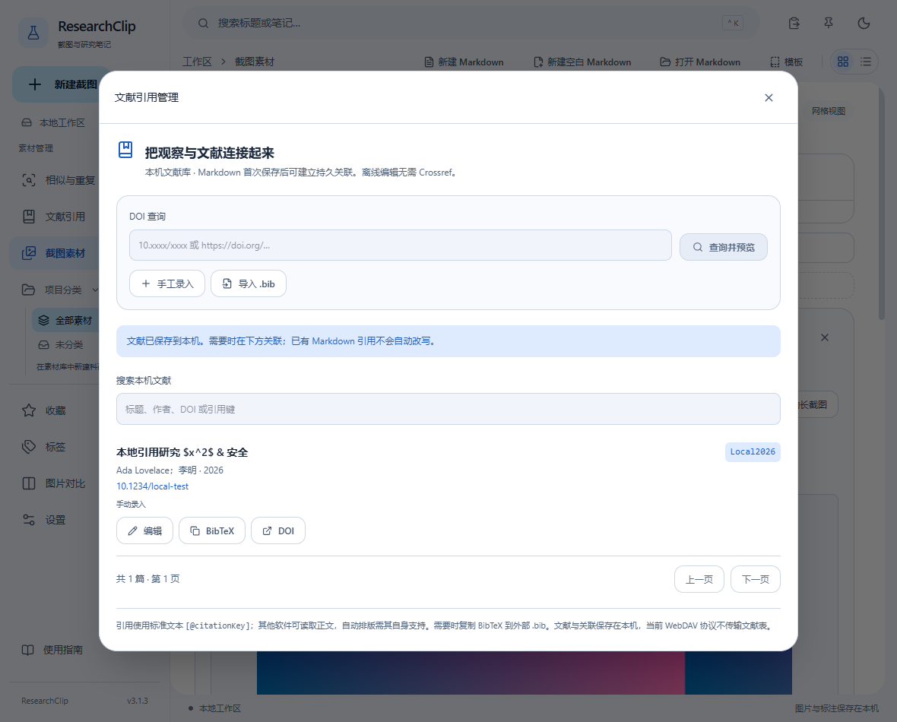

### 13.2 用 DOI 建立第一条文献

#### 13.2.1 查询和预览

1. 点击左侧「文献引用」，或在截图知识卡片/Markdown 面板点击「关联文献」。
2. 输入 `10.xxxx/xxxx`，也可粘贴 `https://doi.org/…`，点击「查询并预览」。
3. 等待结果；单次最长约15秒。可取消等待，旧返回不会自动写入。
4. 检查标题、作者、年份、期刊和 DOI。**空字段表示来源没有提供，不是系统遗漏后的自动猜测。**

#### 13.2.2 确认保存

1. 每行填写一位作者；机构作者也可单独一行。年份未知时留空，已知时填写1–9999整数。
2. 检查引用键，首次默认生成 `ref-…`，可改为容易记忆的英文键，例如 `Li2026Control`。
3. 点击「确认保存文献」。看到已保存提示后，再在列表中点击「关联」。
4. 若 DOI 已存在，查找并使用原记录；不会覆盖另一条文献。

#### 13.2.3 无网络或查询失败

点击「手工录入」继续。Crossref 不可用不会阻止离线笔记编辑。不要为省略字段编造作者、年份或出版物；以后可编辑补充。连续查询至少间隔2秒，服务限流时等待60秒再试。

### 13.3 导入和复制 BibTeX

#### 13.3.1 预览多条 .bib

1. 点击「导入 .bib」，在 Windows 对话框中选择 UTF-8 编码文件。
2. 检查每条标题、引用键和 DOI，取消勾选不需要的记录。
3. 点击「确认导入 N 条」。有 DOI 或引用键冲突时，**整批不写入**；不覆盖原文献。
4. 根据提示排除冲突条目，或使用文献搜索找到已有记录再关联。

#### 13.3.2 支持格式和失败处理

一次最多1 MiB、200条，单条64 KiB。普通花括号/引号字段、机构作者、额外字段会保留。`@string`、`@preamble`、`@comment` 或 `#` 拼接须先在来源工具展开/移除；不支持的语法会明确报错，不默默丢掉条目。年份如 `forthcoming` 请改为空或实际整数再导入。

#### 13.3.3 复制与引用键

列表「BibTeX」按钮复制该文献记录，可粘贴到 Zotero/VS Code/其他 .bib 文件中。现有引用键不会因修改标题或作者自动变化；主动改键需要勾选确认，并自行更新旧文档中的 `[@旧键]`。

### 13.4 关联截图、Markdown 和网页剪藏

#### 13.4.1 关联知识卡片

打开截图详情 →「关联文献」→ 查找标题、作者、DOI 或引用键 →「关联」。已关联区可打开 DOI、复制 BibTeX 或取消关联。解除关联不会删除截图、笔记、原始图像或文献。

#### 13.4.2 在 Markdown 光标插入引用

1. 打开或新建 Markdown，把光标放在需要引用的位置。
2. 如需持久关联，先 Ctrl+S 保存并完成文档登记。
3. 面板「关联文献」→ 找到记录 →「插入引用」。
4. 回到正文检查 `[@Li2026Control]`，再 Ctrl+S 保存。
5. 关闭重开，确认引用仍在。其他 Markdown 软件可以读取这些普通字符；自动文献排版需要它自己的 Pandoc/引用插件和 .bib 数据。

#### 13.4.3 为网页剪藏补充论文来源

浏览器扩展保存后，在桌面通知选择「关联文献」，或先「打开 Markdown」再操作面板按钮。若当前有未保存草稿，先完成文档切换确认，再在右侧点击「关联文献」。扩展不访问 SQLite，不读取 Cookie，也不会自动访问论文 DOI。

### 13.5 在指定范围查找相似图片

#### 13.5.1 选择候选范围

左侧「相似与重复」→ 选择全部素材、未分类或单个项目 → 可勾选「仅收藏」。这些条件共同限制结果和重复组；参考图片可来自其他项目。

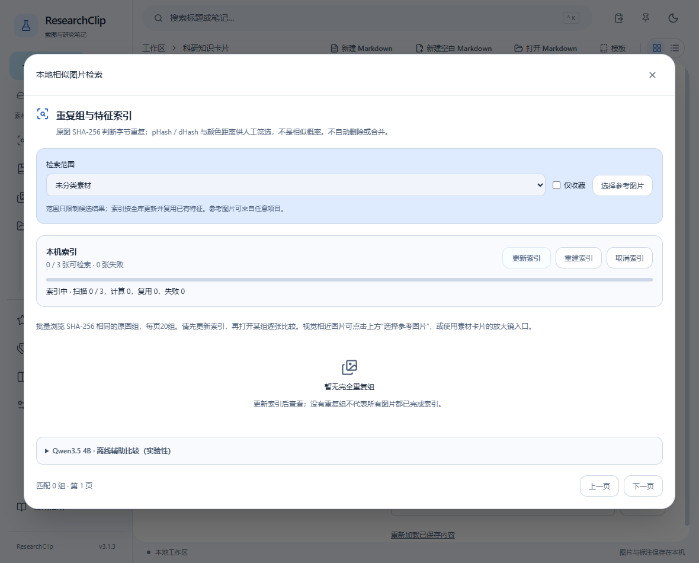

#### 13.5.2 建索引与选择参考

先点击「更新索引」，索引针对整个本机库并复用未改变图片；它不会删除资料。点击「选择参考图片」，输入关键词并分页选图，或从原卡片的查找相似按钮进入。距离阈值只影响感知匹配；SHA-256 相同表示原图字节相同，不等于笔记或标注相同。

#### 13.5.3 人工判断与返回

使用「人工比较」核对细节；没有匹配时可调整范围、取消仅收藏、更新索引或增大阈值。距离不是经过校准的相似概率，不自动合并或删除任何图片。

### 13.6 功能示例

#### 13.6.1 DOI查询、确认与去重

**操作**：输入`10.1038/nphys1170`，查询预览后核对标题、作者和年份，再确认保存；再次输入相同DOI。

**完成标志**：仅确认后写入；规范化后的相同DOI不会静默生成重复记录。网络不可用时可手工录入。

#### 13.6.2 手工文献、编辑与引用键

**操作**：手工新增练习文献“演练论文”，检查引用键后保存；修改标题再保存。

**完成标志**：已有引用键稳定；键冲突或记录版本变化会提示。

#### 13.6.3 BibTeX导入与复制

**操作**：使用随附`examples/references.bib`，系统选择文件后预览，选择条目保存，再复制BibTeX。

**完成标志**：支持字段保留，冲突整批提示；不执行TeX，宏与拼接先在外部展开。

#### 13.6.4 截图与网页来源关联

**操作**：从练习卡关联一条文献；对网页剪藏通知补充相同论文来源。

**完成标志**：文献详情和卡片能看到关联，来源不替换原笔记。

#### 13.6.5 Markdown引用插入与DOI打开

**操作**：在文档光标处选择文献插入引用，再复制对应BibTeX；需要查原文时使用文献DOI入口。

**完成标志**：源码保存`[@key]`；外部软件是否自动排版取决于其支持，不承诺自动生成文献表。

#### 13.6.6 按项目、未分类和收藏找相似图

**操作**：在文献工作流或相似入口选参考图，限制课题A并勾选仅收藏；再切换未分类。

**完成标志**：候选跟随当前组合范围，人工核对后返回资料。

## 14. 双向链接与知识图谱

双向链接把 Markdown 文档和截图卡片连接起来。先保存文档，再用引用串起论证、图表和观察；目标页可反查哪些文档使用了它。

### 14.1 插入一个内部引用

#### 14.1.1 准备目标

文档须先在 ResearchClip 中打开或保存，才会登记到本机文档列表。截图须已存入素材库。搜索候选显示文件名或截图标题、类型和 ID 前八位；同名内容可以区分。正文标题与文件名可以不同，当前候选按文件名搜索文档。

#### 14.1.2 输入与选择

在 Markdown 源文中输入 `[[`，再输入部分名称，例如 `[[Apollonius Circle`。也可先输入完整的 `[[Apollonius Circle]]`。稍等候选出现后点击目标，或按上下方向键选择、Enter插入。Esc或“取消”关闭搜索，继续输入可再次触发。代码块、行内代码和公式中的示例不会触发候选。

选中后变为普通 Markdown 链接，例如：

```markdown
[Apollonius Circle.md](researchclip://document/0123456789abcdef0123456789abcdef)
```

这里的 ID 只是格式示例，请使用候选列表插入真实目标。`[[名称]]` 本身是搜索输入，不会自动成为已绑定的引用；未选择目标的文字没有反向链接。

#### 14.1.3 保存与跳转

按 Ctrl+S 保存，文档底部“内部引用与反向链接”会显示后台索引状态。索引仅处理已保存的文件；当前草稿不会提前改变数据库中的引用关系。完成后点击实时预览中的蓝色引用打开文档或截图卡片；切换文档遇到未保存修改时，仍需选择保存、放弃或取消。

#### 14.1.4 重命名与同名内容

通过文件名菜单“重命名文件”修改名称，ID不变，其他文档的链接仍指向同一内容。旧显示文字不自动改写，不影响定位。不要靠改写链接里的显示文字来更换目标。应用外移动或重命名文件不会自动跟踪，请保留文件位置或在应用中重命名；把文件复制到另一个路径并打开会登记为另一个文档。

### 14.2 使用反向链接

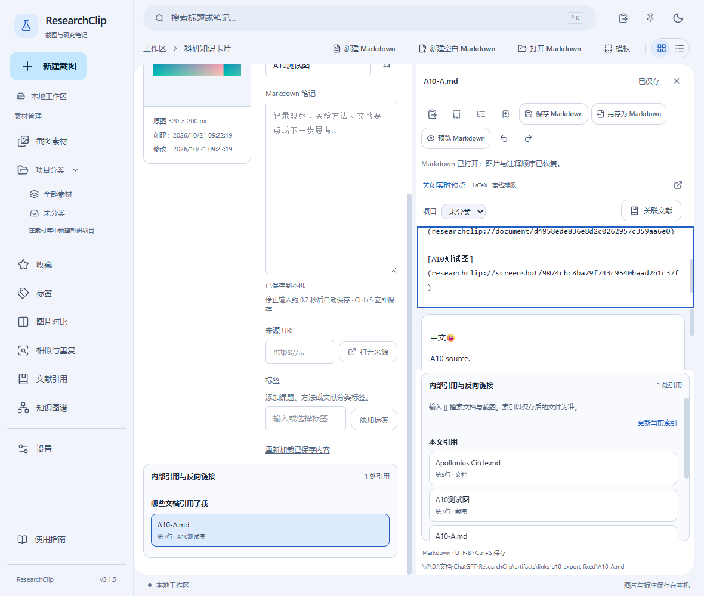

#### 14.2.1 查看哪些文档引用了我

Markdown分栏底部和截图卡片详情都显示“内部引用与反向链接”。来源条目列出文件名、行号和引用文字；重复引用按各自位置显示。

#### 14.2.2 回到引用位置

点击来源条目会打开来源文档，并定位源文中的引用位置。位置按已保存文件计算；如果来源文档有未保存修改，先处理草稿再核对位置。当前文档的“本文引用”还会显示目标是否可访问。

#### 14.2.3 更新或取消索引

保存、打开文档时会在后台更新当前索引，也可点击“更新当前索引”。知识图谱中的“更新全部链接索引”会逐篇处理已登记文档，显示进度并允许取消；已提交的结果保留。文件缺失或损坏时显示未更新清单，不把失败当作成功。

#### 14.2.4 文件删除或外部修改

目标文件缺失或截图已删除时，原引用保留，条目提示不可访问，图谱用虚线节点表示。来源文件删除后，既有反向记录仍可供核对，但不能打开来源。外部编辑之后请更新全部索引；应用不会扫描任意目录或擅自修复、移动、删除文件。恢复原路径文件后可再次更新索引。

### 14.3 浏览知识图谱

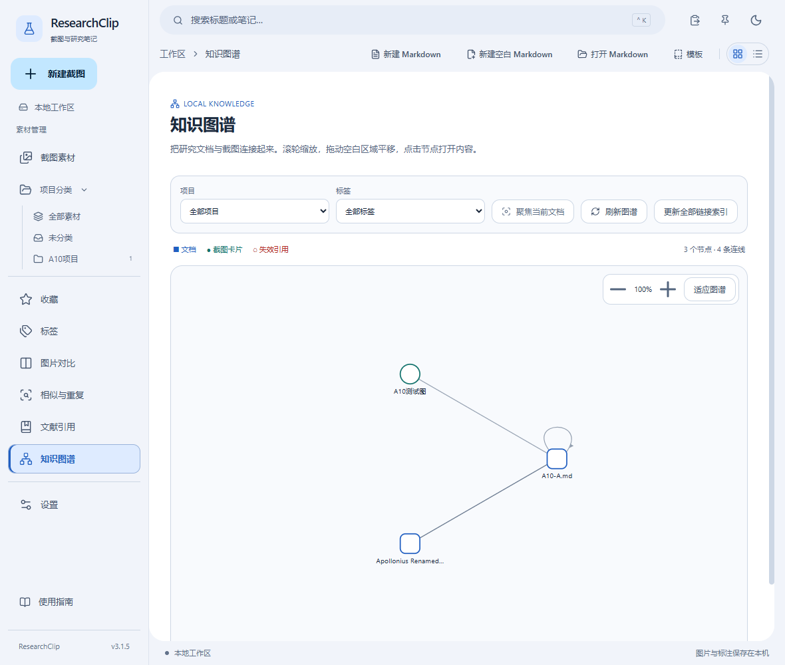

#### 14.3.1 打开与辨认节点

点击左侧“知识图谱”。圆角方形代表文档，圆形代表截图卡片，箭头方向表示谁引用了谁，虚线形状表示失效目标。点击节点打开内容，也可展开底部节点列表用键盘操作。第一次升级后，先更新全部链接索引以纳入旧文档。

#### 14.3.2 缩放、平移与聚焦

滚轮或加减按钮缩放，拖动空白区域平移，“适应图谱”恢复居中。“聚焦当前文档”只保留当前已保存文档及直接相邻节点，点击“查看全图”退出聚焦。A引用B、B又引用A可以正常显示，不会递归展开所有路径。

#### 14.3.3 项目与标签筛选

项目和标签可以组合筛选，只显示匹配节点以及这些节点之间的连线。截图沿用卡片标签；文档可在分栏底部“图谱标签”中选择已有标签，按Ctrl选择多项。新标签在左侧标签页创建。筛选后为空时清除条件再试；“未分类”只显示无项目节点。

#### 14.3.4 数量限制

每篇文档最多索引5000条内部引用。图谱最多展示1000个节点、5000条连线；达到限制会提示缩小范围。反向链接区域最多展示500处引用。较大图谱可先按项目或标签筛选，再聚焦邻居。

### 14.4 导出与安全边界

#### 14.4.1 导出标准Markdown副本

先保存文档并等待索引更新，然后在分栏底部点击“导出标准Markdown副本”，通过系统对话框选择新的 `.md` 名称。已有同名文件会被拒绝覆盖，原文档继续保留。文档自身使用的受管assets会沿用既有导出管线复制并校验。

#### 14.4.2 可携带的相对链接

可访问且位于同一磁盘的文档引用会转换成相对文件链接，空格和中文文件名会编码。被引用文档不会自动打包复制，移动或分享时须带上目标文档及其assets，并保留相对目录结构。直接“保存Markdown”会保留ResearchClip内部ID，适合继续在当前工作区编辑。

#### 14.4.3 不能转换的引用

截图卡片、缺失目标和跨磁盘目标在导出副本中保留可读文字与“内部引用未导出”提示，完成后会列出警告。截图卡片如需独立分享，可使用其现有Markdown或PNG导出功能。代码示例或不支持格式中残留的内部URI也会提示核对。不要把导出成功理解为所有内部目标都已打包。

#### 14.4.4 本机与不可信输入

链接索引、文档映射和图谱标签保存在本机SQLite schema9；升级前沿用现有校验、备份和事务迁移。升级后旧版本不能写入schema9，请勿用旧版本同时打开同一资料目录。内部链接只能通过受管ID定位已经登记的文档与截图，不能直接打开任意本地路径。不执行Markdown中的HTML或脚本。索引和文档标签目前不随WebDAV同步；单独复制.md到另一台设备不会自动带走本机ID映射。没有新增PDF或独立备份恢复系统。

### 14.5 功能示例

#### 14.5.1 内部文档链接与截图链接

**操作**：先保存“Apollonius Circle”文档，再在另一个文档输入`[[Apollonius`，选择候选；也搜索并选择一张截图。

**完成标志**：插入含稳定ID的链接，预览点击分别打开文档或卡片；候选可用方向键、Enter、Esc。

#### 14.5.2 重命名、同名与稳定ID

**操作**：给两个不同文档相同显示标题，按候选类型和短ID选目标；在应用内重命名已链接文档。

**完成标志**：旧链接仍指向同一ID；外部复制/另存是新登记目标，应用外移动不自动追踪。

#### 14.5.3 反向链接与引用行定位

**操作**：保存含两处引用的来源文档，到目标页展开反向链接并点击对应行号。

**完成标志**：打开来源并定位保存源码中的引用位置；未保存草稿不进入索引。

#### 14.5.4 索引、外部修改与失效提示

**操作**：从索引入口更新，必要时取消；只对练习文档在外部删除后再次更新。

**完成标志**：成功项可见，失败项有说明，缺失目标保留失效提示，不扫描任意本地路径。

#### 14.5.5 循环引用与自引

**操作**：让练习文档A引用B、B引用A，再给A加入自引并保存。

**完成标志**：反查和图谱显示直接关系，不递归展开或卡死。

#### 14.5.6 图谱形状、缩放、平移与打开

**操作**：打开知识图谱，找到方形文档和圆形截图节点，缩放并拖动空白处，再点节点。

**完成标志**：节点打开对应内容；缺失目标有不同外观和提示。

#### 14.5.7 图谱邻居、项目与标签筛选

**操作**：打开A后聚焦当前文档邻居，再选择课题A和“演练”标签；清除筛选。

**完成标志**：只显示符合范围的节点/关系；文档标签在链接工具中设置，截图沿用卡片标签。

#### 14.5.8 标准Markdown副本与警告

**操作**：展开文档链接工具，将含文档/截图引用的练习稿导出到新路径，阅读转换报告。

**完成标志**：可用文档目标变为相对文件链接；截图、缺失或跨盘无法转换项明确列出，不自动复制目标文档。

## 15. 图片局部锚点与文档跳转

锚点是原图中的一个点或矩形区域，独立保存于本机SQLite。它不烧录到PNG，也不改变现有标注对象、标注版本或右侧Markdown草稿。先把截图存入素材库，再从编辑器创建锚点。

### 15.1 创建、移动与保存

#### 15.1.1 在原图上选择

打开一张素材的“编辑标注”。在“图片局部锚点”选择“创建点锚点”并点击目标，或选择“创建区域锚点”拖出矩形。Esc取消当前手势，“取消创建锚点”退出创建模式。

#### 15.1.2 填写标题、说明与像素区域

在确认表单输入标题和说明，必要时精确修改X/Y/宽/高。点的宽高均为0；区域的宽高均大于0，整体必须位于原图内。坐标不随窗口缩放、DPI或分栏宽度改变。“保存图片锚点”提交一次事务；失败时表单保留，可修正或取消。

#### 15.1.3 调整与显示

选择工具下拖动锚点标记，会打开带新位置的确认表单；也可在已保存列表点击“编辑锚点”。保存后ID保持，已有引用指向新位置。点击“隐藏锚点标记”可清理视野，列表仍可使用；通过引用跳转的目标短暂高亮3秒。

#### 15.1.4 删除与重开

删除需明确确认；只删锚点，不删图片、标注或Markdown。原ID不复用，旧引用会失效。保存后重启或重新加载仍可看到锚点。每张图片最多200个锚点，标题200字、说明4000字。

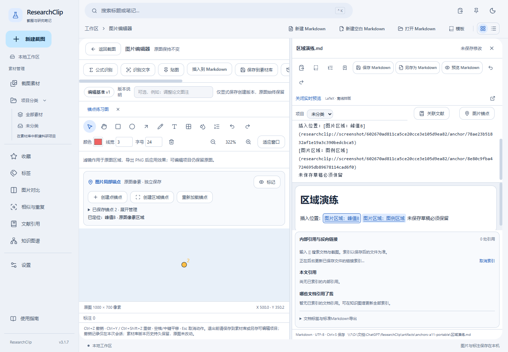

### 15.2 从Markdown引用目标区域

#### 15.2.1 选择并插入

将光标放到右侧Markdown源文，点击“插入图片锚点引用”（按钮显示“图片锚点”），搜索截图后选择该图的已保存锚点。选择器按页显示；本页无截图时可改关键词或翻页。源码模式在记住的光标处插入，图文模式追加文字块。取消不改正文。

#### 15.2.2 点击、定位与继续写作

在实时预览或完整预览点击引用，应用打开左侧对应截图编辑器，缩放并居中目标区域，短暂高亮。右侧Markdown、未保存状态、撤销记录与光标保持，不会为了跳转重开文档。左右分栏宽度变化后仍按原像素区域居中，可继续手动平移缩放。

#### 15.2.3 多个目标连续跳转

连续点击不同锚点，最后一次请求生效，旧异步结果不会覆盖新目标。已打开截图保留标注草稿；最多8个编辑会话/128MiB沿用原有上限，超限有提示，请先保存并关闭不用的会话。

#### 15.2.4 失效与原图版本

链接形如`[图片区域：峰值](researchclip://screenshot/<截图ID>/anchor/<锚点ID>)`。只接受两个严格ID，不接受路径、查询参数或外部应用文件请求。imageRevision是原图PNG的SHA256，普通标注版本改变不会改变它；若原图被外部替换、损坏，或锚点/截图删除，明确显示失效并停止定位，绝不跳到另一个锚点。

### 15.3 导出与数据边界

#### 15.3.1 标准Markdown副本

先保存并更新链接索引，再在文档链接工具选择“导出标准Markdown副本”。锚点转换为可读标题、像素区域和说明；失效锚点保留失效文字及导出警告，不把专有URL留作唯一解释。源文件仍保留增强引用，不覆盖原稿。

#### 15.3.2 与历史、同步及项目文件的关系

锚点独立于Annotation v1的矢量对象和可编辑项目JSON，PNG导出、复制、贴图均不包含锚点标记。锚点目前仅本机，不随WebDAV或旧可编辑项目导出迁移；Markdown增强URL可保存，但其他资料库不自动具有相同目标。此版不增加外部深度链接注册。

### 15.4 功能示例

#### 15.4.1 创建点锚点

**操作**：在练习图峰值处点击，输入“峰值A”，宽高保持0并保存。

**完成标志**：列表出现同名点，重新加载仍能定位。

#### 15.4.2 创建矩形区域

**操作**：在练习图拖出图例框，标题填“图例”，说明填“蓝线为基准”。

**完成标志**：矩形按原图像素保存，可精确修改宽高。

#### 15.4.3 编辑标题与说明

**操作**：把“峰值A”改为“峰值B”，补充“第3秒，待人工核对”。

**完成标志**：原ID保持，既有引用仍定位同一锚点。

#### 15.4.4 移动锚点

**操作**：用选择工具拖动标记，核对表单的新X/Y并保存。

**完成标志**：位置更新；取消表单则保持旧位置。

#### 15.4.5 显示、隐藏与缩放

**操作**：隐藏标记，放大原图，再显示标记。

**完成标志**：像素区域保持不变，标记不写入合成PNG。

#### 15.4.6 插入光标引用

**操作**：在Markdown“观察”段放置光标，选择练习截图和“图例”锚点。

**完成标志**：引用插入光标处，可撤销，文档处于未保存修改状态。

#### 15.4.7 点击与保留草稿

**操作**：保留一段未保存文字，点击实时预览中的锚点引用。

**完成标志**：左侧定位并高亮3秒，右侧文字和编辑状态保持。

#### 15.4.8 分栏与连续跳转

**操作**：拖窄右侧分栏，依次点击峰值、图例、峰值引用。

**完成标志**：视口重新适配，最后一次目标生效。

#### 15.4.9 删除与失效

**操作**：删除练习锚点并确认，再点击原引用。

**完成标志**：显示失效；新建同名锚点不会接管旧链接。

#### 15.4.10 版本、重启与普通导出

**操作**：保存锚点，改标注后保存新版本并重启；再导出标准Markdown副本。

**完成标志**：锚点仍按原图定位；副本保留标题/说明/像素信息。原图版本不匹配则停止跳转。

## 16. 命令面板与可组合工作流

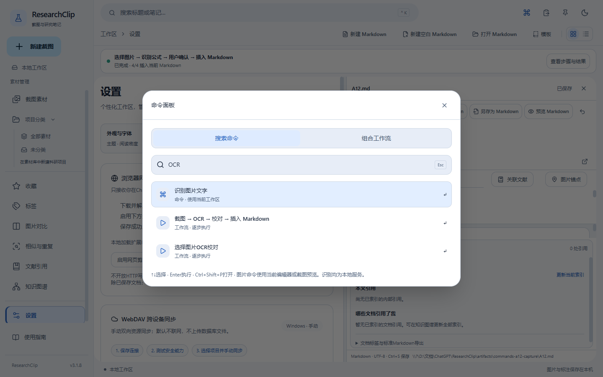

图示来自本版实际Windows原生测试，使用自建练习图和文档；不代表识别准确率。

### 16.1 搜索与快捷键

按 **Ctrl+Shift+P** 或点击顶部命令图标。输入“截图”“OCR”“Markdown”等关键词，方向键选择，Enter执行，Esc关闭。支持中文和英文关键词；不会把输入当作脚本或系统命令。其他对话框打开时先完成或关闭它，再开命令面板。

命令包含新建截图、滚动长截图、打开素材库、新建Markdown、打开最近文档、识别图片文字、识别数学公式、截图插入Markdown和设置。图片命令使用当前素材卡片、编辑器原图或当前截图预览；没有图片时提示先打开图片。插入截图时沿用现有标注合成管线。最近文档只列出已关联的本地文档，可搜索，最多显示30项；打开仍会提示保存未保存草稿。

Ctrl+Shift+P仅作用于应用内。既有Ctrl+K搜索、Ctrl+S保存与撤销重做保留。若旧截图配置使用同组合，配置原文保留但暂停该全局绑定，并提示改键；新设置不能再把它绑定到全屏或区域截图。无法保证其他前台应用或系统工具的拦截行为，工具栏入口始终可用。

### 16.2 三个预设与结果确认

1. **截图 → 创建素材卡片**：主动框选区域，随后写入本地素材库。结果中可打开卡片；已有素材不重复创建。
2. **截图 → OCR → 校对 → 插入Markdown**：先打开Markdown，再开始截图；Windows文字识别后停在校对面板。对照原图修改文字，勾选允许插入后继续。
3. **选择图片 → 识别公式 → 用户确认 → 插入Markdown**：先打开Markdown，从素材库搜索并选择图片。复用已有离线公式运行时和模型，未配置时明确失败。LaTeX可修改并预览，确认后才插入。

选择图片指素材库中的受管图片；外部图片先通过现有“导入图片”入库。文字OCR默认优先已装中文语言，其次首个语言；需要换语言或框选局部时使用普通OCR面板。公式流程识别整图，建议选单公式图片；精确框选仍使用普通公式面板。工作流不自动下载模型、上传图片、保存或覆盖Markdown文件。

### 16.3 组合与保存配置

在命令面板切换“组合工作流”，或在设置进入管理。填写名称，从区域截图/选择素材开始；下拉菜单只列出兼容的下一步。图片可以创建卡片，或识别后校对再插入；必须完成2–8步才能保存。最多16个自定义配置，同一动作不重复，不支持分支、循环、用户脚本、Shell或自动定时触发。移除配置只影响该配置。

配置复用本地设置文件原子写入，保存失败会保留表单并显示错误；重启后恢复成功保存的配置。重启不会恢复未完成执行，不会自动重新截图、识别或写入。

### 16.4 进度、取消与失败重试

顶部进度条显示当前步骤，点击“查看步骤与结果”查看完成记录和保留的识别文本。只允许一个工作流执行；连续触发不会再启动第二个。需要Markdown的流程在开始前检查，没有文档则停止，尚未截图。

点击取消后不再开始下一步。截图框选可按Esc；Windows OCR执行过程中不能强制中止，取消后等待返回并丢弃新结果；公式取消复用本地进程取消接口。已成功创建的卡片不会因取消删除。

可重试的步骤失败时，点“仅重试失败步骤”，已完成的截图或识别不会重做。卡片创建返回错误可能涉及不确定写入，因此不提供自动重试，应先刷新素材库核对。Markdown插入只修改原文档的草稿；若原文档关闭或切换，停止并保留文本，不插到另一个文档。保存Markdown仍使用原有Ctrl+S、文件授权、外部修改保护和失败提示。

### 16.5 功能示例

#### 16.5.1 快捷键与搜索

**操作**：按Ctrl+Shift+P输入“ｏｃｒ 文字”，用方向键和Enter选择。

**完成标志**：找到文字识别命令；输入不存在的关键词时显示空结果。

#### 16.5.2 新建截图

**操作**：搜索“新建截图”，选择区域截图并框选。

**完成标志**：显示原有截图预览，取消框选不产生素材。

#### 16.5.3 滚动长截图

**操作**：搜索“滚动”，明确选择已有浏览器窗口。

**完成标志**：进入现有长截图步骤，仍可停止或取消。

#### 16.5.4 打开素材库

**操作**：搜索“素材库”并执行。

**完成标志**：回到截图列表，右侧草稿保持。

#### 16.5.5 新建Markdown

**操作**：搜索“新建 Markdown”。

**完成标志**：新建空白草稿；已有未保存文档仍要求保存或放弃。

#### 16.5.6 最近文档

**操作**：搜索“最近”，在列表输入之前保存文档的名称。

**完成标志**：选择后打开稳定ID文档；缺失文件不可打开。

#### 16.5.7 识别文字命令

**操作**：先打开文字图片编辑器，再执行“识别图片文字”。

**完成标志**：打开已有OCR面板，可选语言与区域，不会自动插入。

#### 16.5.8 识别公式命令

**操作**：先打开单公式图片，再执行“识别数学公式”。

**完成标志**：打开既有公式面板，仍需要配置本地运行时和人工校对。

#### 16.5.9 截图插入与设置

**操作**：打开Markdown和截图编辑器，执行“将截图插入 Markdown”，再执行“打开设置”。

**完成标志**：合成图在文档中，设置打开后草稿仍保留。

#### 16.5.10 截图创建卡片

**操作**：从组合工作流启动第一个预设，框选练习图。

**完成标志**：完成记录显示写入成功，可点击打开结果卡片。

#### 16.5.11 OCR确认暂停

**操作**：打开Markdown后启动第二个预设；识别完成时先不勾确认。

**完成标志**：正文尚未改变；校对、勾选并继续后插入一次。

#### 16.5.12 公式确认与修订

**操作**：选择库中单公式截图，等待公式识别，手工改一个符号。

**完成标志**：修改会清除确认勾选；重新校对确认后插入独立公式。

#### 16.5.13 组合与重启

**操作**：命名“图片转笔记”，组合选择素材→OCR→校对→插入并保存。

**完成标志**：重启后配置仍在，但没有自动执行或恢复写入。

#### 16.5.14 取消与连续触发

**操作**：启动流程后连续点击，再在选择或校对时取消。

**完成标志**：仅一个运行；不开始下一步，已完成素材保留。

#### 16.5.15 失败重试与文件保护

**操作**：在隔离练习环境制造OCR或设置写入失败，查看错误。

**完成标志**：可重试步骤从失败处继续；配置写入失败保留表单，未覆盖原文件。

#### 16.5.16 没有文档或切换文档

**操作**：关闭Markdown后启动OCR插入流程；再打开文档重试。

**完成标志**：首次在开始前提示缺少文档；执行期间切换原文档则保留结果并停止插入。

## 17. 设置、托盘与快捷键

设置支持深色、浅色、跟随系统；字体、字号、视图、双截图快捷键、PNG 默认保存目录、默认标注颜色/线宽及版本。目录只影响外部另存为的起始位置，不移动现有资料。不适用的目录、快捷键冲突和配置保存失败会提示，保留原配置。

托盘可区域/全屏截图、恢复主窗口、打开设置、退出。默认关闭窗口退出；启用“关闭时隐藏到托盘”后只隐藏，真正退出仍通过托盘“退出”。等待导入/保存/截图时需完成后重试；未保存笔记、标注和 Markdown 有保护提示。强制结束进程不能保证草稿恢复。

常用按键：Ctrl+K 搜索；Ctrl+S 保存当前卡片/Markdown；编辑器或 Markdown 内 Ctrl+Z 撤销、Ctrl+Y/Ctrl+Shift+Z 重做；标注 Delete 删除、Esc 取消；区域截图 Esc 取消。焦点所在面板决定编辑快捷键作用范围。

### 17.1 WebDAV：手动双向同步

**只在 Windows 桌面版中使用；默认不联网。** 两台设备各自保留数据库，通过资源级协议传输原图、可编辑标注及版本历史、笔记、OCR、标签、项目、已登记的 Markdown 和受管 assets。它不是独立备份/恢复系统，不同步设置、模板、模型、未保存草稿或整个磁盘。

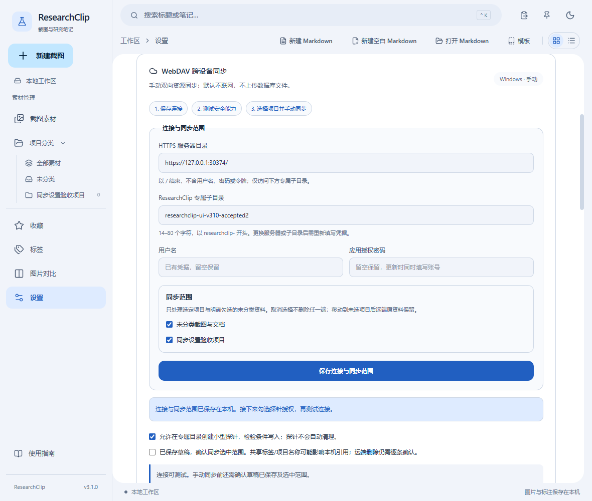

#### 17.1.1 准备专用目录与应用授权密码

1. **先保存**所有笔记、标注及 Markdown，使用少量测试资料建立科研项目；不要先用唯一的科研资料验证服务兼容性。
2. 在服务商官网启用第三方应用访问，创建应用授权密码。**不要发送密码到聊天、Issue、日志或截图中。** 不要使用需要绕过证书验证的服务器。
3. 打开「设置 → 跨设备同步」。服务器填写 HTTPS 目录并以 `/` 结尾。本次专用测试地址为 `https://dav.jianguoyun.com/dav/ResearchClip/`；不要使用 Zotero 目录。
4. 两台设备使用相同的服务器与专属子目录，例如 `researchclip-sync-v2`。应用只在该子目录读写生成的同步对象；不会扫描同级其他应用目录。
5. 在本机表单输入账号和应用授权密码，点击「保存连接与同步范围」。凭据保存在 **Windows 凭据管理器**；表单随后清空，数据库不保存密码。保留已有凭据时账号/密码都留空，更新时两者都填写。

**成功标志**：保存按钮下方出现「连接与同步范围已保存在本机」。保存只写本机配置和系统凭据，**不访问服务器**；不用等待服务器连接成功才能保存。字段有误时会聚焦到对应输入框并显示原因。保存失败时输入保留，请先修正，不必重启或清空资料库。

**核对**：配置保存成功不等于服务器通过；换设备或换工作区可能需要重新输入凭据。服务器目录需预先创建，ResearchClip创建其专属子目录，不负责创建所有父目录。

#### 17.1.2 测试连接与安全写入

1. 勾选允许小型探针，再点击「测试连接与安全写入」。它会产生专属目录、探针及协议描述文件，不上传选中的截图内容。
2. 等待 TLS、目录读取、条件创建、过期/伪造ETag拒绝和两个并发条件写入检查。只有安全门槛通过，才允许资料提交；每次手动任务都会重新检查。
3. 成功后可查看远端项目；勾选本机或远端需要的项目。**未分类**单独勾选，默认不选。

**失败时**：401/403检查应用密码及目录权限；证书错误联系服务商处理，不关闭证书校验；条件写入不可靠则停止，不能通过修改配置强制覆盖。坚果云的实际认证兼容性仍需在你的账号上验证，不能据本机独立服务器测试推定支持。探针保留、不自动删除；频繁测试会消耗服务商请求额度，限流后等待再手动重试。

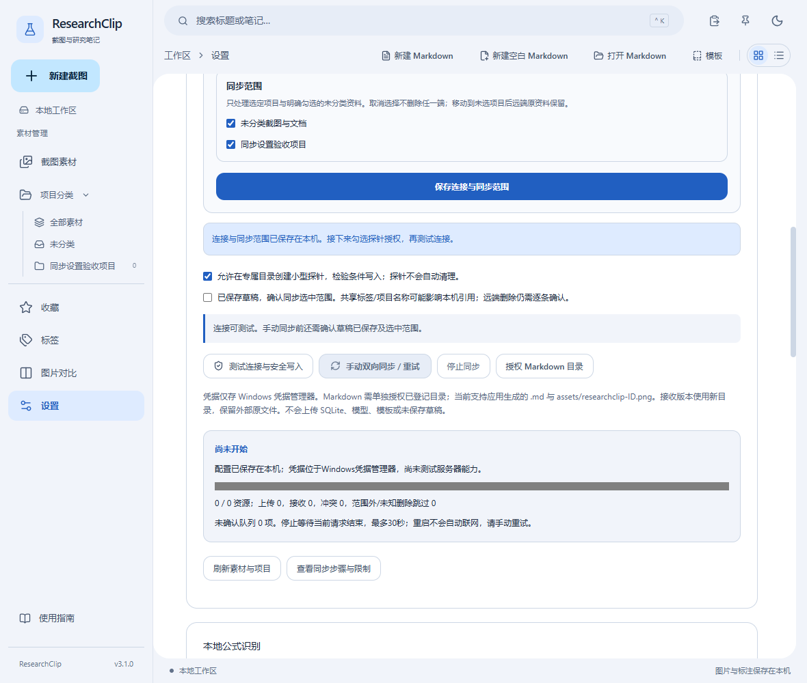

#### 17.1.3 选择项目与授权 Markdown

1. 仅选择本次要同步的项目，再点击「保存连接与同步范围」。取消选择不删除本地或远端资料；把截图移到未选项目也不会自动删除远端旧副本。
2. 截图的笔记、多标签、标注历史与已完成OCR随截图传输。跨项目标签仍是共享定义；同名不同ID或名称不一致时暂停导入，先核对并统一名称。
3. 如项目包含 Markdown，点击「授权 Markdown 目录」，通过系统文件夹选择器选中其文件夹。只授权其中**已经在项目登记的文件**，不自动扫描所有文档。换路径后需要再次授权。
4. 当前支持应用生成的 `.md` 与 `assets/researchclip-ID.png` 相对PNG资源；其他本地图片引用需先通过应用导入并重新插入。不支持的引用会明确报错，不静默丢图片。外部HTTPS图片引用保留来源，不主动下载。

**核对**：接收文档可在「项目 → Markdown文档」打开。接收版本位于应用受管的新目录，原来的外部Markdown文件保留；后续编辑请使用项目中当前登记的版本，以免编辑错副本。

#### 17.1.4 开始、停止与断线重试

1. 保存左右工作区草稿，勾选同步范围确认，再点击「手动双向同步 / 重试」。未保存的 Markdown/标注会阻止开始，笔记保存失败也会阻止。
2. 观察完成资源数、上传、接收和冲突数。已完成项分别提交，不能把进度条理解为整个资料库原子事务。
3. 需要停止时点击「停止同步」。等待当前网络请求结束，最多约30秒；已完成资料保留，未确认队列保留。
4. 网络恢复或重新启动应用后，回到设置再次手动同步。应用**不会自动联网补传**；不反复连续点击，避免限流。已提交但未收到确认的资源会补确认，不重复生成版本。


#### 17.1.5 冲突与远端删除

双方同时编辑同一资料会保留两份不可变快照，在设置中列出资源ID与原因。**先保存当前草稿**，逐条核对后选择：

- **采用本地**：把本机已保存内容作为新提交；仍检查远端ETag，不无条件覆盖。
- **采用远端（含删除）**：应用远端版本；如果远端是删除记录，会明确提示删除本机这1条记录，需要再次确认。外部Markdown原文件不被覆盖或删除。
- **保留两者**：保留本机活动内容，远端活动内容生成独立冲突副本，下次手动同步上传。若远端是删除记录，则保留本地内容及删除快照，不创建一张空图。

**确认前若又发生修改**，操作会失败并要求重新同步刷新，不能沿用旧决定。名称或依赖冲突可能需要先在素材库重命名，再重试。未知缺失不当作删除，初次同步不会按列表差集清空资料。首版不自动清理历史或远端对象。

#### 17.1.6 两台设备的完成检查

1. A先上传一个包含截图/标注/笔记/相对图片Markdown的小项目，B测试连接后选择远端项目并接收。
2. 在B核对原图、历史、标签、笔记、OCR及Markdown图片；修改一处，保存并同步，再在A同步核对。
3. A/B分别修改同一份Markdown并依次同步，确认出现冲突而非静默覆盖。用测试资料演练取消与保留两者。
4. 真正退出并重启，核对已完成资料仍在，队列可手动恢复；停止和退出等待不应丢弃已保存内容。

**上限与排错**：单文件64MiB、单图约1677万像素、单截图历史1024条/JSON总计16MiB、Markdown2MiB/32张受管PNG/资源128MiB、最多5000资源。超限明确停止，不删除或截断。缓存与探针暂不自动回收，请留足空间；当前没有macOS同步验收、定时同步或独立全库恢复入口。

#### 17.1.7 「保存」没有反应时

1. **确认运行方式**：使用下载的 Windows EXE 或安装版。浏览器网页只可预览，不能保存系统凭据；桌面版不应显示「浏览器仅预览布局」。
2. **检查就近提示**：点击「保存连接与同步范围」后，错误会出现在输入框旁或按钮下方。检查 HTTPS、末尾 `/`、专属子目录，以及账号/应用授权密码是否同时填写。
3. **检查本机凭据**：如果提示系统凭据不可用，重新填写两项后保存；不要把密码贴到聊天中。更换服务器、专属子目录、设备或资料工作区后，原连接凭据不能假定可复用。
4. **区分读取与保存**：状态轮询不应锁住保存按钮。状态读取失败会显示错误和「重新读取同步配置」；请记录提示，勿通过删除 SQLite 或重置应用来排错。
5. **运行中不能改连接**：测试或同步期间会锁定连接配置，防止中途换服务器；点击「停止同步」，等待任务显示「已停止」再保存。停止请求不等待前端启动回执，当前网络请求仍可能需最多约30秒结束。

#### 17.1.8 哪个按钮应当何时可用

| 操作 | 需要先完成 | 不可用时如何处理 |
| --- | --- | --- |
| 保存连接与同步范围 | Windows桌面版；没有运行中的任务 | 查看字段错误；任务运行中先停止；后台状态读取不会独占保存按钮 |
| 测试连接与安全写入 | 配置与凭据已保存；允许探针 | 先保存，包括刚修改的账号/密码，然后勾选探针；看按钮上方原因说明 |
| 手动双向同步 / 重试 | 已保存至少一个项目或未分类范围；允许探针；确认已保存草稿 | 勾选范围后再保存；保存 Markdown/标注，确认范围；安全能力仍会重新校验 |
| 停止同步 | 正在启动、测试或同步 | 尚未开始或已经结束时灰色属于正常状态；停止发送后等待当前请求结束 |
| 授权 Markdown 目录 | 没有任务运行；目录中有已登记文档 | 先停止，再通过系统对话框选择目录；不扩大为整个磁盘权限 |

**提交问题时**：只提供版本号、运行方式、脱敏错误与操作步骤；不要发送密码、完整数据库或敏感截图。v3.1.0修复的是本机交互与状态恢复，未将坚果云认证或所有WebDAV服务器标为通过。

### 17.2 对照图：把常用偏好一次设置好


1. **外观**：选择深色、浅色或跟随系统，再选择字体/基础字号。
2. **两组快捷键**：分别修改区域与全屏组合，点击对应「应用快捷键」；冲突时保留原绑定，换一组重试。
3. **保存目录**：用系统文件夹对话框选择，只影响PNG另存为的起始位置；素材库数据目录不会搬迁。
4. **默认标注**：设置颜色和线宽并点击「保存标注默认值」，只作用于之后的新对象。
5. **关闭策略**：按需要启用关闭到托盘；真正退出仍使用托盘「退出 ResearchClip」。

### 17.3 键盘速查

- **Ctrl+Shift+2 / Ctrl+Shift+1**：默认区域/全屏截图，可在设置中修改。
- **Ctrl+K**：打开快捷搜索。
- **Ctrl+S / Ctrl+Shift+S**：当前 Markdown 保存/另存为；卡片Ctrl+S保存卡片。
- **Ctrl+Z / Ctrl+Y / Ctrl+Shift+Z**：当前编辑区域撤销/重做。
- **Delete / Esc**：删除选中标注/取消当前动作；区域截图Esc取消。

**焦点说明**：先点击想操作的编辑区。右侧 Markdown 的撤销不会撤销左侧图片标注；全局截图键与文档保存键不同。


### 17.4 设置修改的生效范围

#### 17.4.1 开始前

主题、字体和视图只影响显示；默认标注样式只影响之后的新对象；PNG默认目录不搬移素材库。

#### 17.4.2 操作步骤

在设置选择深浅或跟随系统，调整字号、双截图快捷键和默认样式；快捷键点击应用并检查注册状态，目录用系统选择器。

#### 17.4.3 完成后核对

重启后核对设置恢复；隐藏到托盘与真正退出不同。退出前确认所有文档/笔记/标注已经保存。WebDAV只在设置中由用户主动触发，先阅读13.1节并通过安全能力测试。

#### 17.4.4 失败与取消

冲突快捷键会保留原配置，换组合重试。目录不可用会提示，不自动把资料搬到其他位置。不要在Issue/聊天/日志中发送凭据。

### 17.5 功能示例

#### 17.5.1 主题、字体、字号与视图

**操作**：切换深/浅主题，选一个合适字体和字号，再切换列表视图后重新打开应用。

**完成标志**：已保存偏好恢复；跟随系统时随系统主题变化。

#### 17.5.2 截图快捷键、目录与标注默认值

**操作**：设置一个未占用的截图快捷键，用选择器指定练习导出目录，再调默认标注颜色和线宽。

**完成标志**：保存成功后生效；快捷键冲突会提示并保留原配置，目录不搬移旧资料。

#### 17.5.3 托盘、隐藏与退出保护

**操作**：开启关闭时隐藏到托盘，关闭主窗口后从托盘恢复；编辑一条未保存笔记再请求退出。

**完成标志**：主窗口可恢复；待保存内容有确认，真正退出通过托盘退出入口。

#### 17.5.4 WebDAV连接与凭据

**操作**：用你控制的专用WebDAV目录和应用授权密码配置练习连接，先测试，再明确允许安全写入。

**完成标志**：成功状态明确；密码走系统凭据存储，不写入Markdown或日志。

#### 17.5.5 WebDAV项目同步、取消与重试

**操作**：只选择练习项目，对已登记Markdown授权后开始同步；中途停止，再手动重试。

**完成标志**：按资源更新与状态反馈完成；未授权本地路径、草稿和模型不自动上传。

#### 17.5.6 WebDAV冲突与远端删除

**操作**：只在两端练习副本上编辑同一资源后同步，阅读冲突详情并选择保留方案；远端删除也先确认。

**完成标志**：冲突经明确选择处理，不以静默覆盖或自动删除解决。

## 18. 数据位置、备份和排错

素材数据库及 originals、thumbnails、backups 位于应用专属数据目录，Windows 通常为 `%APPDATA%/io.researchclip.desktop`；设置及模板位于应用配置目录。应用不向 WebView 开放整个磁盘。请关闭应用后整体备份资料目录，不能只复制正在写入的 SQLite 主文件。

迁移失败、未知未来版本、工作区占用、缺失图片或保存失败时，不要删除数据库解决问题。保留原始目录和提示，退出重复实例，检查磁盘空间、权限与备份，再报告问题。素材删除无回收站；模板删除有文件归档，两者不要混淆。默认卸载保留资料，但若主动勾选删除应用数据会删除资料。

当前限制：Windows 优先，macOS和完整混合DPI/多屏矩阵未全面验收；历史退出句柄与托盘间歇问题仍在QA报告中跟踪。自动化测试、真实Windows验收、未执行的人工项目分别记录，预览或代码存在不能代替实际验收。


### 18.1 安全备份的建议流程

1. 确认卡片、标注、Markdown都保存成功，选择真正退出程序，等待进程结束。
2. 整体复制应用资料目录，保留数据库、原图、缩略图、备份及设置/模板；不要只备份一个正在写入的 `.sqlite3`。
3. 对外部 Markdown，另行备份 `.md` 所在文件夹与其 `assets`；项目索引不等于文档内容备份。
4. 恢复前保留当前目录的独立副本，先在测试位置验证。不确定时报告错误，不用删除原目录“修复”。

### 18.2 出现问题时，先做什么

- **看不到刚保存的图**：检查项目/收藏/标签/关键词，切回全部素材并刷新。
- **保存失败**：保留草稿，检查磁盘空间、目录权限和外部修改提示；必要时另存新文件。
- **窗口没有显示**：检查托盘，使用「打开主窗口」；贴图超出屏幕用顶部恢复贴图按钮。
- **截图被拒绝或画面异常**：确认普通解锁桌面，再记录屏幕缩放/显示器布局与错误；不能保证捕获受保护内容。
- **报告Bug**：附应用版本、操作顺序、预期/实际结果和错误提示。截图请先遮盖个人/科研敏感信息，勿公开整个数据库或原始资料目录。

### 18.3 发布与边界

v1.0.0 为 Windows 正式版本；该版本标识不代表未执行的Windows硬件矩阵、macOS或所有第三方软件已验收。发布说明会列出本轮实际通过、失败修正及仍需人工验证的项目。使用未签名EXE或安装包前，请从官方仓库下载并核对SHA256。

### 18.4 升级与故障报告检查

#### 18.4.1 开始前

保存并真正退出旧实例，再安装新版本。v3.0通过事务和迁移前安全备份升级schema5到schema6，保留既有ID、原图与历史，不重置素材库。

#### 18.4.2 操作步骤

安装包需要WebView2，未签名程序请从仓库Release下载并核对SHA256。浏览器插件使用随Release保留的独立包，不因桌面版本号改变而换扩展ID。

#### 18.4.3 完成后核对

核对原项目、标签、原图、标注历史与Markdown仍可打开。默认卸载保留资料，但明确勾选删除应用数据会删除资料，必须谨慎。

#### 18.4.4 失败与取消

保留错误信息和复现步骤，先备份唯一副本再排查。不要上传整个数据库或敏感截图；隔离同步测试、真实服务商认证验收和Windows原生操作是不同证据。

### 18.5 功能示例

#### 18.5.1 升级与附件选择

**操作**：从同一Release下载3.1.8安装包及所需配套ZIP，核对SHA256，保存并退出旧实例后升级。

**完成标志**：版本变为3.1.8，原库可读；浏览器插件和可选运行时按配套说明安装。

#### 18.5.2 资料位置与手动副本

**操作**：在设置找到实际资料位置，先关闭应用，再把整个资料目录复制到一个新的安全位置。

**完成标志**：副本包含数据库及受管图片；不要只复制正在使用中的SQLite单文件，不覆盖唯一副本。

#### 18.5.3 错误报告与排错

**操作**：遇到导入失败，记下版本、操作顺序、错误提示和不含真实科研内容的复现材料。

**完成标志**：报告能复现问题且不暴露笔记、图片或完整资料路径；不靠删除数据库“修复”。

#### 18.5.4 卸载与资料保留

**操作**：在独立练习环境使用默认卸载，阅读并保持删除应用数据选项未勾选。

**完成标志**：默认保留资料；删除数据需明确选择，不能作为日常清理步骤。

本版实际验收与人工检查：见[高级功能验收报告](qa/ADVANCED_FEATURE_REPORT.md)。保存失败时保留编辑器草稿，记录提示中的操作和系统错误码，检查文件占用/权限/磁盘空间后重试；不要用删除资料解决错误。


## 19. 科研工作区与面板

先打开资源，再安排位置。未打开 Markdown 时只有资料工作台；PDF 与代码目前仅注册面板类型，尚不能阅读或编辑。终端区域仅为布局占位，不能执行命令。

### 19.1 标签页与独立草稿

点击顶部「新建空白 Markdown」或从项目打开已有文档，每份文档有独立正文、撤销记录、光标和保存状态。图片标注也在独立标签中显示。点击目标面板后再执行插图或保存，确认标签名与正文正确。

最多同时保留3份 Markdown，包含隐藏面板和其他工作区中的文档。此限制为原生文件授权预留余量；达到上限请保存并关闭一份。


### 19.2 拆分、拖动与隐藏

打开两个标签后，选中目标面板，点击「向右拆分当前面板」或「向下拆分当前面板」。也可拖动标签到停靠提示区域，拖动分隔条调整比例。最大化按钮暂时放大当前组，再点击还原。

「隐藏当前面板」保留内存中的草稿和撤销历史；通过「隐藏面板」列表重新打开。资料工作台不关闭。左侧资源管理器和底部终端区域可单独显示或隐藏。


### 19.3 保存布局与切换课题

「研究工作区」可选择默认工作区或已有科研项目。切换布局保留其他工作区草稿；同一文档不会因重复打开生成冲突副本。

布局自动保存，也可点击「保存布局」。只记录面板类型、稳定资源ID、可见性和比例，不记录正文、路径、文件授权或终端命令。重启后不会自动打开未授权文件，也不会生成空白 Markdown 分栏；点击「重新打开上次资源」恢复可定位资源。未保存草稿不在重启恢复范围内。

缺失文件会显示错误，请先用现有项目文件定位流程重新关联。未知版本或损坏布局被保留并停止覆盖；不能把布局保存当作文档保存。


### 19.4 关闭、缩放与异常处理

关闭有修改的面板时选择保存、放弃或取消。取消保存对话框、保存失败或取消关闭都保留当前草稿。退出应用会逐一检查所有工作区的修改，隐藏面板同样检查。操作或绘制过程中暂不能关闭。

工作区工具栏的减号、加号调整12–20 px基础字号。小窗口中工具栏换行，狭窄面板使用滚动查看完整控件，短面板可向下滚动到正文。Windows多显示器DPI仍需人工检查。


### 19.5 功能示例

以下操作仅使用自己准备的练习稿。

#### 19.5.1 两份文档独立编辑

新建两份练习稿，分别输入「实验A」与「实验B」；切换标签并在A撤销一次。完成标志：B正文与撤销历史保持独立，保存时分别确认文件名。

#### 19.5.2 对照图片写笔记

从素材库打开图片编辑器，打开一份 Markdown，将文档拆到图片右侧。拖动分隔条，再隐藏、重新打开文档。完成标志：正文未丢失，图片标注画布随面板大小重新适配。

#### 19.5.3 重启后恢复位置

保存两份练习稿并关联到项目，保存布局，正常退出并重新打开。点击重新打开资源。完成标志：已保存文档能打开并恢复拆分位置；尚未打开时没有空白 Markdown 面板。

#### 19.5.4 取消关闭并检查小窗口

修改练习稿，点击关闭并取消，确认文字仍在；分别调到12和20 px，缩窄窗口、拖动分隔条。完成标志：保存按钮可访问、正文能滚动编辑、重新放大后各编辑器正常布局。
