# ResearchClip 使用指南

本指南适用于 **v3.0.0 Windows 版本**。所有素材默认留在本机；无需ResearchClip账号。WebDAV仅在你明确配置并手动开始时传输选定资料，不自动上传。不同 Windows、显示缩放与第三方剪贴板的表现可能不同，请参考各版本验收报告中的已知限制。

目录使用三级结构：**章节 → 小节 → 操作步骤**。左侧可选择目录层级、展开或收起；输入关键词可搜索标题和步骤正文，点击结果定位并高亮当前阅读位置。

阅读路线：第一次使用看第1节；采集看第2–3节；整理资料看第4–5、7节；图片工具看第6、8、12节；写作看第9–11节；设置与备份看第13–14节。应用内目录按任务分组，可搜索章节名称；顶部三张阅读卡片可直接跳转，选中章节会高亮。操作图可点击放大，按 Esc 关闭；在窄窗口中可横向查看原尺寸。下方界面图使用独立示例资料，便于对照操作，不包含您的科研内容。标有v1.x的旧界面图用于说明功能位置；v2.0的边框、颜色和目录布局已有调整，以当前程序为准。流程示意图不代表实际窗口截图。

新版阅读界面提供任务入口、层级目录和阅读位置提示。以下两图由隔离的本地 Edge 前端测试实际生成，仅用于说明新版布局；不代表 Windows 原生截图、托盘或硬件验收。图中内容为使用指南，无真实科研资料。

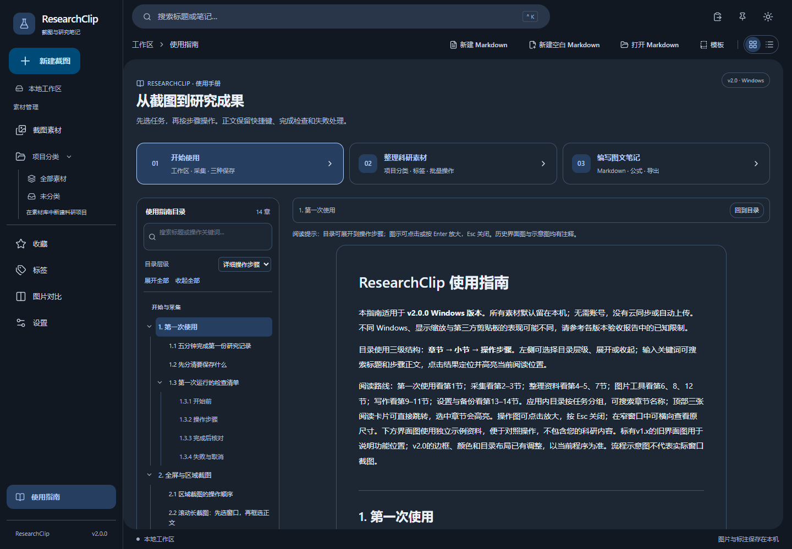

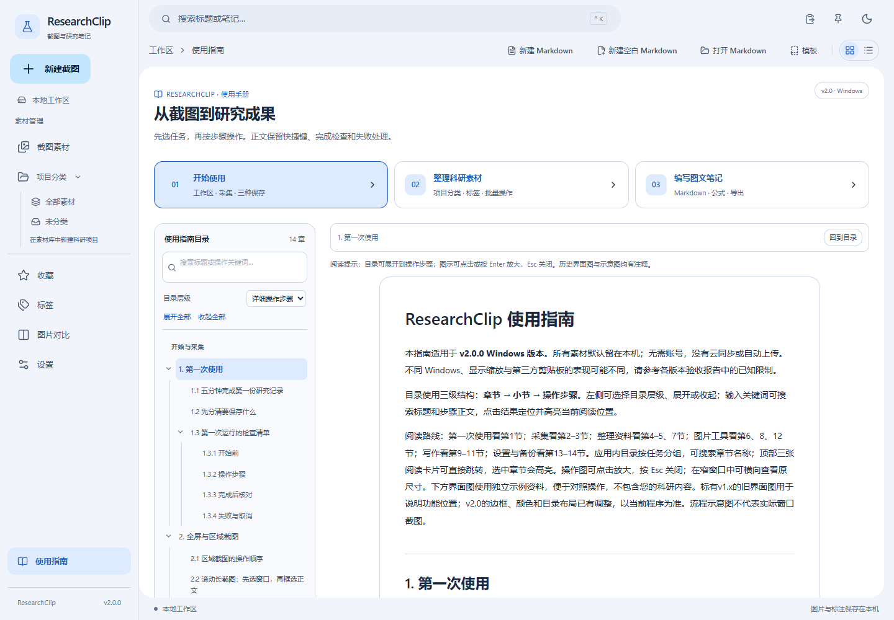

## 1. 第一次使用

保存并退出旧实例，再启动 ResearchClip。Windows 需要 WebView2，发布 EXE 未签名。左侧进入截图素材、收藏、标签、图片对比、设置；底部“使用指南”可随时重新打开本文。顶部提供搜索、剪贴板导入、贴图恢复、主题切换和 Markdown 操作。

推荐按以下步骤开始：

1. 截图或导入图片，确认已存入素材库。
2. 新建科研项目，选择图片并移动到项目。
3. 编辑标注并“保存到素材库”，再写卡片笔记、标签和来源。
4. 新建Markdown，插入图片与注释，保存 `.md` 和 `assets`，关联到同一项目。
5. 关闭前确认没有待保存提示；定期关闭应用并整体备份资料目录。

> **三个保存动作**：“存入素材库”保留科研资料；“保存到素材库”保留可编辑标注；Markdown“保存”保留文档与assets。单独导出PNG不会替代前两者。截图预览、未保存标注和未保存 Markdown 都可能仅在当前会话中，请留意“未保存”提示。

### 1.1 五分钟完成第一份研究记录

1. **先采集**：点击左侧「新建截图」，或将一张 PNG 拖入「截图素材」。截图完成后先点击「存入素材库」；文件导入会直接入库。
2. **再标注**：在卡片点击「编辑标注」，选中箭头工具，拖动标出重点，点击「保存到素材库」。仅切换工具、缩放画布不会保存。
3. **写解释**：返回素材库，单击缩略图打开知识卡片，在「Markdown 笔记正文」记录观察；等待保存状态完成。
4. **组织成文档**：点击顶部「新建空白 Markdown」，输入标题。回到素材库，点击该卡片「插入到 Markdown」，图片与已有笔记一起插入。
5. **确认可携带**：在右侧按 Ctrl+S，选择空文件夹保存；检查里面同时有 `.md` 与 `assets`。分享或移动时选择整个文件夹。

**完成标志**：素材库里能找到图片；右侧文档显示「已保存」；重新打开 `.md` 仍能看到图片与说明。

### 1.2 先分清要保存什么

- **研究素材**：截图完成区「存入素材库」；之后才能从库中再次打开。
- **可继续修改的标注**：编辑器「保存到素材库」，或「另存可编辑项目」。PNG 不是可编辑项目。
- **给其他软件使用的图片**：编辑器「导出标注 PNG」/「复制合成图片」，包含箭头、文字等可见结果。
- **图文稿件**：Markdown 面板「保存 Markdown」，同时保留 `.md` 和相对 `assets`。

> **关键步骤**：看到「图片已复制」只表示剪贴板更新；它不表示图片已入库或 Markdown 已保存。


### 1.3 第一次运行的检查清单

#### 1.3.1 开始前

确认Windows x64已安装WebView2；保存并退出旧实例后再升级，不同时运行两个版本。

#### 1.3.2 操作步骤

先进入截图素材，再打开设置选择主题、字号与两组截图快捷键。第一次先用一张不含敏感信息的图片练习。

#### 1.3.3 完成后核对

截图预览、素材库与Markdown是不同工作状态。截图后存库，编辑后保存标注，写作后保存.md，三者分别核对。

#### 1.3.4 失败与取消

窗口没有出现时先检查托盘；启动报资料版本或锁错误时保留提示，不删除AppData或数据库。

## 2. 全屏与区域截图

点击“新建截图”或素材页的截图入口，选择显示器后进行全屏截图或区域截图。区域模式显示冻结画面，拖动选择矩形，松开完成；Esc 取消，零面积选区不会保存。区域选区限制在目标显示器内，不跨屏拼接。

默认全局快捷键：区域 Ctrl+Shift+2，全屏 Ctrl+Shift+1；在设置中分别修改。快捷键捕获主显示器，注册冲突会提示并保留旧配置。Windows 高 DPI、混合缩放及特殊显示器配置需要专项验证。

截图完成后可复制图片、保存 PNG、贴图、识别文字、打开编辑器或存入素材库。复制使用真实图片数据，可在画图等应用中粘贴；保存 PNG 使用系统对话框，同名文件不会自动覆盖。“存入素材库”才会建立可重启恢复的卡片。

### 2.1 区域截图的操作顺序

1. 在「目标显示器」选择需要截取的屏幕；直接使用全局快捷键时采用主显示器。
2. 点击「区域截图」。原窗口短暂隐藏，屏幕停留在开始时的冻结画面。
3. 按下鼠标左键并拖出矩形，核对选区像素尺寸，松开完成。取消用 Esc；误触零面积时重新拖动。
4. 回到预览后选择「存入素材库」「打开编辑器」或「复制图片」。不需要该截图时点击「取消」。

**注意**：截图选择层出现后，背后应用的变化不会更新冻结画面。锁屏、受保护内容、远程桌面、HDR或混合DPI可能受到系统限制；失败提示需要按实际环境排查，不能通过清空资料解决。


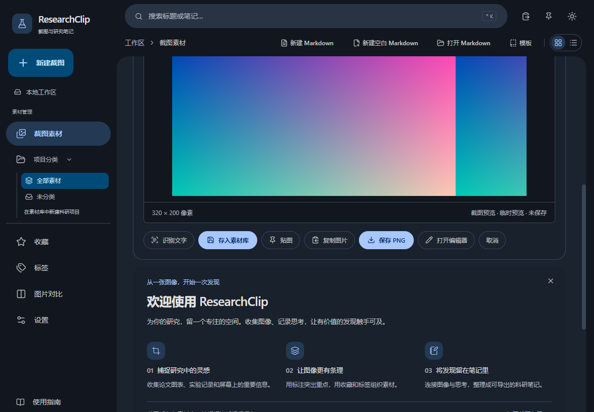

**截图图注**：这里是完成后的临时预览；「存入素材库」和「保存 PNG」目的不同。

### 2.2 滚动长截图：先选窗口，再框选正文

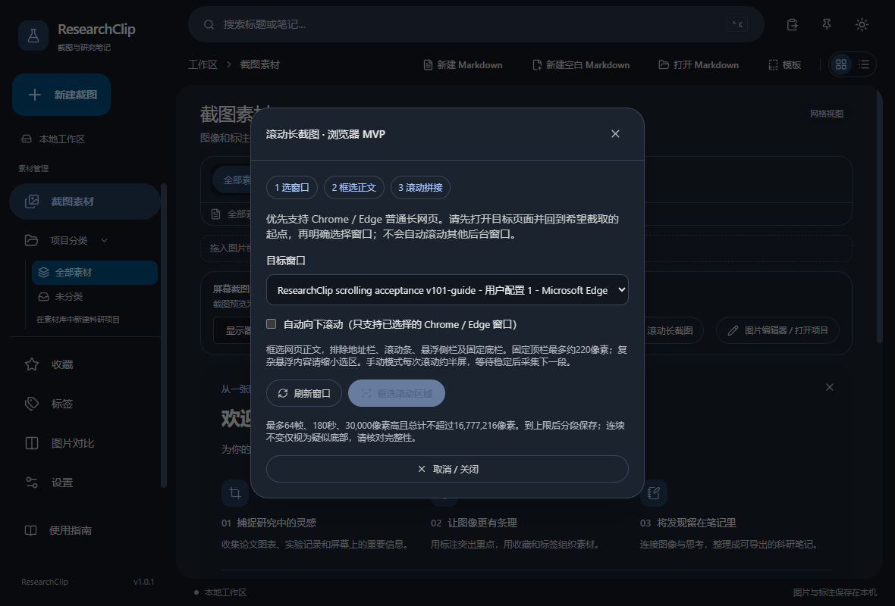

**操作图注**：这是本版实际设置面板；示例目标为独立验收浏览器。先选窗口，再框选正文，最后开始。模式和上限可在面板内核对。

**适合**：Chrome / Edge 中普通、垂直滚动的长网页。其他应用可尝试手动滚动，但不是通用自动化支持。受保护内容不支持；页面有视频、悬浮卡片、无限加载或多层滚动容器时，优先缩小选区或分段采集。

1. 打开网页，滚到希望截取的起点，等待图片和字体加载完成。
2. 点击「滚动长截图」，在「目标窗口」**明确选择**网页所在窗口。刷新列表后要重新选择，不能依赖旧窗口编号。
3. 第一次建议取消「自动向下滚动」。点击「框选滚动区域」，在冻结屏幕上拖出正文区域；排除地址栏、滚动条、固定底栏和悬浮工具栏。选区至少128×160，最多4,194,304像素、宽不超过4096；必须处于所选窗口及同一显示器中。
4. 回到面板核对尺寸，点击「开始」。主窗口隐藏，出现单独控制窗；控制窗在取帧时短暂隐藏，不会被正常录入长图。
5. **手动模式**：自行向下滚动约半屏，等待稳定，再点击「采集下一段」。保留至少约半屏重叠；不要一次跳到很远的位置。重复画面不会增加长图高度。
6. **自动模式**：仅Chrome / Edge窗口开放；开始时鼠标定位选区中心，逐次发送向下滚轮。保持目标窗口、位置、尺寸和焦点不变，不按住Ctrl/Shift等修饰键。鼠标离开选区、窗口失焦或遮挡会暂停，不自动把输入转发给其他后台窗口；可改手动继续。
7. 点击「停止」生成当前长图；「取消」丢弃本次临时拼接，不删除已有素材。窗口关闭或应用退出也会取消并释放采集资源。
8. 检查长图接缝和末尾完整性，再点击「保存 PNG」「存入素材库」或「打开编辑器」。沿用原有PNG系统对话框、禁止自动覆盖、SQLite缩略图和无损标注流程。

**遇到提示时怎么做**：

| 提示或现象 | 操作 |
| --- | --- |
| 重叠不足 / 画面变化过大 | 当前失败帧不会追加；向上回滚到与上一成功画面仍有重叠处，稳定后再手动采集，或停止保存已有部分 |
| 页面重复纹理、没有可靠拼接点 | 选择含文字/图形特征的正文区；大片空白、重复表格可能无法可靠对齐，不强行纵向叠加 |
| 页面仍在动画 / 动态加载 | 等待加载后手动采集；延后加载仍可能在取帧后发生，最终须自行核对 |
| 连续两次画面未变化 | 自动模式按“疑似底部或滚动未生效”停止；不保证网页全部加载完，不把不变画面当作绝对底部证明 |
| Windows不允许激活窗口 / 拒绝滚动输入 | 点击目标窗口确认普通桌面及相同权限级别后重选，或用手动模式；不要以管理员权限绕过受保护内容 |
| 达到高度 / 像素 / 帧数 / 时限 | 分段采集。停止可保留已完成部分，失败或达到上限不会默默接入错误帧 |

**上限与限制**：一次最多64帧、180秒、30,000像素高，且总像素不超过16,777,216（四项同时约束）。例如1920宽的长图高度最多8738像素；10屏全宽4K不在本版预算内。拼接仅估计垂直位移，不做复杂配准。固定顶栏优先在匹配时排除顶部最多约220像素，首帧保留顶栏、后续只接入新增底部；过高顶栏、固定底栏和悬浮元素需在框选时排除。125%/150%物理缩放、多屏及特殊网页仍以专项验收记录为准。


### 2.3 选择正确的采集方式

#### 2.3.1 开始前

普通单页用全屏/区域；长网页用滚动长截图。先避开受保护窗口，确认目标显示器和缩放比例。

#### 2.3.2 操作步骤

区域截图开始后，拖出矩形并松开；选区显示的是实际图片像素。滚动截图先选Chrome/Edge目标，再框正文，选择自动或手动模式。

#### 2.3.3 完成后核对

完成后查看预览宽高和边缘，长图检查页头重复、文字断行及底部是否缺失，再保存PNG或存入素材库。

#### 2.3.4 失败与取消

Esc取消区域；滚动中停止可检查已采集内容，取消则放弃本次任务。自动滚动失焦/重叠不足时按提示暂停，切手动或重选范围。

## 3. 从剪贴板和文件导入

点击顶部剪贴板图标“从剪贴板导入图片”。只在点击时读取一次，不监视剪贴板。需复制图片本身，复制文件路径或文本会提示没有图片；被其他应用占用时请稍后重试。支持常见 Windows PNG、24/32位 DIB 位图，特殊位图可以先在画图中打开后重新复制。

将本地 PNG、JPG/JPEG、WebP 文件拖到素材库，可一次导入多张。单张最多20 MiB、16,777,216像素，每批最多10张、合计64 MiB。扩展名与实际内容必须一致；坏图和不支持格式单独报告，同批有效图片仍可保存。重复导入创建独立副本，不覆盖已有素材。

导入后生成受管 PNG 和缩略图，外部源文件不修改；JPEG 方向信息应用到副本，预览采用8位 RGBA，动画图片仅使用静态帧，不保证保留全部元数据或色彩配置。可在素材卡片中重命名、写笔记、标注和插入 Markdown。

拖到已打开的 Markdown 面板时，会先保存到素材库，再按顺序插入当前光标位置；如文档资源已满或插入失败，素材仍保留在库中，可手动重新插入。Markdown 工具栏“从剪贴板插入图片”提供相同流程。文件夹、网页链接和远程图片不是本阶段的拖拽来源。

### 3.1 如何确认导入成功

1. 从画图或其他应用复制**图片像素**，再点击顶部剪贴板图标；不要只复制资源管理器的路径文本。
2. 拖入文件时将鼠标停在素材库内容区域，看到目标高亮后松开；不要拖到标题栏或左侧导航。
3. 查看「图片导入结果」的**成功数与失败数**。混合批次可能部分成功；先核对已入库项，再只重试失败文件，避免重复副本。
4. 如刚导入却找不到图片，切到「全部素材」，清空关键词、标签和收藏筛选，再刷新。

**常见提示**：剪贴板暂不可用→关闭占用它的操作后重试；没有图片→重新复制图片本身；格式不支持/损坏→先在系统图像应用确认能打开；尺寸超限→对外部副本缩小后导入，不改唯一原件。


### 3.2 Chrome / Edge 网页剪藏（A02）

**准备一次扩展安装，每次启动按需启用桌面连接。** 扩展不直接访问SQLite，不扫描浏览记录或读取Cookie；只有你点击图标、读取预览和保存时才工作。

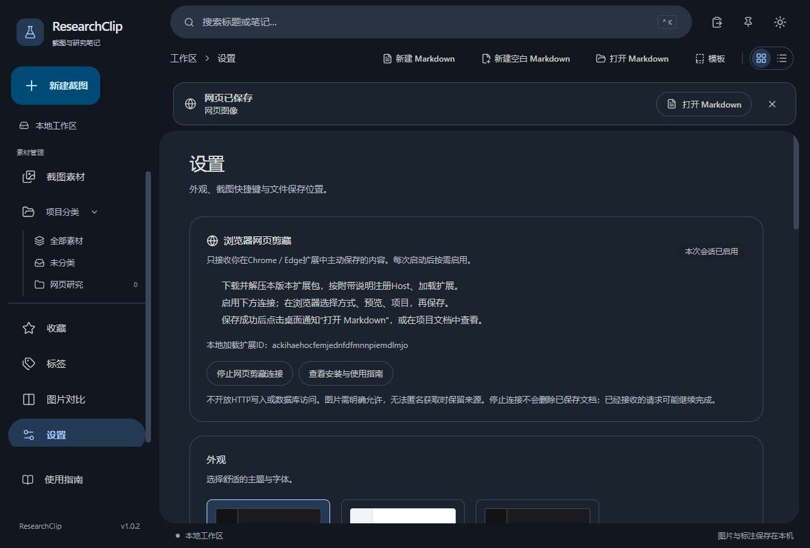

1. 从同版本Release下载并解压**网页剪藏扩展包ZIP**到固定目录。按包内README执行`register-host.ps1`，再在Chrome/Edge扩展管理页由你确认加载包内`dist`目录；第一次安装需要手动启用开发者模式。
2. 在ResearchClip设置中点击**启用网页剪藏连接**。重启应用后默认关闭，需要再次启用；停止连接不删除已保存文档。
3. 打开普通网页，再点击扩展图标；先点**刷新项目连接**。Host找不到时检查注册路径是否移动、扩展ID是否与包内说明相同。
4. 选择**网页链接 / 选中文字 / 网页主要正文 / 页面图片**，点击**读取当前页并预览**。文字应从网页正文选择，表单、输入框和密码不剪藏。复杂网站提取不完整时改用选中文字或链接。
5. 修改标题，选择项目或**未分类**。图片模式可以勾选多图；默认只记录来源。明确允许复制后才尝试当前网页同源HTTPS的兼容图片，不发送Cookie，不绕过登录或付费限制；获取失败会在Markdown“图片资源状态”中说明。
6. 点击**保存到 ResearchClip**，再在桌面通知中点**打开 Markdown**。已有未保存文档会要求保存/放弃/取消；选择取消会保留原草稿。也可在该项目的文档列表打开。
7. 继续添加注释或公式，按Ctrl+S保存；另存为可将.md与本地assets放到自己选择的位置。移动整个文档文件夹时保持相对目录关系。

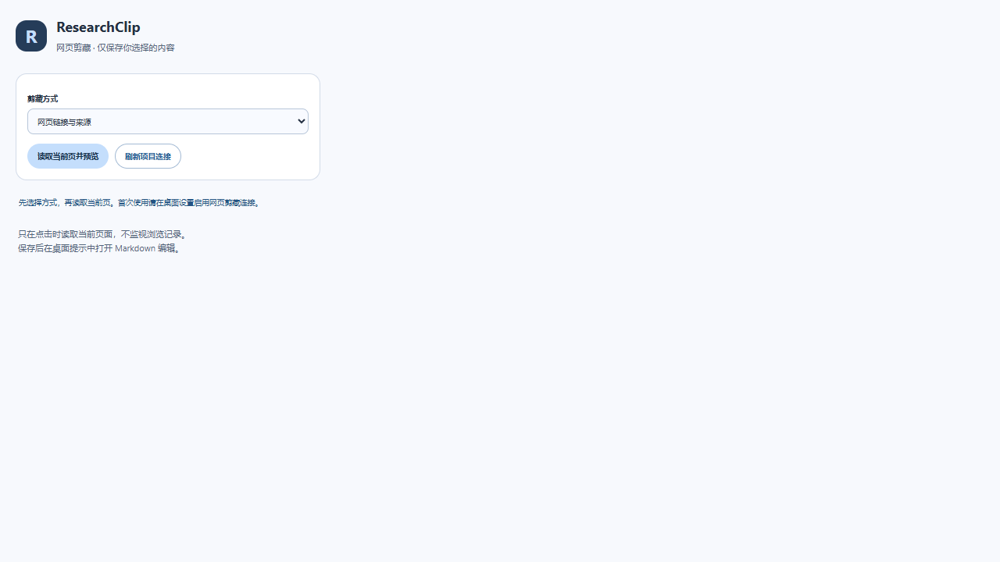

**重试与取消：**通信中断后，保持内容不变再保存，会复用请求ID并返回已有结果，不重复创建。浏览器会话暂存待确认内容，下次打开会清理超过10分钟的记录；浏览器退出清空。取消等待不等于撤回已提交的保存，先重试确认，不要直接删除资料。

**资源上限：**正文192 KiB、32张图片来源；本地复制最多4张、单PNG256 KiB/419万像素、合计384 KiB，整个消息预检700 KiB。跨域、非HTTPS、登录限制和超限图片保留来源，不伪称已经下载。ResearchClip不自动加载远程图片；其他Markdown软件可能联网加载这些引用，请先核对来源。

**验收边界：**真实Edge提取、扩展Native Messaging项目读取、Host→桌面保存/重试/分栏/重启已测；真实工具栏点击的完整用户交互因Windows工具无法确认浏览器URL而受阻，仍需按验收清单人工验证。Chrome及复杂网站不据此标记通过。


### 3.3 导入外部图片的完整流程

#### 3.3.1 开始前

剪贴板必须包含真正的图片数据；复制文件路径或网页文字不等于复制图片。单张20MiB、每批最多10张/合计64MiB，并受像素上限限制。

#### 3.3.2 操作步骤

主动点击顶部剪贴板图标，或拖PNG/JPG/JPEG/WebP到素材库。拖进Markdown时也要检查图片导入和插入结果。不会持续监视剪贴板。

#### 3.3.3 完成后核对

检查导入数量、失败项、缩略图与标题。图片已复制进应用目录，可重命名、编辑标注和插入Markdown；外部原文件不改动。

#### 3.3.4 失败与取消

不支持、损坏或过大的文件会单独报错。保留原文件，缩小或转换后重试；不要因一张失败就重复导入已成功的全部图片。

## 4. 素材库、网格和列表

网格适合按缩略图浏览，列表适合查看标题、尺寸、日期和批量整理。顶部视图按钮切换，两种视图使用同一真实 SQLite 数据和分页，不会复制素材；选择保留在当前页面会话内。每页24项，按创建时间最新/最早排序，搜索与筛选只加载当前页缩略图。

点击图片或标题打开科研知识卡片；“编辑标注”进入编辑器。星标收藏；铅笔按钮修改标题；删除按钮必须确认，删除记录、笔记、标签关联及受管图片，没有素材回收站。外部源图和已经导出的文件不会删除。缩略图读取失败有独立占位和重试，原图缺失不会静默清空数据库。

勾选卡片可跨页选择并批量整理，详见第5节；导出所选 Markdown；正好选择两张时可“对比所选 2 张”，顺序按选择顺序。搜索/收藏筛选可能隐藏新导入资料，请清除筛选或切回全部素材。库有未完成保存或清理任务时，先查看提示，再使用“重试恢复与清理”。

### 4.1 对照图：两种浏览方式

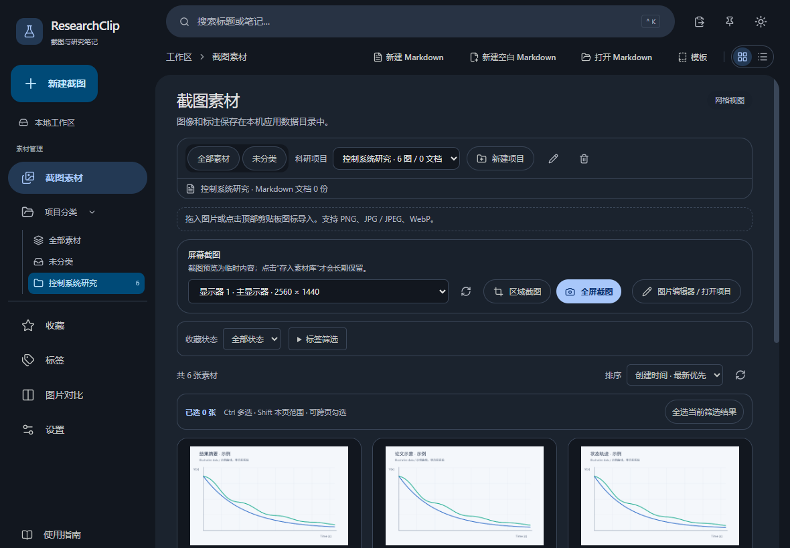

**网格图注**：① 左侧决定项目范围；② 顶部选择网格或列表；③ 图片下方显示标题与创建时间；④ 勾选后展开批量操作。截图区在无预览时采用紧凑布局，把空间留给素材。

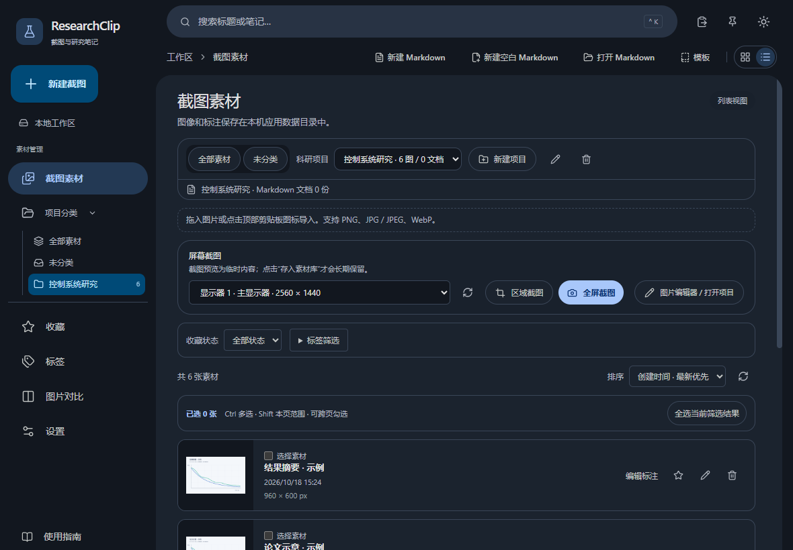

**列表图注**：缩略图与文字分列，更适合连续检查名称、尺寸和时间。两种视图引用同一资料，切换不会复制文件。

### 4.2 单张图片的常用操作

1. **阅读笔记**：点击图片或标题。
2. **修改标注**：点击卡片的「编辑标注」按钮。
3. **整理名称**：点击铅笔图标，输入新标题并确认；不会改动原图文件名。
4. **查漏补缺**：损坏缩略图使用「重试」，原图缺失时先找备份，不要删除数据库。


### 4.3 按目标选择网格或列表

#### 4.3.1 开始前

网格适合识图，列表适合检查标题、时间及逐项整理；两种视图使用同一份SQLite数据。

#### 4.3.2 操作步骤

使用顶部视图切换，结合排序与检索来源缩小结果。翻页只加载当前页缩略图，点击图像/标题打开卡片，编辑标注另有入口。

#### 4.3.3 完成后核对

切换视图后核对同一批标题、数量与收藏状态。没有结果时先清除筛选，再查看全部素材或未分类。

#### 4.3.4 失败与取消

缩略图失败不代表记录已丢失，可单项重试。原图缺失时保留记录并检查文件，不把删除数据库当成修复。

**有素材时的截图工具**：为给首行缩略图留出空间，素材库内的截图工具默认收起。点击「截图工具 · 全屏、区域与滚动长截图」展开；左侧「新建截图」和全局快捷键仍可直接使用。

## 5. 科研项目与批量整理

项目用于逻辑分组：每张图片属于一个项目或未分类，标签可以跨项目共享。**左侧「素材管理 → 项目分类」**直接选择项目，即可只看该项目的图片；也可切换「全部素材」「未分类」。项目右侧数字是图片数，悬停查看图片/文档数量；窄窗口用分类下拉框。素材页上方保留同一套筛选和项目管理入口。新建项目最多80字符；重命名只改变名称。移动不改变图片ID、文件路径、标注、笔记或来源。

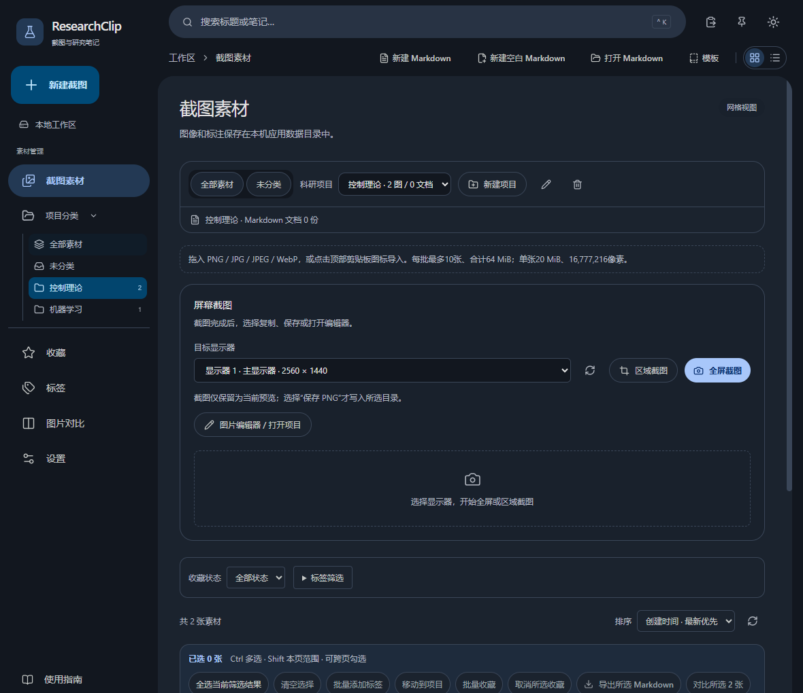

**整理图片**：勾选卡片，或按住 Ctrl 点击缩略图/标题多选；Shift 点击选择当前页锚点到目标之间的连续范围，可继续跨页勾选。“全选当前筛选结果”只查询ID和版本，包含所有分页，不读取全部大图；最多5000张，超过会要求缩小筛选，绝不静默只选一部分。切换项目/搜索/筛选后会清空选择，防止误操作。

批量工具可添加标签（逗号分隔，合并而非替换）、移动到项目/未分类、收藏/取消收藏、导出Markdown和删除。导出沿用每批最多100张及现有资源限额；选择过多请分批导出。标签、收藏和移动是整批事务；若任一资料版本已变，整批取消，请刷新并重新选择。所选卡片的待保存笔记会先保存，失败停止操作。

> **批量删除不能撤销。** 确认框明确显示数量，只有点击“确认删除 N 张图片”才删除受管原图、缩略图、记录、笔记和关联。取消会保留全部。外部源图、Markdown及assets不删；失败清理任务持久保留，可重试或重启。已打开的标注草稿保留，重新存库会建立新资料。

**关联Markdown**：文档通过应用打开或保存后登记SQLite文件引用；在Markdown面板的“项目”下拉框关联项目，或展开素材页的Markdown文档列表调整关联。点击文件名复用现有分栏打开，未保存文档仍经过保存/放弃/取消保护。首次保存前的内存草稿不能关联；旧文档需先通过“打开Markdown”登记。应用内重命名保持关联，另存为是独立文档。应用外移动或改名会导致原引用不可访问，请打开新位置重新登记；程序不会擅自搜索磁盘或搬移文件。

**删除项目与删除资料不同**：第一版仅支持删除空项目，确认框显示图片/文档数量。非空项目必须先将资料移到其他项目或未分类；不存在“删除项目内数据”的隐式选项。删除项目不删除任何图片或Markdown。数据库升级先备份再迁移，旧素材保留为未分类。

### 5.1 示例：把一批图放入同一课题

1. 点击素材页「新建项目」，输入「控制系统研究」并保存。
2. 点击左侧「全部素材」，按住 Ctrl 逐一选择需要的卡片；连续范围可以用 Shift。
3. 核对「已选 N 张」后点击「移动到项目」，选择课题并「确认应用」。
4. 点击侧栏项目名，检查图片数；项目只记录逻辑归属，不移动受管原图。
5. 需要多个主题时添加标签，例如「Lyapunov」「实验」；同一卡片可有多个标签，但只能归属一个项目。

**选择范围说明**：Shift 只选当前页可见范围；「全选当前筛选结果」包含其他分页。改变筛选会清空选择。未选择时只显示全选入口，选中后才展开完整批量按钮。

**安全删除空项目**：先移动所有图片，将关联 Markdown 调为其他项目或未分类，确认两种计数都为0，再删除项目。图片删除和项目删除是不同操作。


### 5.2 批量操作前后如何核对

#### 5.2.1 开始前

先确定项目和筛选范围；Shift只选当前页连续范围，“全选当前筛选结果”包含其他页，上限5000张。

#### 5.2.2 操作步骤

Ctrl多选或Shift选择范围，核对数量，再批量添加标签、移动项目或收藏。批量导出最多100张，请分批执行。

#### 5.2.3 完成后核对

移动项目后图片ID、原图路径、笔记和标注应保持；项目数量按真实资料计算。Markdown需已保存/打开登记后才能关联项目。

#### 5.2.4 失败与取消

删除确认必须显示数量；取消不删除。非空项目不能直接删除，先移出图片和文档。发生版本冲突时刷新并重新选择，不用重复强删。

## 6. 无损图片标注

编辑器支持选择、矩形、椭圆、箭头、画笔、文字、马赛克、局部模糊和编号。点击工具后在原图上拖动或点击；切回选择工具移动对象，拖动手柄调整尺寸，Delete 删除选中项，Esc 取消当前绘制。文字可双击编辑。编号可以手动修改数值，删除中间编号不会重排其他编号。

工具栏放大/缩小、适应窗口；平移工具拖动画布。坐标与标注保存在原图像素空间，视口缩放不会改变对象实际位置。马赛克和模糊处理选区原图像素，矢量标注在滤镜上方；重叠滤镜以后一个区域覆盖，具有处理预算，超出时会报错。

Ctrl+Z 撤销；Ctrl+Y 或 Ctrl+Shift+Z 重做；一次拖动是一个操作，新编辑会清除无效重做分支。历史有上限，重启不保留会话撤销记录。

“保存到素材库”保存可编辑标注；项目保存/打开可保留原图与标注 JSON。“导出 PNG”和“复制合成图片”输出原分辨率合成图，不含手柄，也不等于保存可编辑标注。原图不会被标注直接覆盖；不支持的未来数据版本会拒绝写入，请勿使用旧版本重存新类型对象。

### 6.1 标注版本：保存、预览与恢复

**v1.0.5 新增；仅管理单张素材的可编辑标注，不是全库备份。** 原图只保存一份，历史保存独立 JSON。首次存库自动生成 v1；从旧版升级时，升级前已经保存的标注保留为 v1，不会凭空重建过去未保存的操作。

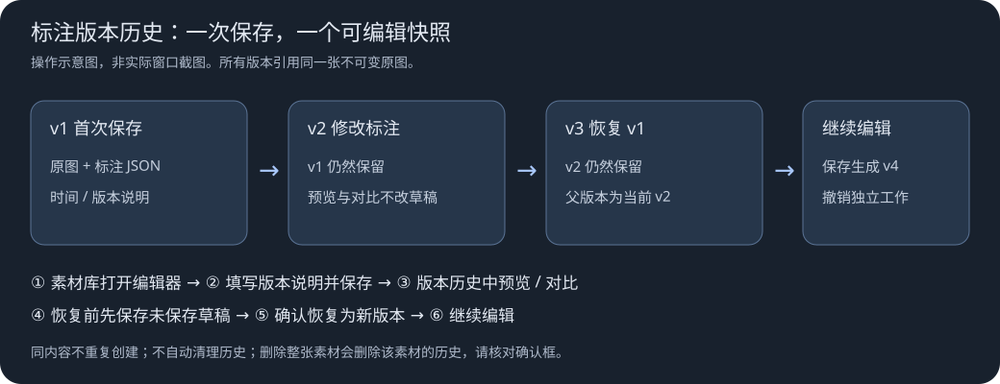

1. **先存库**：截图进入编辑器，点击「保存到素材库」。尚未存库时不能浏览历史；首次说明固定为「首次保存」。
2. **创建新版本**：编辑后，在「版本说明」中填写本次修改，例如「补充控制器参数」，再点击「保存到素材库」。空说明允许；相同标注内容不会重复创建版本，仅改说明也不会创建冗余快照。
3. **核对编辑基准**：工具栏显示「编辑基准 vN」；有修改时显示「未保存修改」。这与鼠标手势产生的会话撤销记录不同，撤销记录不会跨重启保存。
4. **预览旧版**：点击「版本历史」，选择列表中的版本。只读预览通过已有 PNG 合成管线绘制，原图、当前草稿、缩放与撤销记录不变。每次最多读50条元数据，用「读取更早版本」继续浏览。
5. **比较**：选定旧版后点击「与当前草稿对比」。左图是历史，右图是包括未保存标注的当前草稿；两图使用同一原图和原像素尺寸，不进行图像配准或科学误差计算。
6. **恢复**：点击「恢复为新版本」，填写说明并确认。恢复 v1 时，若当前为 v2，会生成 v3，保留 v1/v2。若内容已经相同，则保持现有版本。父版本指向保存前的最新版本。
7. **保护草稿**：未保存修改不会自动成为正式版本。恢复确认会明确提示「放弃草稿并恢复为新版本」；如需保留，请取消恢复、先保存草稿，再重新打开历史。恢复失败时保持原草稿，不自动关闭面板。
8. **继续编辑**：恢复后仍是可编辑对象，颜色、位置、滤镜可继续修改；再次保存生成后续版本。Ctrl+Z 可以撤销本次会话中的恢复操作，但只产生草稿，不删除已保存版本。

**损坏或未知版本**：读取失败会提示错误并保留原记录，可选择其他版本；不会通过清空数据库修复。首次升级先验证并备份旧数据库，再进行 schema5 事务迁移。请不要用 schema4 的旧程序写入已经升级的资料库。

**数据范围**：不自动清理任何历史，也不新增清理按钮。删除整张素材时，该素材的历史随确认删除一起移除；导出的独立 JSON 项目仍只包含导出时的当前标注，不携带整套 SQLite 历史。图片快照对比使用适应容器的静态合成图；复杂同步对比仍可使用原有双图对比工具。

### 6.2 对照图：编辑器的三个操作区

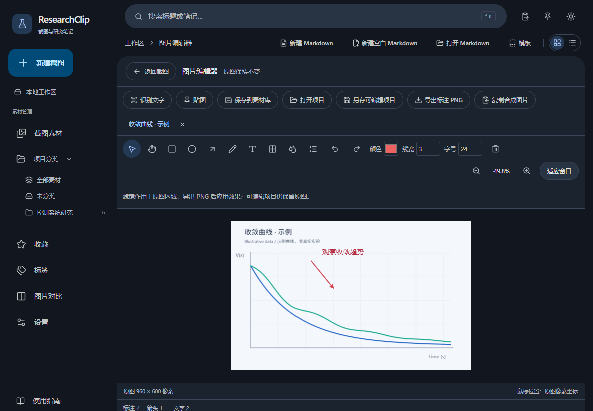

**图注**：上排负责保存与导出；中排选择绘图工具、颜色、线宽和缩放；中央画布显示图片与独立标注。底部对象列表可直接选择已有对象。

### 6.3 画一个箭头并继续修改

1. 打开一张素材，点击「适应窗口」，让整张图片进入视口。
2. 选择箭头工具，从起点按下并拖到终点，松开创建；在绘制中按 Esc 可取消。
3. 切回选择工具，点击对象后拖动；可用属性区改颜色和线宽。
4. 需要撤回用 Ctrl+Z；重做用 Ctrl+Y。缩放后继续编辑，位置仍按原图像素保存。
5. 点击「保存到素材库」，确认保存成功提示，再导出 PNG 或插入 Markdown。

### 6.4 每种工具如何使用

- **矩形/椭圆**：拖出范围；选择后拖动手柄调整大小。
- **箭头/画笔**：拖动起终点或连续轨迹；线宽单位是原图像素。
- **文字**：点击位置，输入并确认；双击已有文字修改内容。
- **马赛克/模糊**：拖选矩形区域；选中后调整强度、位置和大小。导出会真正处理像素；可编辑对象仍独立保存。
- **编号**：点击插入，下一个自动递增；选择后手动修改编号数值/大小。删除一个不会重排其他编号。
- **平移**：平移工具拖动，或按住空格/中键拖动；滚轮缩放不会改写原图。

> **隐私提醒**：马赛克和模糊是可编辑效果，原图及可编辑项目仍包含原始内容。分享敏感信息前请只分享检查过的合成 PNG，勿同时附带原图或可编辑项目。


### 6.5 安全保存一个可编辑版本

#### 6.5.1 开始前

确认原图显示正常，选择工具后再操作；画布缩放和平移不改变标注保存的原像素坐标。

#### 6.5.2 操作步骤

绘制、移动或改属性后点击“保存到素材库”。首次生成v1，后续可以填写版本说明。只导出PNG不会替代可编辑标注保存。

#### 6.5.3 完成后核对

打开版本历史查看时间、说明和编辑基准；相同内容重复保存不新增版本。预览或并排比较不会替换当前草稿。

#### 6.5.4 失败与取消

恢复前先保存需要保留的草稿。确认恢复旧版会追加新版本；坏JSON/未知格式会拒绝读取且保留记录，不能靠清空历史绕过。

## 7. 科研知识卡片、笔记和搜索

卡片包含图像预览、标题、Markdown 纯文本笔记、来源 URL、多个标签、收藏及时间。停止输入约700ms后自动保存，也可点击保存或 Ctrl+S。快速切换保留各卡片的未保存草稿；保存失败明确提示，退出前请处理所有待保存内容。草稿不保证断电或强制结束后的恢复。

标签可快速添加/移除；移除标签关联不会删除截图。来源只允许有效 http/https 链接，通过显式“打开来源”打开。标签页可管理已有标签，删除标签须确认。

顶部搜索支持中文、ASCII英文不区分大小写，匹配标题和笔记正文；约300ms防抖。可组合多个标签（全部匹配）、收藏状态和创建时间排序。%、下划线和反斜杠按字面搜索。空查询表示不限制关键词；无结果时可清除全部筛选。Ctrl+K 打开快捷搜索。

### 7.1 对照图：让一张截图变成知识卡片

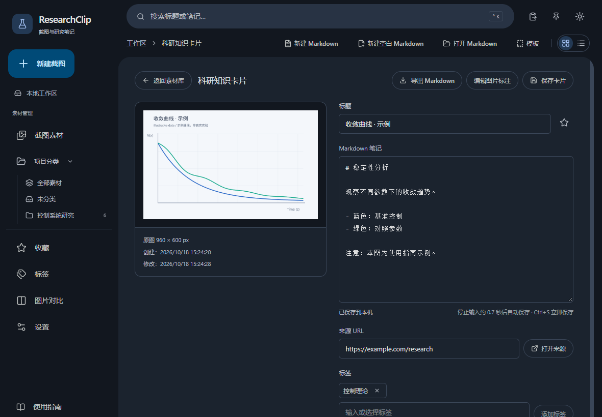

1. 单击素材缩略图，在右侧输入标题与 Markdown 正文。
2. 来源粘贴有效的论文/网页 `https://` 地址；点击「打开来源」会先尝试保存。
3. 标签输入后点击「添加标签」；点击标签旁的 × 仅移除该卡片关联。
4. 停止输入后观察保存状态；也可点击「保存卡片」。出现错误时先保留草稿，不要反复重新加载覆盖它。

### 7.2 搜索示例

- 输入「稳定性」：匹配标题或任意笔记正文中的这个词。
- 输入 `Lyapunov`：ASCII英文不区分大小写；不提供语义或公式相似搜索。
- 同时选择「理论」「控制」：只显示同时有两个标签的卡片。
- 搜索不到：先核对项目范围与收藏页，再点击「清除全部筛选条件」。


### 7.3 让知识卡片容易被再次找到

#### 7.3.1 开始前

标题概括内容，笔记记录解释，来源填写http(s)链接；普通OCR和手写笔记分开保存。

#### 7.3.2 操作步骤

打开卡片后编辑Markdown笔记、来源、标签和收藏。笔记会防抖自动保存，也可点击保存；等保存状态成功再快速切换。

#### 7.3.3 完成后核对

顶部搜索可以组合标题、笔记、标签和OCR来源，中文短词也可检索。核对摘要来源，不把OCR错误当成自己确认的笔记。

#### 7.3.4 失败与取消

保存失败保留草稿并显示错误，先重试或复制正文。切换/删除遇到未保存提示时处理草稿，不强制关闭或清理缓存。

## 8. 双图片对比

左侧“图片对比”打开独立工作区，选择两张素材，或分别用 A/B 的文件夹按钮通过系统对话框选择本地 PNG/JPEG/WebP。不将本地对比文件自动入库；素材使用库中原图，不合成标注。显示各自名称、实际尺寸和来源格式；“交换图片 A 和 B”交换两张图。

三种模式：左右并排、分割滑块、透明叠加。滚轮缩放、拖动画布平移，两个图共享同一变换。分割模式拖动分割线，或用方向键微调、Home/End 到边缘；叠加模式调节 B 图透明度。适应窗口可重置视口。

不同尺寸采用原像素左上角对齐，不拉伸、不自动配准；多余区域显示棋盘背景。它是视觉观察工具，不给出科学误差、相似性或实验显著性结论。本阶段不实现可选像素差异图、复杂配准或AI分析。

“返回工作区”回到进入前页面；离开对比释放内存图片，下次进入重新选择。标注编辑状态和 Markdown 会话独立保留。图片读取失败保留已有可用图并提示重新选择，源文件不修改。

### 8.1 对照图：分割线观察局部变化

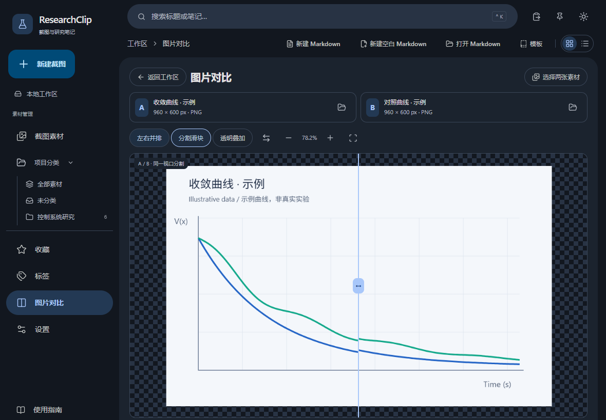

1. 在素材库正好选择两张，点击「对比所选 2 张」；也可从侧栏进入后分别选择本地文件。
2. 确认 A/B 的名称、尺寸与格式；选错时重新选择，或点击「交换图片 A 和 B」。
3. 点击「分割滑块」，左右拖动分割线；放大后拖动画布，两张图同步移动。
4. 点击「透明叠加」并改变 B 的透明度；最后「返回工作区」。

**尺寸不同时**：按原像素左上角对齐，空白处显示棋盘格。应用不会自动拉伸、配准或得出科学误差结论；对齐前的视觉差别不能当实验指标。


### 8.2 比较前确定对齐方式

#### 8.2.1 开始前

从素材库选两图，或分别选择本地图片；两张图按原像素左上角对齐，不自动配准或拉伸成相同尺寸。

#### 8.2.2 操作步骤

并排看整体；滑块模式拖分隔线；叠加模式调B透明度。滚轮缩放、拖动画布保持同一坐标变换，可交换A/B。

#### 8.2.3 完成后核对

观察相同坐标位置是否对应同一对象。尺寸不同时多余区域显示背景；这只是视觉比较，不是科学误差指标。

#### 8.2.4 失败与取消

图片失败时重新选择该图。退出对比返回原工作区，不改源图；多次打开应避免把对比选择误认成编辑器当前图片。

## 9. Markdown 图文编排与动态分栏

“新建 Markdown”进入图文编排：设置标题，从素材库按勾选顺序添加图片，可编辑每图下方注释，整体上移/下移、删除，在两块之间插入 Markdown 文本。图片使用已保存标注的合成图，已有卡片笔记作为添加时的默认注释快照；之后各自编辑不会互相覆盖。

“新建空白 Markdown”直接输入源文，默认 untitled.md。打开文件后右侧 Markdown 分栏出现，左侧仍可管理或标注图片；拖动中间分隔线调整比例，比例通过已有设置持久保存。关闭文档后分栏真正移除，原工作区恢复宽度。

### 9.1 写作与公式：先输入，再检查预览

1. **源码编辑**：输入中文、英文及标准 Markdown；行内用 `$...$`，独立公式用单独两行 `$$` 包围。工具栏可关闭/开启实时预览，也可点击「预览 Markdown」切换为整页预览，再点击「继续编辑」返回。
2. **离线排版**：字体与 KaTeX 随程序提供，不需要联网。支持上下标、分式、求和、积分、希腊字母、矩阵及 `aligned` 多行公式。
3. **错误处理**：红色「公式错误」保留错误源码；请回到编辑区修正。不支持完整 LaTeX 宏包或任意自定义命令；不会自动把公式改成图片，也不是 AI 公式识别。
4. **保留源码**：预览只读，不改写反斜杠、美元符号或公式内容；保存后仍是普通 `.md`。左侧「插入到 Markdown」插入当前光标处，图文模式追加内容块。

**可以直接复制的示例**（矩阵换行使用两个反斜杠；范数使用 `\|`）：

```markdown
中文段落中的 $V(x)=x^T P x$。

$$
\dot{x}=Ax+Bu,\qquad \frac{dV}{dt}<0
$$

$$
\|x-p\|=\lambda\|x-e\|
$$

$$
\begin{bmatrix}1&2\\3&4\end{bmatrix}
$$

$$
\begin{aligned}V(x)&=x^TPx\\\dot{V}(x)&<0\end{aligned}
$$
```

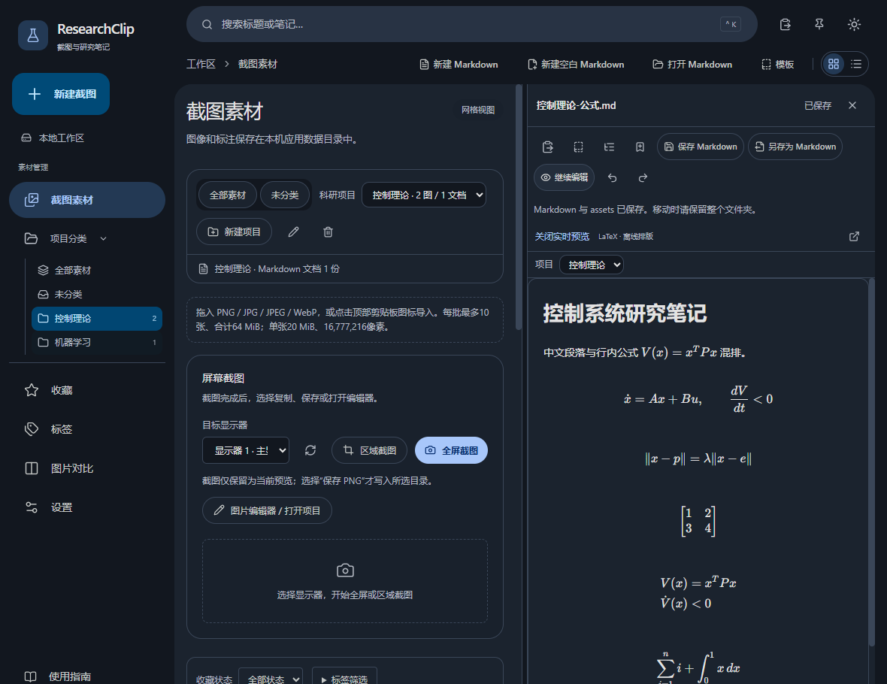

> **语法提醒**：`1&2\\\3&4` 在行分隔符后多出一个反斜杠；正确写法为 `1&2\\3&4`。程序显示错误而不会偷偷改正。普通金额的美元符号请写成 `\$`，代码片段内的公式不会排版。

### 9.2 保存、重开与其他应用

- **保存**：Ctrl+S；首次使用系统保存对话框，之后更新当前文件。「另存为」建立新文件。右键面板文件名可重命名，文件名与正文标题独立。
- **关闭**：未保存修改会询问「保存／放弃／取消」；保存失败保留面板。外部程序修改过文件时拒绝覆盖，请另存为，或保留草稿后重新打开磁盘文件。
- **其他应用**：点击面板的「使用其他应用打开」图标；草稿先保存，取消保存则不启动其他应用。Windows 显示应用选择器，选择已安装的 Obsidian、Typora、VS Code 等。是否支持公式预览取决于外部应用及其设置；ResearchClip 不安装这些应用，不替用户修改默认关联。
- **移动与分享**：UTF-8 `.md` 与相对 `assets` 一起保存，**移动整个文件夹**，不要只移动 `.md`。外部应用编辑源码时，建议使用普通源码文档；图文编排中的 ResearchClip 注释元数据请勿随意修改。
- **资源与安全**：同名新文件不会覆盖；2 MiB 正文、32 张受管图片、128 MiB 资源。HTML/脚本不执行，预览链接不自动打开，远程图片不加载。数学外部链接/HTML扩展禁用；单公式最多8192字符、500次宏展开，单次预览最多256个公式/128 KiB公式文本。超限仍保留源码并提示，不影响磁盘资料。

### 9.3 对照图：左边整理图片，右边编辑文档

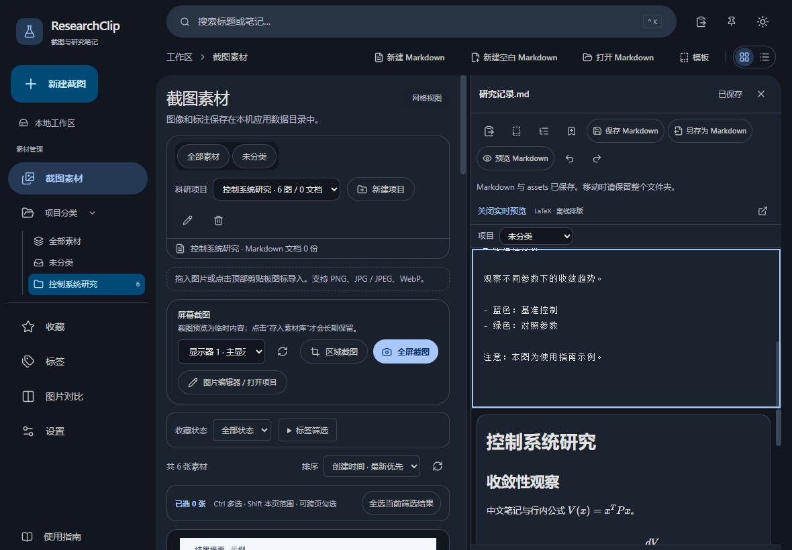

**图注**：右侧只有打开文档时才出现；文件名旁的未保存状态用于确认是否落盘；中间分隔线改变显示比例，不改变左侧标注坐标。源码区下方显示实时预览。

### 9.4 新建、插图、保存的完整步骤

1. 点击「新建空白 Markdown」，先在内存编辑，无需立刻选择目录。文件名默认 `untitled.md`。
2. 输入 `# 研究标题` 和正文。右键文件名可改建议名称；正文标题和磁盘文件名相互独立。
3. 把光标停在要插图的位置，在左侧卡片点击「插入到 Markdown」。库中图片采用**已保存标注**；编辑器插入采用当前合成结果。
4. 需要按块调整时使用「新建 Markdown」图文模式：添加图片和注释，整块上移/下移，不拆散配对。
5. Ctrl+S 首次选择 `.md` 路径；后续保存更新原文件。「另存为」选择新文件，不覆盖同名目标。
6. 关闭面板时，未保存会询问保存、放弃、取消；保存失败不会自动关闭。请在成功提示后再移动文件夹。

### 9.5 Markdown 常用写法

```markdown
# 一级标题
## 二级标题
**加粗重点** 和 *斜体术语*
- 无序列表
1. 有序步骤
`行内代码`
[论文链接](https://example.com/paper)
```

代码块使用三个反引号包围；源码中的链接保留为标准 Markdown，ResearchClip 预览不自动打开不可信链接。LaTeX 的可复制示例见上方「写作与公式」。


### 9.6 从空白文档到可携带文件夹

#### 9.6.1 开始前

新建空白文档默认untitled.md，仅在内存中。没有文档时右侧分栏完全不存在，打开/新建后才出现。

#### 9.6.2 操作步骤

在右侧输入文字，把光标放在插图位置，再从左侧卡片或编辑器点击“插入到Markdown”。图文编排模式中移动整块，图片与注释一同移动。

#### 9.6.3 完成后核对

Ctrl+S首次弹系统保存框；之后保存更新原文件。另存为产生新文件，检查.md旁的assets及相对引用，移动整个文件夹后仍可阅读。

#### 9.6.4 失败与取消

关闭脏文档可保存、放弃或取消；保存失败保持文档打开。源文件被外部应用改动时不要覆盖，保留草稿再另存或重新打开。

## 10. Markdown 模板与大纲

顶部“模板”或面板“新建模板文档”选择空白、论文精读、数学定理、科研实验、自定义模板，设置新文档名称。模板创建普通可编辑草稿，不强制立即落盘。

“保存为模板”将当前正文和受管图片复制为独立模板，不修改原文档；最多100个、名称80字符，同名不覆盖。选择框可重命名、两次确认删除。删除将目录移为配置目录 templates-v1/deleted-ID，保留文件供关闭应用后手动恢复或归档，不自动释放其磁盘占用。

“显示大纲”识别 H1–H6 及 Setext 标题，忽略代码块中的伪标题。点击跳到源文对应光标位置或预览标题，编辑后自动更新，可隐藏。图文模式跳到预览，不转换原内容块；没有文档时不显示分栏或大纲。

### 10.1 用模板开始，而不是覆盖原稿

1. 点击顶部「模板」，选择论文精读/数学定理/实验记录，设置文件名后创建。
2. 根据各节提示填入内容；这是独立新草稿，仍需 Ctrl+S 才落盘。
3. 将经常使用的结构整理好后点击「保存为模板」，输入新名称；不会自动保存或替换当前文档。
4. 下次从自定义模板加载。重命名只改模板名；删除要确认且保留独立归档。
5. 打开「显示大纲」，用 H1–H6 标题组织长文，点击目录跳转；关闭大纲不会丢失正文。

**适用范围**：模板是普通 Markdown；没有文档时不留空分栏。不支持完整 LaTeX 文档编译或任意宏包导入。


### 10.2 模板与大纲的操作检查

#### 10.2.1 开始前

模板是新文档的起点，不是套在原文件上的强制格式。选择空白、论文精读、定理推导、实验记录或自定义模板。

#### 10.2.2 操作步骤

新建模板文档后直接编辑。保存为自定义模板会单独存储；重命名/删除模板不应改动原笔记。大纲根据真实Markdown标题更新。

#### 10.2.3 完成后核对

点击大纲标题应跳到源码/预览对应位置；代码块里的示例标题不应进入大纲。指南自己的多级目录与文档大纲相互独立。

#### 10.2.4 失败与取消

未知格式或资源缺失时保留现有文档。删除自定义模板前核对名称；不把保存模板当成已经保存当前.md文件。

## 11. Markdown 卡片导出

卡片或素材库可导出一张/多张知识卡片到所选目录，生成 Markdown、标题、笔记、标签、来源、创建时间及相对图片资源。该卡片批量导出使用原图；图文文档添加图片则使用标注合成图，请按目的选择。

已有目标不覆盖，文件名会合法化；缺失或损坏图片会报告失败/部分导出结果，不把用户本机绝对路径写入 Markdown。请在 Obsidian、VS Code 等工具中打开输出目录检查资源。

### 11.1 两种 Markdown 输出如何选择

- **导出已有卡片**：选择素材后「导出所选 Markdown」，每次最多100张；适合带笔记、来源和标签的资料清单，图片是原图。
- **编写标注图文稿**：新建文档并插入图片，使用标注合成图，可调整顺序并补注释；按文档资源上限保存。

示意目录：

```text
研究记录/
  notes.md
  assets/
    researchclip-唯一ID.png
```

**检查方法**：用其他 Markdown 软件打开 `notes.md`，确认相对图片可见。复制整个目录到另一个位置，再打开检查；不要把临时 `blob:` URL 当长期资源。部分导出失败时先查看失败列表，避免把不完整成果当作全部成功。


### 11.2 导出给Obsidian或其他编辑器

#### 11.2.1 开始前

卡片批量导出与当前Markdown编辑器保存是两种入口。卡片导出包含标题、笔记、来源、标签和创建时间，图片采用该入口说明的模式。

#### 11.2.2 操作步骤

选择一张或多张卡片，点击批量导出并选择目录；或在右侧编辑完整图文文档后保存.md。系统选择器取消时不写文件。

#### 11.2.3 完成后核对

打开输出目录，核对Markdown图片使用assets相对路径，不含本机绝对资料路径。用其他编辑器打开，检查中文、公式源码与图片。

#### 11.2.4 失败与取消

同名目录/文件不静默覆盖；缺失图片的部分失败须查看提示。不要把失败输出当成完整结果，保留原资料后针对失败项重试。

## 12. 桌面贴图与 OCR

截图预览或编辑器“贴图”创建独立置顶窗口。拖动移动，滚轮等比缩放，右键可复制、另存为、调透明度、关闭。可以多张并存；顶部恢复贴图按钮可把屏幕外贴图移回可见区域。隐藏主窗口保留贴图，真正退出关闭全部，不跨重启恢复。

“识别文字”可整图或框选区域 OCR。Windows 本地引擎使用已安装语言包，不上传图像、不随应用自动下载模型。结果需校对，可编辑、复制或明确插入当前 Markdown 光标。不把识别结果自动写入笔记；复杂 LaTeX、特殊符号、小字/低清图和数学公式不保证准确。

### 12.1 贴图与OCR各解决什么问题

- **贴图**用于桌面对照：截图/编辑器点击「贴图」后，独立窗口始终置顶。右键可以复制、另存为和调透明度；右键「关闭贴图」只关闭这一张。
- **OCR**用于提取自然语言：点击「识别文字」，选择已安装语言；整图识别或框选后检查结果，手动改正，再复制/插入 Markdown。

识别无文字时不应当作失败内容写入笔记。中英混合、小字、特殊符号请逐行校对；复杂公式请保留原图并手工输入LaTeX，不要把未经核对的OCR内容当作正确公式。


### 12.2 OCR 全文索引：先识别，再搜索

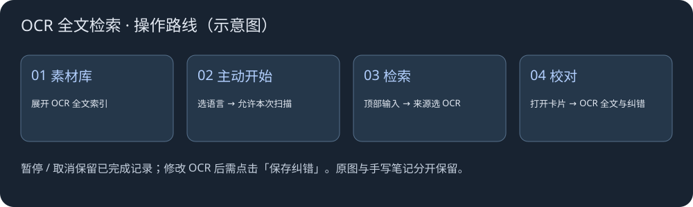

1. **单张识别**：打开知识卡片，点击「OCR 全文与纠错」→选择已安装语言→「生成 OCR 全文」。结果独立保存；不会覆盖笔记。
2. **批量识别**：素材库展开「OCR 全文索引」，勾选「允许本次批量索引」后开始。只扫描没有结果和失败的图片，一批最多5000张，逐张处理。
3. **控制任务**：可暂停、继续、取消；暂停/取消需等待当前原生识别结束，已完成记录不丢失。关闭主窗口到托盘后任务继续；退出或崩溃的在途记录下次可手动重试，不自动扫描。
4. **检索**：顶部快捷搜索输入关键词；素材库「检索来源」选择全部、标题、笔记、标签或OCR。支持与项目、收藏、多个标签组合。输入防抖约0.3秒，结果摘要中的关键词高亮；点击卡片查看完整OCR。
5. **纠错**：在全文面板修改文本，点击「保存纠错」，索引同时更新。关闭未保存草稿或重新识别会提示确认；重新识别可能替换人工纠错。
6. **索引恢复**：点击「重建搜索索引」只重建本地派生索引，不重新识别、不清空笔记或图片。

**短词说明**：FTS5 trigram处理至少3个Unicode字符的字面查询；1–2个字符使用转义LIKE，因此「科研」「控」可检索。百分号、下划线、引号均按原字符搜索，不执行FTS语法。ASCII英文不区分大小写，不保证所有语言的复杂大小写折叠或词形变化。

**校对与失败**：本机可能只有中文语言包；中文引擎能识别部分英文但不能保证准确率。空白图片保存空结果；失败或原图缺失显示状态并保留已有文本。「重试失败任务」不自动替换已成功结果。OCR不是数学证明或LaTeX识别，复杂公式请保留原图。

### 12.3 数学公式图片转LaTeX：必须校对

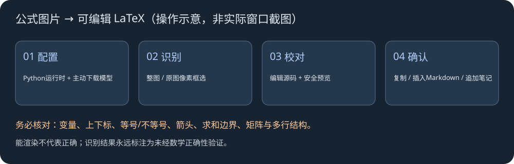

1. **一次性准备**：安装Windows x64 Python3.12，按[运行时安装说明](../math-ocr/README.md)安装隔离依赖。设置中「本地公式识别」选择环境的python.exe；不修改全局Python。
2. **主动取得模型**：点击「下载模型 · 171 MiB」，确认官方GitHub来源和178,952,787字节体积。也可导入四份离线模型。没有自动下载、云端OCR或图片上传。
3. **选择图片**：截图预览、知识卡片或图片编辑器点击「公式识别」；建议框选一个清晰公式。编辑器使用原图，避免标注遮挡。框选坐标对应原图像素，不修改原文件。
4. **等待或取消**：本地CPU单任务识别，60秒超时；随时可取消。模型下载最长5分钟，超时可重试，已有校验通过文件保留，不覆盖不同文件。
5. **逐项校对**：修改LaTeX源码，现有KaTeX实时预览。**重点核对上下标、等号/不等号、箭头、变量v/希腊ν、积分与求和边界**；有错误时预览明确提示。
6. **明确确认后使用**：复制LaTeX可直接操作；插入Markdown或保存到截图笔记前，勾选已对照原图校对。默认独立公式，取消「独立公式」可插入行内公式。更改源码后需重新确认。
7. **保留旧笔记**：已保存截图可追加已校对公式；不会自动替换已有公式。未存入素材库的临时截图先复制/插入，或关闭面板后存入素材库再关联。关闭结果面板前会提醒保留。

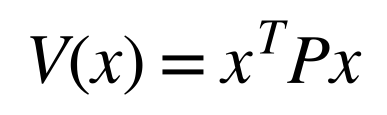

**请勿混淆两种OCR**：普通「识别文字」用于自然语言全文检索；「公式识别」生成待校对LaTeX。首轮样本中，模型确实把求和等号改成不等号、把范数等号改成箭头，因此不能依据预览外观判断正确，也不会自动写入索引或笔记。所有结果仍标注为未经数学正确性验证。

**失败恢复**：未配置运行时、缺失模型、摘要不匹配、无内容、超时、损坏图片均显示错误；可取消/重试，原图、旧笔记与当前LaTeX草稿保持。若模型目录存在不同文件，应用拒绝覆盖，请先保留并核对它们。GPU、手写公式、所有论文样式和其他Windows/macOS矩阵没有承诺支持。


### 12.4 区分贴图、文字OCR与公式识别

#### 12.4.1 开始前

贴图用于桌面悬浮参照；普通OCR用于自然语言文字；公式OCR需要另装可选Python运行时及模型，不能保证数学正确。

#### 12.4.2 操作步骤

截图预览或编辑器点击相应入口。普通OCR可选整图/局部；结果可编辑，复制或在当前Markdown光标处插入。公式必须逐项人工核对。

#### 12.4.3 完成后核对

检查复制是否是所需文字/图像；截图索引的OCR正文可纠错并重新搜索。贴图滚轮等比缩放、右键调整透明度和关闭，主窗口不受影响。

#### 12.4.4 失败与取消

无文字、语言包缺失、模型缺失、超时或摘要不符都有对应提示；不要将错等号、错变量或错公式自动写成已验证结论。关闭不需要的贴图释放资源。

## 13. 设置、托盘与快捷键

设置支持深色、浅色、跟随系统；字体、字号、视图、双截图快捷键、PNG 默认保存目录、默认标注颜色/线宽及版本。目录只影响外部另存为的起始位置，不移动现有资料。不适用的目录、快捷键冲突和配置保存失败会提示，保留原配置。

托盘可区域/全屏截图、恢复主窗口、打开设置、退出。默认关闭窗口退出；启用“关闭时隐藏到托盘”后只隐藏，真正退出仍通过托盘“退出”。等待导入/保存/截图时需完成后重试；未保存笔记、标注和 Markdown 有保护提示。强制结束进程不能保证草稿恢复。

常用按键：Ctrl+K 搜索；Ctrl+S 保存当前卡片/Markdown；编辑器或 Markdown 内 Ctrl+Z 撤销、Ctrl+Y/Ctrl+Shift+Z 重做；标注 Delete 删除、Esc 取消；区域截图 Esc 取消。焦点所在面板决定编辑快捷键作用范围。

### 13.1 WebDAV：手动双向同步

**只在 Windows 桌面版中使用；默认不联网。** 两台设备各自保留数据库，通过资源级协议传输原图、可编辑标注及版本历史、笔记、OCR、标签、项目、已登记的 Markdown 和受管 assets。它不是独立备份/恢复系统，不同步设置、模板、模型、未保存草稿或整个磁盘。

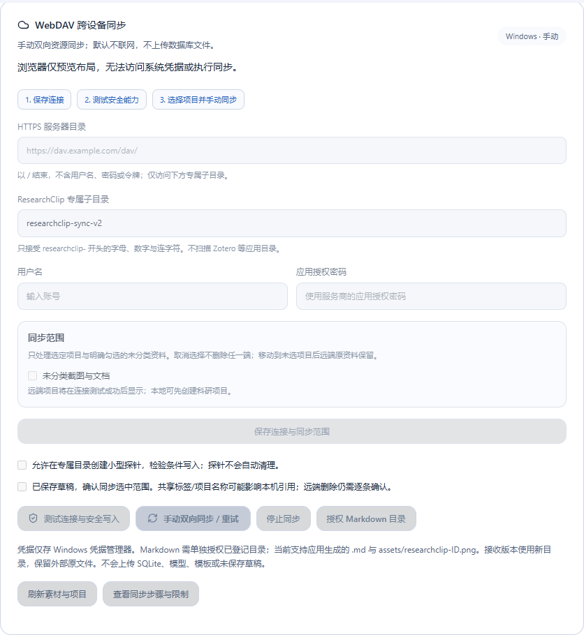

#### 13.1.1 准备专用目录与应用授权密码

1. **先保存**所有笔记、标注及 Markdown，使用少量测试资料建立科研项目；不要先用唯一的科研资料验证服务兼容性。
2. 在服务商官网启用第三方应用访问，创建应用授权密码。**不要发送密码到聊天、Issue、日志或截图中。** 不要使用需要绕过证书验证的服务器。
3. 打开「设置 → 跨设备同步」。服务器填写 HTTPS 目录并以 `/` 结尾。本次专用测试地址为 `https://dav.jianguoyun.com/dav/ResearchClip/`；不要使用 Zotero 目录。
4. 两台设备使用相同的服务器与专属子目录，例如 `researchclip-sync-v2`。应用只在该子目录读写生成的同步对象；不会扫描同级其他应用目录。
5. 在本机表单输入账号和应用授权密码，点击「保存连接与同步范围」。凭据保存在 **Windows 凭据管理器**；表单随后清空，数据库不保存密码。保留已有凭据时账号/密码都留空，更新时两者都填写。

**核对**：配置保存成功不等于服务器通过；换设备或换工作区可能需要重新输入凭据。服务器目录需预先创建，ResearchClip创建其专属子目录，不负责创建所有父目录。

#### 13.1.2 测试连接与安全写入

1. 勾选允许小型探针，再点击「测试连接与安全写入」。它会产生专属目录、探针及协议描述文件，不上传选中的截图内容。
2. 等待 TLS、目录读取、条件创建、过期/伪造ETag拒绝和两个并发条件写入检查。只有安全门槛通过，才允许资料提交；每次手动任务都会重新检查。
3. 成功后可查看远端项目；勾选本机或远端需要的项目。**未分类**单独勾选，默认不选。

**失败时**：401/403检查应用密码及目录权限；证书错误联系服务商处理，不关闭证书校验；条件写入不可靠则停止，不能通过修改配置强制覆盖。坚果云的实际认证兼容性仍需在你的账号上验证，不能据本机独立服务器测试推定支持。探针保留、不自动删除；频繁测试会消耗服务商请求额度，限流后等待再手动重试。

#### 13.1.3 选择项目与授权 Markdown

1. 仅选择本次要同步的项目，再点击「保存连接与同步范围」。取消选择不删除本地或远端资料；把截图移到未选项目也不会自动删除远端旧副本。
2. 截图的笔记、多标签、标注历史与已完成OCR随截图传输。跨项目标签仍是共享定义；同名不同ID或名称不一致时暂停导入，先核对并统一名称。
3. 如项目包含 Markdown，点击「授权 Markdown 目录」，通过系统文件夹选择器选中其文件夹。只授权其中**已经在项目登记的文件**，不自动扫描所有文档。换路径后需要再次授权。
4. 当前支持应用生成的 `.md` 与 `assets/researchclip-ID.png` 相对PNG资源；其他本地图片引用需先通过应用导入并重新插入。不支持的引用会明确报错，不静默丢图片。外部HTTPS图片引用保留来源，不主动下载。

**核对**：接收文档可在「项目 → Markdown文档」打开。接收版本位于应用受管的新目录，原来的外部Markdown文件保留；后续编辑请使用项目中当前登记的版本，以免编辑错副本。

#### 13.1.4 开始、停止与断线重试

1. 保存左右工作区草稿，勾选同步范围确认，再点击「手动双向同步 / 重试」。未保存的 Markdown/标注会阻止开始，笔记保存失败也会阻止。
2. 观察完成资源数、上传、接收和冲突数。已完成项分别提交，不能把进度条理解为整个资料库原子事务。
3. 需要停止时点击「停止同步」。等待当前网络请求结束，最多约30秒；已完成资料保留，未确认队列保留。
4. 网络恢复或重新启动应用后，回到设置再次手动同步。应用**不会自动联网补传**；不反复连续点击，避免限流。已提交但未收到确认的资源会补确认，不重复生成版本。

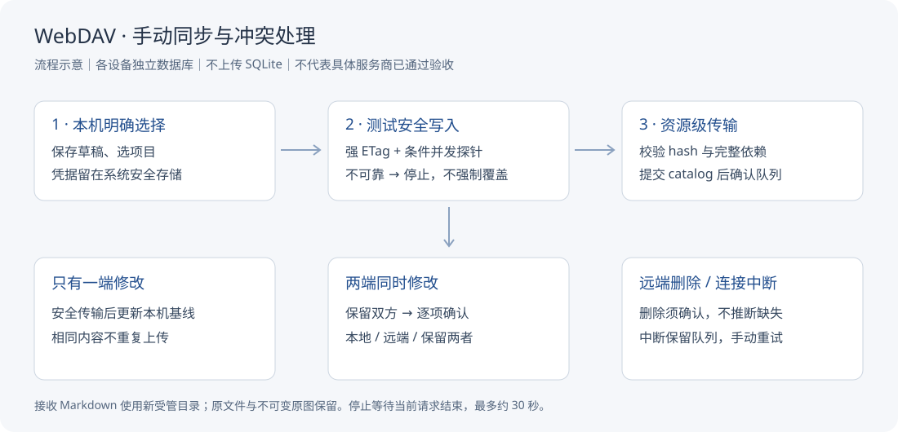

#### 13.1.5 冲突与远端删除

双方同时编辑同一资料会保留两份不可变快照，在设置中列出资源ID与原因。**先保存当前草稿**，逐条核对后选择：

- **采用本地**：把本机已保存内容作为新提交；仍检查远端ETag，不无条件覆盖。
- **采用远端（含删除）**：应用远端版本；如果远端是删除记录，会明确提示删除本机这1条记录，需要再次确认。外部Markdown原文件不被覆盖或删除。
- **保留两者**：保留本机活动内容，远端活动内容生成独立冲突副本，下次手动同步上传。若远端是删除记录，则保留本地内容及删除快照，不创建一张空图。

**确认前若又发生修改**，操作会失败并要求重新同步刷新，不能沿用旧决定。名称或依赖冲突可能需要先在素材库重命名，再重试。未知缺失不当作删除，初次同步不会按列表差集清空资料。首版不自动清理历史或远端对象。

#### 13.1.6 两台设备的完成检查

1. A先上传一个包含截图/标注/笔记/相对图片Markdown的小项目，B测试连接后选择远端项目并接收。
2. 在B核对原图、历史、标签、笔记、OCR及Markdown图片；修改一处，保存并同步，再在A同步核对。
3. A/B分别修改同一份Markdown并依次同步，确认出现冲突而非静默覆盖。用测试资料演练取消与保留两者。
4. 真正退出并重启，核对已完成资料仍在，队列可手动恢复；停止和退出等待不应丢弃已保存内容。

**上限与排错**：单文件64MiB、单图约1677万像素、单截图历史1024条/JSON总计16MiB、Markdown2MiB/32张受管PNG/资源128MiB、最多5000资源。超限明确停止，不删除或截断。缓存与探针暂不自动回收，请留足空间；当前没有macOS同步验收、定时同步或独立全库恢复入口。

### 13.2 对照图：把常用偏好一次设置好

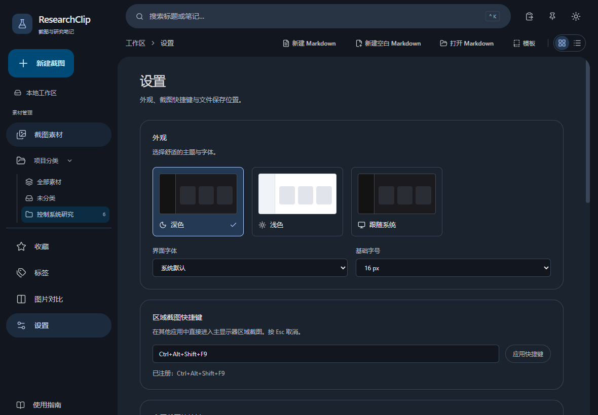

1. **外观**：选择深色、浅色或跟随系统，再选择字体/基础字号。
2. **两组快捷键**：分别修改区域与全屏组合，点击对应「应用快捷键」；冲突时保留原绑定，换一组重试。
3. **保存目录**：用系统文件夹对话框选择，只影响PNG另存为的起始位置；素材库数据目录不会搬迁。
4. **默认标注**：设置颜色和线宽并点击「保存标注默认值」，只作用于之后的新对象。
5. **关闭策略**：按需要启用关闭到托盘；真正退出仍使用托盘「退出 ResearchClip」。

### 13.3 键盘速查

- **Ctrl+Shift+2 / Ctrl+Shift+1**：默认区域/全屏截图，可在设置中修改。
- **Ctrl+K**：打开快捷搜索。
- **Ctrl+S / Ctrl+Shift+S**：当前 Markdown 保存/另存为；卡片Ctrl+S保存卡片。
- **Ctrl+Z / Ctrl+Y / Ctrl+Shift+Z**：当前编辑区域撤销/重做。
- **Delete / Esc**：删除选中标注/取消当前动作；区域截图Esc取消。

**焦点说明**：先点击想操作的编辑区。右侧 Markdown 的撤销不会撤销左侧图片标注；全局截图键与文档保存键不同。


### 13.4 设置修改的生效范围

#### 13.4.1 开始前

主题、字体和视图只影响显示；默认标注样式只影响之后的新对象；PNG默认目录不搬移素材库。

#### 13.4.2 操作步骤

在设置选择深浅或跟随系统，调整字号、双截图快捷键和默认样式；快捷键点击应用并检查注册状态，目录用系统选择器。

#### 13.4.3 完成后核对

重启后核对设置恢复；隐藏到托盘与真正退出不同。退出前确认所有文档/笔记/标注已经保存。WebDAV只在设置中由用户主动触发，先阅读13.1节并通过安全能力测试。

#### 13.4.4 失败与取消

冲突快捷键会保留原配置，换组合重试。目录不可用会提示，不自动把资料搬到其他位置。不要在Issue/聊天/日志中发送凭据。

## 14. 数据位置、备份和排错

素材数据库及 originals、thumbnails、backups 位于应用专属数据目录，Windows 通常为 `%APPDATA%/io.researchclip.desktop`；设置及模板位于应用配置目录。应用不向 WebView 开放整个磁盘。请关闭应用后整体备份资料目录，不能只复制正在写入的 SQLite 主文件。

迁移失败、未知未来版本、工作区占用、缺失图片或保存失败时，不要删除数据库解决问题。保留原始目录和提示，退出重复实例，检查磁盘空间、权限与备份，再报告问题。素材删除无回收站；模板删除有文件归档，两者不要混淆。默认卸载保留资料，但若主动勾选删除应用数据会删除资料。

当前限制：Windows 优先，macOS和完整混合DPI/多屏矩阵未全面验收；历史退出句柄与托盘间歇问题仍在QA报告中跟踪。自动化测试、真实Windows验收、未执行的人工项目分别记录，预览或代码存在不能代替实际验收。


### 14.1 安全备份的建议流程

1. 确认卡片、标注、Markdown都保存成功，选择真正退出程序，等待进程结束。
2. 整体复制应用资料目录，保留数据库、原图、缩略图、备份及设置/模板；不要只备份一个正在写入的 `.sqlite3`。
3. 对外部 Markdown，另行备份 `.md` 所在文件夹与其 `assets`；项目索引不等于文档内容备份。
4. 恢复前保留当前目录的独立副本，先在测试位置验证。不确定时报告错误，不用删除原目录“修复”。

### 14.2 出现问题时，先做什么

- **看不到刚保存的图**：检查项目/收藏/标签/关键词，切回全部素材并刷新。
- **保存失败**：保留草稿，检查磁盘空间、目录权限和外部修改提示；必要时另存新文件。
- **窗口没有显示**：检查托盘，使用「打开主窗口」；贴图超出屏幕用顶部恢复贴图按钮。
- **截图被拒绝或画面异常**：确认普通解锁桌面，再记录屏幕缩放/显示器布局与错误；不能保证捕获受保护内容。
- **报告Bug**：附应用版本、操作顺序、预期/实际结果和错误提示。截图请先遮盖个人/科研敏感信息，勿公开整个数据库或原始资料目录。

### 14.3 发布与边界

v1.0.0 为 Windows 正式版本；该版本标识不代表未执行的Windows硬件矩阵、macOS或所有第三方软件已验收。发布说明会列出本轮实际通过、失败修正及仍需人工验证的项目。使用未签名EXE或安装包前，请从官方仓库下载并核对SHA256。

### 14.4 升级与故障报告检查

#### 14.4.1 开始前

保存并真正退出旧实例，再安装新版本。v3.0通过事务和迁移前安全备份升级schema5到schema6，保留既有ID、原图与历史，不重置素材库。

#### 14.4.2 操作步骤

安装包需要WebView2，未签名程序请从仓库Release下载并核对SHA256。浏览器插件使用随Release保留的独立包，不因桌面版本号改变而换扩展ID。

#### 14.4.3 完成后核对

核对原项目、标签、原图、标注历史与Markdown仍可打开。默认卸载保留资料，但明确勾选删除应用数据会删除资料，必须谨慎。

#### 14.4.4 失败与取消

保留错误信息和复现步骤，先备份唯一副本再排查。不要上传整个数据库或敏感截图；隔离同步测试、真实服务商认证验收和Windows原生操作是不同证据。
