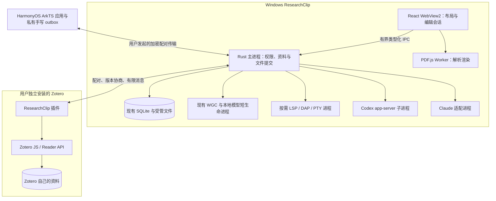

# ResearchClip Research IDE：目标架构

Step02实施说明：[科研工作区](WORKSPACE_SYSTEM.md)。前述Step00选型状态为历史时间点，当前增量仅新增固定版FlexLayout。

实施状态更新：Step01统一资源标识与关联层已按[资源模型契约](RESOURCE_MODEL.md)实现，验证见[Step01报告](../qa/RESOURCE_MODEL_STEP01.md)。其余目标仍为设计提案，未授权实施；本文件的schema11现状描述属于Step00时间点。

日期：2026-10-23。状态：Step 00 设计提案，**未实现、未执行迁移、不是后续开发授权**。现状见 [CURRENT_STATE](CURRENT_STATE.md)，选型依据见 [TECHNOLOGY_DECISIONS](TECHNOLOGY_DECISIONS.md)，顺序与阶段门槛见 [路线图](../ROADMAP_RESEARCH_IDE.md)。

## 1. 产品与边界

在现有 Windows 科研资料工作台中，逐步加入多文档工作区、Zotero 文献/PDF、独立手写层、HarmonyOS 伴侣端、项目代码编辑及 Codex/Claude Code 会话。现有截图、编辑、OCR、SQLite、Markdown、素材库、搜索、手动 WebDAV 保持可用。

明确排除 Markdown→PDF 导出和独立数据备份/恢复系统。PDF 在此专指输入文献阅读与定位，不从 Markdown 生成 PDF；现有迁移前一致快照、保存中断处理继续作为存储安全机制保留。

## 2. 进程与部署划分



这是同一桌面产品的模块化单体加必要外部运行时，不拆微服务、不引入 DI 容器、通用插件市场或通用工作流引擎。

| 运行单元 | 所有者/启动条件 | 能力 | 明确禁止/退出行为 |
| --- | --- | --- | --- |
| Rust 主进程 | 现有 Tauri 生命周期 | 唯一 ResearchClip SQLite 写协调、文件授权/提交、取消、桥接消息校验 | 不给 WebView 任意 SQL/fs/shell；退出先处理全部脏会话和在途提交 |
| WebView2 主界面/辅助窗口 | 复用现有窗口能力分组 | 展示状态、编辑缓冲、Diff、用户批准 | 外部内容不获取主窗口权限；辅助窗口不能冒充主窗口 |
| PDF Worker | 打开 PDF 时按需创建 | 解析、页面栅格、文本层数据；只读输入 | 不写原 PDF，不调用终端、不解析路径获得授权；关闭取消 render task/释放页缓存 |
| Zotero 插件 | 由用户在 Zotero 中安装/启用，运行在 Zotero 自有进程 | 通过 Zotero API 读条目/附件/标准批注；经单独授权执行有限写回 | 不是独立 Zotero DB writer；无通用 JS 执行消息，不修改原 PDF 页结构 |
| HarmonyOS 应用 | 独立 ArkTS/ArkUI 应用，前台配对 | 触笔输入、本地私有 ink 缓冲、已授权文献副本、显式传输 | 不运行桌面 Tauri/Rust、Codex 或任意命令；不维护另一套 Markdown 服务 |
| IDE 能力子进程 | 打开受信任代码项目后按需 | 首期单语言 LSP；后续 PTY/DAP 分别授权 | 不共享 SQLite；不能把 cwd、Job Object 当作文件访问沙箱；无项目自动任务 |
| Codex 进程 | 用户主动启动所选项目的 Agent 会话 | stdio 协议、事件、批准请求、取消/恢复 | 默认不开放危险 shellCommand/process/spawn 等旁路；不复用本应用全部文件权限 |
| Claude 适配进程 | 用户主动启动；按固定版本 CLI/SDK 探针选择 | 供应商 session、事件、工具批准 | 不假设与 Codex 同协议；SDK需要的 Node 仅该模块按需使用，不强加全项目后端 |

现有 WGC/ONNX worker 的输出上限、超时、进程树清理经验可复用，但其 Job Object 主要限制生命期/资源，**不证明 Agent 无法读取其他本机文件**。Agent 安全必须另有 OS 级受限访问验证。

## 3. 工作区与 Markdown 会话

### 3.1 三个概念

- 数据根：仍是当前唯一受管 SQLite/原图根目录。本计划不提供多数据库切换/数据目录迁移。
- 研究项目：复用 `projects.id`，组织文献、截图、Markdown 和代码根的关联；切换不触发正文写入或进程执行。
- 工作区：同一资料根内按研究项目保存的一份布局和会话资源引用。未分类也可有布局；不复制 project 或资源 ID。

### 3.2 渐进布局

保留 WorkspaceSplit 的默认“左主视图＋右Markdown”模式，先增加有界标签，再允许固定的阅读、写作、代码、Agent 区域。首期建议每工作区不超过8个已打开文本会话；实际上限由内存/Grant 生命周期实验决定，不直接放开当前4个 Grant 限制。没有 Markdown 时仍不创建空右栏。

布局只保存 `layoutVersion`、panel kind、现有 resource ID、分栏比例、焦点、有限滚动位置/标签次序。schema 不兼容时保留原布局并回退单栏；不删除文档。重启恢复布局不自动运行语言服务器、终端、Agent、联网或解锁文件授权。

### 3.3 单一内容服务

在现有 `createDocumentStore()`/DocumentFiles 上渐进抽出会话集合；每个资源只有一个规范编辑缓冲、一个保存管线及明确 revision 基准。相同文件打开两次共享会话/视图，不创建竞争保存者。Monaco 仅是代码视图，若后续用于 Markdown，也必须成为同一会话的视图适配器。

所有插图、OCR、公式、引用、链接和 Agent 插入显式携带目标 session/generation；后台完成后核对目标仍存在且 revision 相符。项目 store、工作流 `targetDocument`、全局 Ctrl+S 和退出守卫均纳入回归。关闭/切换工作区：保存全部成功才继续；失败保留原焦点和草稿；取消不销毁会话。继续保留笔记与标注各自独立的保存语义。

## 4. 稳定身份与资源关系

沿用现有32位小写hex ID规则及 `(kind,id)` 类型区分，新增真正领域实体时分配实体 ID，**不新建覆盖现有资源的第二套通用 ID/URI 注册表**。

| 领域 | 规范身份 | 文件/外部身份 |
| --- | --- | --- |
| 截图/Markdown/文献/研究项目 | 既有表 ID 原样保留 | 文件路径可变；不是身份；Markdown block/session ID 不替代已登记文档 ID |
| Zotero 条目 | 映射到既有 literature_references.id | 使用 library namespace＋item key；本机 libraryID 只能是插件实例内定位值 |
| Zotero 附件 | 映射到 PDF 文档 ID | library namespace＋attachment key；父条目 key 和内容摘要分别保存 |
| PDF | 新 `pdf_documents.id`，附当前不可变内容 SHA256 | 文件替换产生新内容版本，保留旧位置/笔迹，要求重新绑定，不按文件名误配 |
| PDF 位置 | `pdf_locations.id`，绑定 pdf ID＋内容摘要 | 页索引、显示页标签、PDF坐标、格式版本；位置实体不替代PDF ID |
| 标准批注 | Zotero annotation key＋库/附件限定，保留来源快照 | 在 ResearchClip 仅缓存/提交候选修改，不夺取 Zotero 权威身份 |
| 私有手写 | private ink layer/stroke ID，绑定 PDF 版本或私有画布 | 与 Zotero annotation key 独立；禁止自动互转/降级写回 |
| 代码根/文件 | 代码根 ID，文件使用根内规范相对路径；需要持久链接时登记既有类型化目标契约 | 不给每次打开的文件再建一套全局 ID；根移动需要重新授权 |
| Agent | 本地 agent session ID＋provider session ID | provider ID 只是外部关联，不替代项目/文件身份 |

Zotero namespace 需要握手明确个人/群组身份或本机配置作用域；本地 profile/libraryID 不跨设备猜测。匹配 DOI 或标题只给候选，确认后复用既有文献，不自动覆盖重复条目。

## 5. Zotero 桥与标准批注

桥协议是未来自定义协议，不是 Zotero 已有公开 HTTP API。优先让插件向 Rust 的专用 loopback 端口发起短连接；端口仅启用期间存在。复用剪藏的长度封包、随机 token、版本/请求ID/输出预算理念，使用**不同 scope/token/消息类型**，不能复用剪藏 token 获得文献写权限。传输方式要先在实际 Zotero 版本验证，失败时只保留手动 BibTeX 路径。

握手包含协议版本、插件/应用/Zotero版本、capabilities、允许的库/附件范围。默认只读；每个消息有 requestId、超时、大小限制和错误码。任何插件提供的路径都不是自动授权：PDF 优先传有界字节流/用户确认的副本，Rust 自己分配受管路径。拒绝任意 SQL/JS/shell、远程地址、`..`、跨scope资源请求；loopback亦需认证、Origin/Host约束及重放保护。

分两阶段：先条目/附件/标准批注只读和打开定位；之后才做写回。标准批注以 Zotero 为权威，ResearchClip 维护只读快照和待确认变更。写回前插件在 Zotero 内再次核对附件版本、批注 key、完整来源摘要、权限、页坐标/类型，调用匹配版本 API；回执后重读确认。`version` 不能单独代替本地内容摘要检测并发。

每次写回有 operationId、基准摘要、payloadHash、稳定目标key映射和回执。必须通过“写入成功但回执丢失/插件崩溃后重试不重复创建”的实验，不能只靠 Rust outbox 保证跨进程 exactly-once。若该 Zotero 版本不能证明幂等创建/冲突安全，保持只读，写回标记不支持。

支持批注类型由握手和真实版本测试决定；即使 Zotero 原生存在 ink，本项目私有压感层也**不自动写成 Zotero ink**。插件只走 Zotero JS/Reader 数据 API，不直写其 SQLite，不调用页面增删/旋转/重排 API。卸载或桥断开保留原标准批注；缓存显示“离线快照”，不声称实时。

## 6. PDF 阅读与定位

首选实验路线是本地 PDF.js＋Worker＋文本层，按需加载。采用 main 有界读命令/受限流式读取，renderer 不获得任意文件 URL；沿用 CSP 最小权限，不通过关闭 CSP 或开放 `file://*` 解决加载问题。worker-src 与资源打包如需调整必须做单独实验和权限回归。

输入来源为原生选择器授权，或 Zotero 插件显式选中文献附件的受控副本。原 PDF 只读，导入复制禁止覆盖，按真实 SHA256 绑定；无后台扫描 Zotero storage。PDF 内嵌 JS、启动动作、外部资源/链接默认禁用；恶意/损坏/加密 PDF 显示受控错误或密码会话，不记录密码、不通过 Agent 解锁。

位置格式拟包含 `positionVersion`、`pdfId`、`contentHash`、0基 `pageIndex`、可选 `pageLabel`、`cropBox/mediaBox`、页面原生旋转、PDF user space 坐标及文本摘录定位证据。UI视口缩放/附加旋转单独保存。不得把 CSS 像素、DPI 或页标签当作规范位置。统一坐标适配器处理左下/左上原点、CropBox、UserUnit、旋转与多矩形；与 Zotero position 格式先做往返实验，尚未验证时不写回。

先实现打开/页导航/缩放/搜索/位置链接，再加标准批注显示；文本摘录到 Markdown 是用户主动插入普通文本和位置链接。PDF全文索引属于独立后续门槛，不能把截图 FTS 数据误当 PDF 全文。

## 7. 私有手写与 HarmonyOS

私有手写为 ResearchClip 自有 sidecar，不改原 PDF 或 Zotero 标准批注。格式需版本化：layer、page binding、strokeId、工具/颜色/笔宽、点序列 `(x,y,dt,pressure?,tiltX?,tiltY?,twist?)`、输入设备能力与坐标规范。保留原采样，平滑/笔宽映射为渲染派生结果；未上报压感时标为缺失，不能用固定压力冒充实测。擦除/撤销按笔画或明确片段定义，不能覆盖原始 PDF 资产。

私有空白页/无限画布如后续提出，只存 private canvas/page 引用，不插入/重排 Zotero PDF 页面。每个 layer 使用 CAS 和格式上限，旧版本未知字段保留或只读拒写；大笔迹放受管文件，SQLite 只存索引/摘要/当前 revision，避免把所有采样堆入单条无界 JSON。

HarmonyOS 原生端只实现触笔、受控文献副本和 ink outbox。触笔/手掌抑制/历史点/倾斜等由实际设备+SDK能力探测；UI静态效果不能替代真机压感测试。桌面与手机/平板不直接共享 SQLite。首期可先做显式导入一份版本化研究资料包的离线互操作；若实现局域网配对，则独立阶段增加双端认证、TLS、撤销、大小预算、断线重试与冲突副本。这个包是受限文献/笔迹交换格式，不扩展成全库备份产品。

双端不同 layer 可独立提交；同 layer 并发修改返回冲突，保留两份候选供用户选择，不自动按时间覆盖。Windows 回执只在文件和DB都激活后发出；重复operationId只重发回执。收到未知文献hash/格式版本保留outbox并拒绝套用到另一PDF。云账号、后台上传、自动WebDAV同步均不在默认方案内。

## 8. 代码 IDE 与 Agent 边界

### 8.1 代码编辑

首期选择 Monaco 作为代码编辑视图，Rust 提供项目根授权、文件列表/读取/CAS保存；语言服务通过按需子进程，首个语言建议 TypeScript 或 Python，最终由下一阶段实际科研用例决定。代码文件保留在用户选择目录，SQLite 不复制项目源码。禁止自动执行 package scripts、仓库 hooks、调试配置或文献中的命令。

根授权需验证最终路径、Windows大小写/UNC/设备路径/重解析点/链接越界，记录能力不记录凭据。目录选择只授予枚举/读取，代码保存、终端、语言服务器和调试分别授予；项目关闭撤销能力并终止所属进程树。文件外部变化触发冲突并保留编辑缓冲。大/二进制/未知编码文件明确拒绝或只读，不把任意文件强制UTF-8回写。

PTY/终端和 DAP 延后到单独阶段；Monaco 不自带扩展宿主、完整 IDE 后端、终端或调试器。不得为了两种 Agent 引入整个 Theia/Code-OSS 或强行替换现有 Markdown 管线。

### 8.2 Agent 权限与 Diff

统一的是本产品的展示契约：provider、session、phase、事件、待批准动作、目标项目授权、Diff、失败与取消。供应商适配器仍是两个具体实现，不制造通用 Agent 平台。MCP 只可在后续授权中暴露有界研究资源读操作，不是自动获取终端权限的捷径。

默认会话仅获得用户选中的项目/资料片段读取能力，默认禁止写原工作树、执行命令、网络工具、读取 Zotero DB、应用数据库、凭据目录和无关磁盘。模型请求本身若经云服务会传出选中上下文，界面必须先显示发送对象/范围并获得授权；不能再宣称整个 Agent 流程离线。本轮不发模型请求、不登录、不购买或下载运行时。

优先在应用自有的暂存项目副本中让 Agent 形成修改提案；原工作树保留既有未提交改动。仅改 cwd 或清理环境变量不足以约束供应商内置工具，必须先证明供应商沙箱/受限token或外部隔离能阻止越界读取、写入和联网。Windows上不能证明时，禁用对应工具/可执行Agent，降级为用户手动发送选中内容的只读建议。

应用修改提案至少包含文件相对路径、原基准hash、目标hash、创建/修改/删除类型、权限范围。审阅时显示实际Diff、命令、cwd、网络目的地；应用前再次核对文件hash和授权。拒绝/超时/过期批准均不执行；未知协议事件不扩大权限。用户已有改动不被重置、stash或覆盖。多文件写入需暂存、提交意图和故障处理，不能把非原子文件系统提交说成SQL事务。

确认取消终止该会话所属进程树，已提交效果仍显示；断连后待批准请求作废。会话恢复只恢复外部session关联/事件游标，不继承旧授权，不自动重放命令。密钥留供应商安全凭据机制/系统凭据，不进正文、URL、SQLite会话事件或普通日志。

## 9. 新数据布局与兼容性

以下是候选布局，目录仅在对应阶段首次需要时创建，本轮不创建：

```text
<existing-data-root>/
  researchclip.sqlite3          # 继续唯一主库
  originals/ thumbnails/       # 保留既有字节与路径
  pdfs/<pdf-id>/<hash>.pdf       # 新类型不可变副本
  private-ink/<layer-id>/...     # 自有sidecar与提交暂存
  agent-sessions/<id>/...        # 有界事件/提案，按隐私保留策略
```

外部 `.md + assets` 及代码根继续在用户授权位置，不迁入第二套存储。PDF、ink、Agent 大文件写入复用已有的禁止覆盖/路径校验/文件先落盘再激活经验，但不能误调用仅支持PNG的 `files::image_path`。新文件类型分别提供具体校验函数，不写一个接受任意扩展名的万能路径入口。

新增资源默认本机范围。既有 WebDAV 协议不认识的新类型不可静默忽略后显示“项目完全同步”，应显示“仅支持旧协议类型”，并保持旧资源字节协议不变。扩展协议需独立授权、能力协商与旧客户端拒写测试。

## 10. 失败模式与观测

所有新模块均有 `idle/loading-or-running/cancelling/failed/completed` 可见状态；打开/取消/超时/重复回执带session代次，UI卸载后清监听、任务和Blob。耗时网络/渲染/模型/语言服务不持SQLite锁，进程崩溃只影响该功能。

日志只记错误码、任务/资源脱敏标识、耗时和版本，不默认打印正文、PDF文本、像素、全路径、提示词或令牌。UI可由用户主动查看诊断；不新增遥测。文件缺失/DB损坏/未来版本不重置资料、不自动删孤立文件。每模块的依赖、验收和关闭能力后的回退方式见路线图矩阵。
