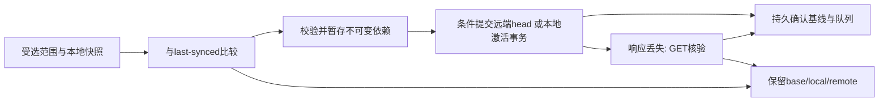

# A06 WebDAV 资源同步协议草案 v1

**状态：M1 设计；不是已经实现的网络协议。** 当前应用仍为 v1.0.5 / SQLite schema5。兼容性审计发现必须先迁移的数据缺口，见[迁移方案](MIGRATION.md)与[实际审计](../qa/A06-M1.md)。M2–M6尚未实施；实际测试服务器信息由用户稍后提供。不得据本文宣称任何服务器兼容或已完成跨设备同步。

## 1. 一致性边界

- 每台设备各自持有 SQLite；绝不上传、替换或合并 `.sqlite3`、WAL、SHM、锁文件。同步资源通过领域服务导入，现有FTS等派生索引由本地重建/触发器维护。
- 资源身份与本机路径、标题、文件名、时间戳、单机CAS序号分离。客户端生成稳定ID；外部同名内容不能据名称自动视为同一资源。
- 每个一致性单元采用「不可变内容对象 → 不可变资源清单 → 条件写入一个head」提交。不同资源之间不承诺WebDAV全局事务；依赖缺失、未核验或冲突时暂存，不激活不完整资料。
- 标注版本仍保存可编辑Annotation JSON，不复制同一张原图；缩略图可从原图在接收端重建。标注v1、同步协议v1和SQLite schema6是三个独立版本号。
- 首次启用只能非破坏性合并或保留冲突，不把远端/本地列表中缺少一项解释为删除。未保存编辑草稿不上传，也不被接收内容替换。

## 2. 身份与本地状态

| 字段 | 约定 |
| --- | --- |
| workspaceId | 32位小写hex；标识同一远端同步空间，首次明确创建或加入，不以服务器URL推导 |
| deviceId | 32位小写hex的本机随机ID，不能把复制SQLite当作复制设备身份；本地OS凭据绑定隔离，丢失后生成新身份，绝不复用旧计数器 |
| resourceId | `kind/32位hex`；旧截图、笔记、项目、标签、文档和标注revision的原有ID保留；二进制assets采用内容哈希身份 |
| resourceRevision | `{deviceId, counter}`；counter使用十进制字符串，避免WebView大整数精度问题；在短本地事务中持久分配，重试不重新分配 |
| contentHash | 经过验证的精确payload字节的SHA-256，不使用ETag充当摘要；JSON/Markdown/二进制分别遵守其格式校验 |
| remoteETag | 对head GET获得的不透明**强**ETag，包含引号原样使用；弱ETag不能用于本协议可写模式 |
| lastSyncedState | 本地base manifestHash、payload hash、对应ETag、已确认revision、选择范围代数；只有远端提交及本地应用均确认后推进 |
| pendingOperation | 稳定operationId、resourceId、准备好的revision/字节摘要、base ETag/hash、阶段、尝试次数及下次可重试时间 |
| conflictState | base/local/remote三方清单及依赖的不可变引用、冲突类型、未解决/已解决状态；不能只留一段错误文案 |

payload按精确字节哈希，不假定JS/Rust的任意JSON重序列化都相同，也不宣称已实现RFC8785。待上传字节第一次准备后固定，重试复用；时间戳和本机路径不参与“内容是否变化”的判断。业务层继续进行标注语义去重。收到未知字段/版本要隔离并提示，不丢弃未知数据后上传为新版本。

## 3. 资源与依赖

| 资源 | 同步内容 | 不上传/本地差异 |
| --- | --- | --- |
| screenshot bundle | ID、标题、创建/修改时间、收藏、原图hash/尺寸、当前annotation revision ID、笔记快照、标签ID集合、项目ID、历史索引根hash | 原图绝对路径、缩略图路径、数据库CAS、截图临时URL不进入清单 |
| annotation revision | 原revisionId、screenshotId、parentRevisionId、Annotation JSON hash、时间、说明、schemaVersion | 单机version_number是显示序号；接收端另行分配，不用它判断谁更新 |
| history index | 每页最多50条版本引用、下一页hash；包含全部已保存历史及分支 | 不按最新N条裁掉历史；环/未知父节点/缺失页阻止整个截图激活 |
| project | ID、名称、创建/修改时间 | 数量由接收端计算；相同名称不同ID不得静默合并 |
| tag | ID、名称 | 标签关联归截图bundle；同名不同ID进入名称冲突处理 |
| Markdown bundle | 稳定documentId、标题/建议文件名、项目ID、原始UTF-8 `.md` hash、相对assets路径与blob hash/大小清单 | 本机path、文件授权token、光标、草稿不上传；LaTeX源码/换行不格式化或改写 |
| blob | 不可变原PNG、标注JSON、Markdown文本、assets图像等的精确字节 | 受管路径从ID生成，远端不能提供本地绝对目标路径 |

截图作为冲突一致性单元，包含全部笔记而非仅UI展示的第一条，避免旧笔记被遗漏。其历史及大资源以hash引用，不能把所有PNG装入一个JSON。保留Annotation schema1原始数据；检测到未来/损坏版本时阻止同步该单元并保留两端数据，不“修复”为空标注。历史同步需要独立current-head映射，不能用接收端最大的显示序号选择当前版本。

普通OCR文本与手写笔记不混合。A06首版建议将用户纠正的OCR正文作为截图bundle可选版本化字段；running状态、错误详情、队列、FTS以及本地模型路径不上传。正式迁移时需确定此字段，不能声称已同步。应用设置、快捷键、凭据、模型、运行时、模板、缓存及完整备份均不在A06范围。

### 项目选择

只为明确选择的项目准备上传/接收任务；未分类单独可选，默认不选。依赖闭包只包含相关截图、笔记、历史、文档、assets及必需标签定义，不上传未选项目的卡片或反向关联。

标签跨项目共用，必须在选择界面解释：同步共享标签名称会影响本机所有引用它的卡片。删除共享标签如仍被未选资料引用，应阻塞为冲突，而非级联删除本机未选资料。不同ID同名时暂停关联导入，提供明确的合并或保留两者并改名，不能用 `INSERT OR REPLACE`。

取消项目勾选仅暂停范围，不产生tombstone。把卡片从已选项目移到未选项目也是范围变化，不等于删除，远端资料保留并标为范围外待处理；用户明确决定是否把该资源移出远端同步范围。跨范围移动不是多文件原子提交，不承诺瞬间一致；最终激活根据完整bundle中的项目ID进行。首次同步预览必须列明这些行为，不能用全库列表差集实现删除。

## 4. 远端布局与请求

以下位于用户明确选择的专属测试/同步目录；所有路径段由客户端生成。

```text
researchclip-sync-v1/<workspaceId>/
  workspace.json
  heads/<kind>/<resourceIdHex>.json
  manifests/sha256/<prefix2>/<sha256>.json
  blobs/sha256/<prefix2>/<sha256>
  probes/<randomId>/
```

head是小型指针，包含resourceId、manifestHash、声明的project scope。scope只用于预筛选，激活前必须与已核验manifest核对。首次加入可读取有界的head元数据，但不自动下载未选项目内容。发现分页/目录结果超限时提示缩小范围或继续分批，不把截断结果当作完整快照。

资源清单至少包含protocolVersion、workspaceId、resourceId、resourceRevision、parents（上个已知清单，解决冲突可包含双方）、contentHash、deleted、payload引用与依赖引用。deleted清单只保留必要身份、父基线及删除操作，不携带本机路径。hash字段使用64位小写hex；清单本身也按精确字节寻址，不能包含自引用hash。head不是最终用户的Markdown文件；接收端仍生成标准`.md + assets`。

WebDAV的方法、集合和Multi-Status语义参考[RFC4918](https://www.rfc-editor.org/rfc/rfc4918)；条件请求参考[HTTP Semantics](https://httpwg.org/specs/rfc9110.html#conditional.requests)。以下是客户端要求和待执行的能力测试，不是对任意服务器的保证。

| 请求 | 用途 / 安全条件 |
| --- | --- |
| PROPFIND Depth:0/1 | 指定getetag、getcontentlength、resourcetype；解析每个propstat状态，不能把207整体当成功；不用Depth:infinity |
| GET | 流式下载，核对长度上限、格式、SHA；head须获取当前ETag；禁用凭据跨域重定向 |
| MKCOL | 逐级建立本协议目录；405后只能核验确为已有集合，不能吞掉任意错误 |
| PUT If-None-Match:* | 创建workspace、hash对象或首次head；412后GET并核验既有对象，绝不转为无条件PUT |
| PUT If-Match:"etag" | 更新既有head；412转冲突，弱/缺失ETag禁止更新；先上传且核验所有不可变依赖 |

正常资料同步不执行远端物理DELETE，不依赖MOVE或LOCK提供事务，不自动垃圾回收对象。测试探针只能在全新随机目录内使用；任何探针清理必须核验自身记录和目录范围，不删除服务端已有内容。

### 能力门槛（M2必须实际完成）

1. 验证HTTPS/TLS、认证及专属目录；只读列目录先于写探针。服务器类型/地址由用户提供，密码在未来设置的OS凭据存储入口输入，不在聊天或测试脚本命令行传递。
2. 用户明确允许后在新随机probe中建立文件；首次 `If-None-Match:*` 成功，再次相同URL带不同字节必须412且原文件未变。
3. 用真实GET返回的强ETag写一次，使用旧ETag再写必须412且已成功写入内容不变；伪造ETag也必须拒绝。只有声明支持DAV/OPTIONS不足以通过。
4. 两连接并发使用同一基线ETag提交不同字节，必须只有一个成功。测试GET/ETag与PROPFIND描述一致性、断线后的可确认状态。
5. 检查404/401/403/409/412/423/429/507及代理改写、弱ETag、部分propstat失败。权限/服务器配置或URL变化使能力结论失效，重新测试。
6. 任一可靠条件写入测试不满足，只显示“只读诊断/此服务器暂不支持安全双向同步”；不退回最后写入获胜或普通PUT。只读亦不自动改本地资料。

## 5. SyncEngine阶段与崩溃一致性（待实现）

单个活动任务、一个有界后台worker；UI只接收计数/阶段/错误，不能直接传任意URL/SQL/磁盘路径。



1. 先flush已明确保存的数据，脏的卡片/编辑器/Markdown可跳过并提示。SQLite短读事务复制所需元数据，文件逐个核验读前/读后hash；不持数据库锁进行网络I/O。
2. 本地内容快照、稳定revision、操作ID、期望基线与依赖hash持久写入outbox。故障后重用同一快照；新编辑创建后继操作，不原地改在途快照。
3. 上传不可变对象，GET核验其bytes/hash；依赖齐全后条件提交head。发布head之前取消最多留下未引用对象，不构成可见完整资料。
4. 下载写入受管临时文件，流式限额，校验长度/hash/格式/关联完整性后落盘为禁止覆盖的hash对象。下载不完整不登记为可用资源。
5. 本地采用持久apply journal：prepared → filesReady → dbCommitted → acknowledged；先确保文件，再用领域导入事务更新卡片/笔记/标签/当前head及基线。失败保留staging，启动时核验重试或提示；不得只回滚数据库而遗失唯一文件副本。
6. 外部Markdown还有文件与SQLite之间的提交边界。替换前必须经用户确认并核对原字节基线；prepare记录旧hash和新hash，重启以实际磁盘hash决定完成/冲突。遇到第三种内容则保留两份，不强制覆盖。
7. PUT超时不等于失败未提交。GET当前head：等于待确认manifest则确认同一操作；仍为base时可按原条件限次重试；其他状态转冲突。GET也失败则保持uncertain，不推进last-synced。
8. 用户停止/应用退出先停止新请求；在途操作不能确定时持久标为interrupted/uncertain。重启显示“上次中断”，用户手动继续，不自动联网或删除.parts。

## 6. 三方比较与解决

B=上次共同确认的基线，L=本地已保存快照，R=重新读取的远端head。比较内容hash及明确tombstone，不比较单机revision大小或墙上时间。即使本地记录缺失，也只有本机持久删除记录才是本地删除。

| B/L/R | 动作 |
| --- | --- |
| 两端等于B | 无操作 |
| L变，R=B | 条件上传L |
| L=B，R变 | 验证并计划接收R；外部文件/实际删除须确认 |
| L与R同内容、不同修订 | 校验依赖后对齐基线，避免重试复制资源；历史分支仍保留 |
| L、R均变且不同 | 冲突，保留B/L/R，不自动合并Markdown或标注 |
| B缺失且两端同ID不同内容 | 初始冲突，不能假装本地优先 |
| 任一端明确删除、另一端修改 | delete/modify冲突，不立即清理原图、历史或用户文件 |
| 远端head/对象意外404 | missing-remote/损坏状态，不推导为用户删除 |
| 远端内容/hash或父链不一致 | 隔离为untrusted/corrupt；不激活、不自动上传“纠正” |

冲突面板提供“采用本地”“采用远端”“保留两者”，先显示原图/Markdown差异和操作数量，再确认。选择结果仍使用**最新**ETag作条件提交；解决过程中远端又变则重新冲突。

截图冲突先并入全部可编辑历史（全局revisionId去重、冲突隔离），再选择current-head；不覆盖原图。保留两张卡片时生成新截图ID并按映射重建副本中的版本ID/parent，保存origin引用，不能违反现有同图外键。采用远端也必须保留本地冲突版本/快照供读取，不只保存扁平PNG。

Markdown冲突副本放在受管`conflicts/<conflictId>/`，使用不含设备私密信息的合法文件名与各自完整assets，均可普通Markdown软件打开；不得在原目录猜测同名文件并覆盖。显式tombstone不自动清理远端对象；为避免用户未确认的实际图片删除，首版接收删除先成为“待确认删除”，继续保留本地数据，确认后才复用既有删除恢复队列。不得把确认尚未完成的状态作为双方已删除基线。

## 7. 文件与安全

- 默认且首版正式配置只允许HTTPS，校验证书；私有CA必须通过受支持的系统/显式信任机制，不能提供“忽略TLS”。局部测试用CA仅用于隔离测试，不写系统全局信任。本轮没有建立测试服务器或导入证书。
- 用户名/密码或应用令牌放OS安全凭据存储。Windows优先评估既有windows-rs的WinCred适配器（需后续feature及编译验证），仅settings中存connectionId和credential reference；不存明文secret JSON/SQLite/localStorage，不把密码传命令行、环境变量或日志。参考[CredWriteW](https://learn.microsoft.com/en-us/windows/win32/api/wincred/nf-wincred-credwritew)及[CREDENTIALW](https://learn.microsoft.com/en-us/windows/win32/api/wincred/ns-wincred-credentialw)。macOS Keychain留接口，未实现。
- URL拒绝userinfo/query/fragment；重定向默认不跟随。所有响应href必须同源、位于所选专属根，拒绝编码分隔符、点段、UNC、盘符、NUL及解码歧义。不要把href或服务端文件名传给本地Path.join。
- 对hash对象使用`Accept-Encoding: identity`，禁用未经约定的透明内容变换；响应仍必须经过实际读取字节的大小及摘要校验，不凭Content-Length放行。能力探针应在每次可写同步前复核，结论不是对服务器未来行为的永久保证。HTTPS保护传输，不是端到端加密；服务器运营方可读取用户明确选择上传的资料，不能把内容哈希当成作者签名或服务器可信证明。
- XML禁DTD、外部实体及网络实体解析，深度/数量/字节有界；JSON版本、ID、所有引用、媒体实际内容均再次校验。Markdown纯文本不执行HTML，不自动抓取远程图片、Cookie或模型。
- Markdown必须独立选择/确认纳入同步，并核对外部文件授权。接收新文档默认放受管sync-documents目录，既有外部文件的更新需预览确认，不能因数据库登记过一个path就获得永久任意覆盖权限。
- 现有DocumentFiles仅识别`assets/researchclip-<id>.png`的管理路径。未来预检必须遍历真实Markdown图片节点，安全支持批准目录中的PNG/JPEG/WebP普通相对图片；不满足的SVG、缺失图片、路径穿越、Windows大小写重名等应阻塞并指出资源问题，而非静默漏传后宣称成功。标准.md保持原文，不能随意格式化LaTeX或改写用户链接。
- 建议初始预算：head≤8KiB，manifest≤4MiB，XML列表≤2MiB/10000项，单Markdown≤2MiB，单Annotation≤4MiB/500对象，图片沿用MAX_PNG_BYTES及16,777,216像素，文档assets合计≤128MiB。每批传输≤512MiB后可手动继续；不能因此丢弃历史。单并发、连接10秒/单请求60秒/能力探针15秒，每操作最多3次，指数退避并尊重有上限的Retry-After。所有数值仍需M3实测，超限必须安全暂停。
- 错误仅记录类别、阶段和计数，不记录凭据、正文、图片、完整本地路径或服务器返回的未经脱敏内容。通用错误也不能伪装为“已同步”。

## 8. 分阶段门槛与界面草图

| 阶段 | 进入条件与退出证据 | 当前状态 |
| --- | --- | --- |
| M1 | 数据盘点、风险复现、协议/迁移方案；现有模型缺口先解决，不能先写联网同步 | 文档完成；实现门槛BLOCKED |
| M2 | 得到实际测试服务器信息；连接/列目录/OS凭据/条件写探针及负向TLS测试 | BLOCKED，尚未实现 |
| M3 | 两隔离客户端单向上传/下载、hash、大小、非法路径、下载不完整测试 | NOT_IMPLEMENTED |
| M4 | 资源级双向、依赖闭包、项目选择、三方基线及restart原子性 | NOT_IMPLEMENTED |
| M5 | 双改/删除修改/同名冲突保留双方；解决时再次CAS；界面核验 | NOT_IMPLEMENTED |
| M6 | 持久队列、断线幂等重试/取消/退出、进度、设置和故障管理；发布检查 | NOT_IMPLEMENTED |

未来设置布局沿用现有深浅色角色，不新增框架：第一块“服务器与凭据”（保存凭据、连接测试、能力结论）；第二块“同步范围”（项目/未分类、共享标签影响、外部文档授权）；第三块“手动同步”（预览变更数量、开始/停止、阶段/字节进度）；第四块“需要处理”（冲突与失败的独立计数、逐项解决/重试）。用文字和图标区分失败/冲突，颜色只是辅助；不默认自动同步。不先做可点击但无安全实现的同步按钮。

定时自动同步留到后续明确请求。PDF、独立全库备份/恢复、云账号和浏览器插件同步均不随A06增加。完成M1不构成v1.0.6已开发或可发布的证据；当前正式程序和插件保持不动。
